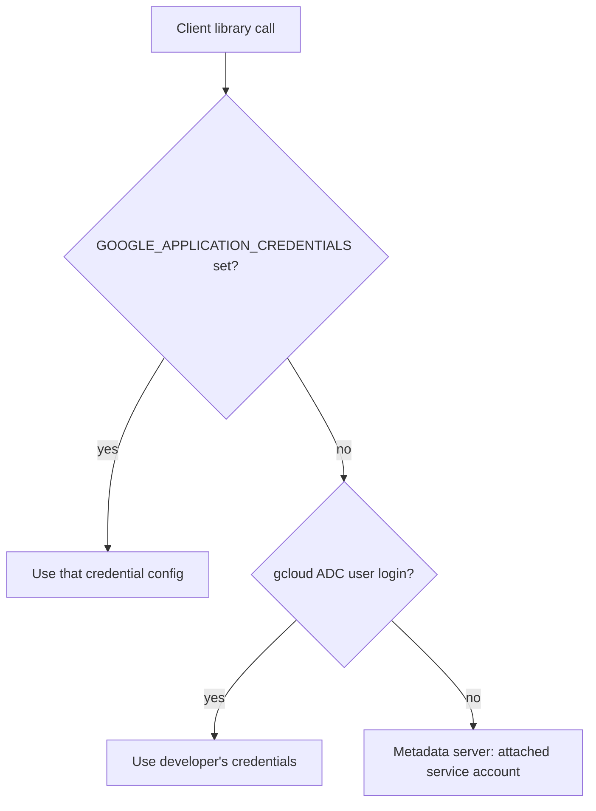

Objective **5.2** is about every way code and people talk to Google Cloud other than clicking in the
console: shells and IDEs, the CLI tools, local emulators, infrastructure as code, and client
libraries. Exam questions here are short and practical: "which tool", "which credential", "what
should the code do when it gets HTTP 429".

## 1. Where developers work

| Tool | What it is | Use it for | Limits to remember |
|---|---|---|---|
| **Cloud Shell** (terminal) | A browser-based Linux VM, already authenticated as you, with gcloud, kubectl, Terraform, bq and language runtimes installed | Quick admin tasks, tutorials, running a script from anywhere without installing anything | Ephemeral VM; **5 GB persistent `$HOME`**; default **50 hours per week**; `$HOME` deleted after **120 days** without use |
| **Cloud Shell Editor** | A Code OSS-based editor running on the same Cloud Shell VM | Editing code and config in the browser, with Cloud Code and Gemini Code Assist built in | Same limits as Cloud Shell |
| **Cloud Code** | Plugins for VS Code and JetBrains IDEs (and built into Cloud Shell Editor) | Develop, run and debug Kubernetes and Cloud Run apps locally (Skaffold, local Cloud Run emulator), browse APIs, use Secret Manager, Gemini Code Assist in the IDE | Runs on the developer's machine |
| **Cloud Workstations** | Managed, persistent development environments in your VPC | Teams that need consistent, secure dev environments with private network access and no source code on laptops | Paid; you define the image and machine type |

> [!TIP]
> If a scenario needs a dev environment **inside a VPC**, **long-running**, or **centrally
> controlled** (no code on laptops), the answer is **Cloud Workstations**, not Cloud Shell. Cloud
> Shell is for quick, personal, ad hoc work.

## 2. The CLI tools

The Google Cloud CLI (often still called the Cloud SDK) bundles several tools:

| Tool | Scope | Examples |
|---|---|---|
| **gcloud** | Almost every Google Cloud service | `gcloud compute instances list`, `gcloud run deploy`, `gcloud container clusters get-credentials` |
| **gcloud storage** | Cloud Storage (current) | `gcloud storage cp -r ./site gs://bucket/`, `gcloud storage rsync` |
| **gsutil** | Cloud Storage (legacy) | `gsutil -m cp …`; Google now recommends `gcloud storage` instead |
| **bq** | BigQuery | `bq query --use_legacy_sql=false '…'`, `bq load`, `bq mk --dataset`, `--dry_run` to estimate bytes scanned |
| **kubectl** | Kubernetes / GKE | Installed as a gcloud component |

Habits the exam expects:

- **Configurations** (`gcloud config configurations create prod`) hold project, account and region,
  so one person can switch between projects safely.
- **Release levels:** commands under `gcloud alpha` and `gcloud beta` are not GA.
- **Scripting:** use `--format` (`json`, `value(name)`, `csv`) and `--filter` rather than parsing
  human-readable output, and `--quiet` to suppress prompts in automation.
- **Service account impersonation** (`--impersonate-service-account=…`) lets a human run a command
  as a service account without downloading its key.

```bash
# List running VMs in one zone as plain names, ready for a loop
gcloud compute instances list \
  --filter="status=RUNNING AND zone:europe-west1-b" \
  --format="value(name)"
```

## 3. Emulators: integration tests without a project

The emulators run locally (on a laptop or in a Cloud Build step) and accept the same client library
calls as the real service. Start one with `gcloud beta emulators <service> start` (Spanner also ships
as a Docker image) and point the client library at it with an environment variable:

| Service | Start | Environment variable |
|---|---|---|
| Pub/Sub | `gcloud beta emulators pubsub start` | `PUBSUB_EMULATOR_HOST` |
| Bigtable | `gcloud beta emulators bigtable start` | `BIGTABLE_EMULATOR_HOST` |
| Spanner | `gcloud emulators spanner start` (or Docker) | `SPANNER_EMULATOR_HOST` |
| Firestore | `gcloud emulators firestore start` (or Firebase Local Emulator Suite) | `FIRESTORE_EMULATOR_HOST` |
| Datastore | `gcloud beta emulators datastore start` | `DATASTORE_EMULATOR_HOST` |

`$(gcloud beta emulators pubsub env-init)` prints and exports the right variable, so the application
code does not change between test and production; the client library detects the variable.

> [!WARNING]
> Emulators are for **functional** testing. They are in-memory, do not enforce IAM, do not persist
> data, and do not reproduce production performance or every feature. A question asking how to test
> **latency at scale** or **IAM permissions** wants a real (test) project, not an emulator.

## 4. Infrastructure as code from the developer's seat

Lesson 2 covered choosing Terraform, Infrastructure Manager or Config Connector. For 5.2, know the
day-to-day loop: `terraform init` (downloads providers, configures the remote backend), `terraform
plan` (shows the diff), `terraform apply` (makes the change). Gemini Cloud Assist and Gemini Code
Assist can draft Terraform or gcloud commands; treat the draft like any other code: review it, run
`plan`, and merge through the pipeline.

## 5. Client libraries and calling Google APIs well

### Which library

| Option | Use when |
|---|---|
| **Cloud Client Libraries** (for example `google-cloud-storage`, `cloud.google.com/go/pubsub`) | Default. Idiomatic, handle auth, retries, pagination and gRPC/REST for you |
| **Google API Client Libraries** (generated, older style) | The API has no Cloud Client Library yet |
| **Direct REST or gRPC** | A language with no library, or a one-off call with `curl` and `gcloud auth print-access-token` |

### Which credentials: Application Default Credentials

Code should call the library **without naming a credential**, and let **Application Default
Credentials (ADC)** find one in this order:

1. The `GOOGLE_APPLICATION_CREDENTIALS` environment variable (a credential configuration file, for
   example for workload identity federation, or, as a last resort, a key file).
2. User credentials from `gcloud auth application-default login` (a developer's own machine).
3. The **attached service account** from the metadata server (Compute Engine, GKE with Workload
   Identity Federation for GKE, Cloud Run, Cloud Run functions, App Engine).

The same code therefore runs as the developer locally and as the service account in production.



### Authentication best practices

- **Avoid service account keys.** Inside Google Cloud, attach a service account. Outside Google
  Cloud (other clouds, on-prem, GitHub Actions), use **Workload Identity Federation**. For humans,
  use **impersonation**. Keys are long-lived secrets that leak.
- **Least privilege:** one service account per workload, with only the roles it needs.
- **API keys** identify a *project*, not a user. Use them only for APIs that accept them (for
  example Maps), and **restrict** each key to specific APIs and to specific referrers, IPs or apps.

### Calling behaviour best practices

- **Retry transient errors** (HTTP 408, 429, 500, 502, 503, 504; gRPC `UNAVAILABLE`) with
  **truncated exponential backoff plus jitter**. Only retry **idempotent** operations blindly.
  Cloud Client Libraries do this by default for most calls.
- **Respect quotas.** A 429 means slow down; check quotas in the console and request increases ahead
  of a launch, not during it.
- **Paginate** list calls with page tokens, and use **field masks** to ask for only the fields you
  need.
- Prefer **regional endpoints** where a service offers them for data residency, and **Private Google
  Access** or Private Service Connect so VMs without external IPs can reach Google APIs.

## Worked example: KnightMotives' supply-chain service

**Situation.** A KnightMotives team is writing a Go service that reads parts orders from Pub/Sub and
writes them to Spanner. It will run on GKE. Today the developers keep a service account key in the
repository so tests can run, and the CI pipeline runs on GitHub Actions. The service occasionally
crashes on bursts of `RESOURCE_EXHAUSTED` errors from Spanner.

**Advice.**

1. **Delete the committed key** and rotate it. Locally, developers use `gcloud auth
   application-default login`; on GKE, the pod uses **Workload Identity Federation for GKE** mapped to
   a dedicated service account with `roles/spanner.databaseUser` and `roles/pubsub.subscriber` only.
2. **GitHub Actions** authenticates with **Workload Identity Federation** (an OIDC token exchanged
   for short-lived credentials). No key needed.
3. **Integration tests** in CI run against the **Pub/Sub and Spanner emulators**, started in the
   pipeline with `PUBSUB_EMULATOR_HOST` and `SPANNER_EMULATOR_HOST` set. Code is unchanged.
4. Use the **Cloud Client Libraries** for Go, which retry retryable errors with backoff. For
   `RESOURCE_EXHAUSTED`, back off with jitter rather than crashing, and check whether Spanner compute
   capacity or a quota needs raising before the next model-year launch.
5. A **load test** against a real staging Spanner instance confirms throughput; the emulator cannot.

## Check yourself

1. Developers need a browser-based environment with persistent home directories, private access to
   resources in a VPC, and no source code on laptops. Cloud Shell or Cloud Workstations?
2. In what order does Application Default Credentials look for credentials?
3. A nightly job calling a Google API gets intermittent HTTP 503 errors. What should the code do?

<details>
<summary>Answers</summary>

1. **Cloud Workstations.** Cloud Shell is personal, has a 5 GB home, weekly usage limits and is not
   placed in your VPC.
2. The `GOOGLE_APPLICATION_CREDENTIALS` variable, then the user credentials from `gcloud auth
   application-default login`, then the attached service account from the metadata server.
3. Retry with **truncated exponential backoff and jitter** (the Cloud Client Libraries do this by
   default for idempotent calls), and alert if retries are exhausted.

</details>

> [!NOTE]
> **Sources.** Exam guide §5.2; Cloud Shell, Cloud Shell limits, Cloud Code and local Cloud Run
> testing docs; gcloud, gsutil and bq references; the gcloud emulators reference with the Pub/Sub,
> Spanner, Bigtable and Firestore emulator guides; client libraries explained, ADC, service account
> key best practices, Workload Identity Federation, API key best practices, Cloud Storage retry
> strategy and the AIPs.
