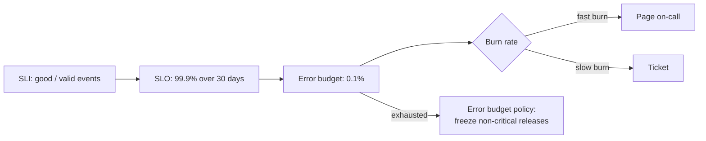

Objective **6.1** asks you to understand "the principles and recommendations of the operational
excellence pillar of the Google Cloud Well-Architected Framework". The pillar is short, and its first
principle is built on **service level objectives**, so this lesson covers both: the pillar's five
principles, then SLIs, SLOs and error budgets, which run through the whole of Section 6.

## 1. The operational excellence pillar

The Well-Architected Framework groups Google's recommendations into pillars (operational
excellence; security, privacy and compliance; reliability; cost optimisation; performance
optimisation) plus cross-pillar perspectives such as AI and ML. The **operational excellence** pillar
is about running workloads efficiently: automation to remove toil, orchestration for complex
processes, and data-driven decisions, backed by a culture of continuous learning.

It has **five core principles**:

| # | Principle | What it means in practice | Typical Google Cloud tools |
|---|---|---|---|
| 1 | **Ensure operational readiness and performance using CloudOps** | Define SLOs, monitor comprehensively, performance-test, plan capacity *before* launch | Cloud Monitoring SLOs, dashboards, load tests, capacity planning |
| 2 | **Manage incidents and problems** | Observability, clear incident response procedures, blameless retrospectives, preventive fixes | Alerting, Error Reporting, Personalized Service Health, postmortems |
| 3 | **Manage and optimise cloud resources** | Right-size, autoscale, monitor cost | Recommender, autoscaling, budgets and billing export |
| 4 | **Automate and manage change** | IaC, CI/CD, controlled change, remove manual toil | Terraform, Cloud Build, Cloud Deploy |
| 5 | **Continuously improve and innovate** | Learn from incidents and data, keep improving the platform and process | Postmortem action items, DORA metrics, experimentation |

> [!TIP]
> **Memory aid: "Ready, Respond, Resources, Release, Refine."** Readiness (CloudOps and SLOs),
> Respond (incidents and problems), Resources (optimise), Release (automate change), Refine
> (continuous improvement). Exam questions often describe a symptom ("every release is a manual
> runbook", "nobody knows the service is down until customers call") and ask what to do; map the
> symptom to the principle, then to the tool.

## 2. SLI, SLO, SLA

| Term | Definition | Owned by | Example |
|---|---|---|---|
| **SLI** (indicator) | A quantitative measure of service behaviour, ideally as *good events ÷ valid events* | Engineering | Proportion of HTTP requests served successfully in under 300 ms |
| **SLO** (objective) | A target for an SLI over a compliance period | Engineering with the business | 99.9% of requests good over a rolling 30 days |
| **SLA** (agreement) | A contract with consequences (credits) if missed | Business / legal | 99.5% monthly availability or a 10% credit |

Rules from Google SRE practice:

- **Measure what users experience.** Server CPU is not an SLI; request success and latency as seen
  at the load balancer (or better, the client) are.
- **100% is the wrong target.** Users cannot tell 99.99% from 100% through their own networks, and
  every extra nine costs far more engineering and slows releases.
- **SLO tighter than SLA.** The internal SLO (99.9%) gives you warning before the external SLA
  (99.5%) is breached.
- **Few SLOs per service**, each tied to a user journey: availability, latency, and for pipelines
  freshness or correctness.

Cloud Monitoring supports SLOs natively. A service can be detected automatically (GKE, Cloud Run,
App Engine, Cloud Service Mesh) or defined as a custom service. SLIs can be **request-based** (good
requests ÷ total) or **windows-based** (good minutes ÷ total minutes), with a **rolling** or
**calendar** compliance period.

## 3. Error budgets

The **error budget** is the unreliability the SLO allows: `1 − SLO`. It turns reliability into a
budget the team can *spend* on releases, experiments and maintenance.

| SLO | Error budget | Over 30 days (43,200 min) |
|---|---|---|
| 99% | 1% | 432 min (7.2 h) |
| 99.5% | 0.5% | 216 min (3.6 h) |
| 99.9% | 0.1% | 43.2 min |
| 99.95% | 0.05% | 21.6 min |
| 99.99% | 0.01% | 4.32 min |

An **error budget policy**, agreed in advance between product and engineering, says what happens
when the budget runs out. Google's example policy: if the service has exceeded its error budget over
the preceding window, **halt all changes and releases other than P0 issues and security fixes** until
it is back within SLO, and focus engineering on reliability. When there *is* budget left, the team
may release faster. That is the core trade: the error budget aligns developers (who want velocity)
and operators (who want stability) on one number.

## 4. Burn rate and alerting on SLOs

**Burn rate** is how fast the budget is being consumed relative to the rate that would use exactly
all of it by the end of the period. Burn rate 1 spends 100% of a 30-day budget in 30 days; burn rate
10 spends it in 3 days.

Fraction of budget spent = burn rate × (alert window ÷ compliance period).

Google SRE's recommended **multiwindow, multi-burn-rate** alerts for a 30-day SLO:

| Severity | Budget consumed | Long window | Burn rate | Short window |
|---|---|---|---|---|
| Page | 2% | 1 hour | 14.4 | 5 minutes |
| Page | 5% | 6 hours | 6 | 30 minutes |
| Ticket | 10% | 3 days | 1 | 6 hours |

Check: 14.4 × (1 h ÷ 720 h) = 0.02 = 2%. The **short window** makes the alert reset quickly once
the problem is fixed. Cloud Monitoring implements this directly as burn-rate alerting policies on an
SLO, typically one **fast-burn** policy (short lookback, high threshold, pages someone) and one
**slow-burn** policy (long lookback, lower threshold, opens a ticket).

> [!WARNING]
> "Alert when the error rate goes above 0.1%" sounds right for a 99.9% SLO but is a poor alert: it
> fires on every brief blip (noisy) and is blind to whether the budget is actually at risk. Burn-rate
> alerts page only when the SLO is genuinely threatened. Prefer them in judgement questions.

## Worked example: EHR Healthcare's patient-portal SLO

**Situation.** EHR Healthcare's case study requires at least **99.9% availability** for its
customer-facing systems. The patient portal serves about **2 million requests per 30 days**. In the
first 10 days of the window, two bad releases caused **1,400 failed requests**.

**Step 1: SLI and SLO.** SLI = successful requests (HTTP non-5xx served within 1 s) ÷ valid requests
at the external Application Load Balancer. SLO = 99.9% over a rolling 30 days.

**Step 2: Budget in requests.** 0.1% × 2,000,000 = **2,000 failed requests** allowed per 30 days.
(In time: 43.2 minutes of total outage.)

**Step 3: Status.** 1,400 ÷ 2,000 = **70% of the budget spent** after one third of the window. The
average burn rate so far is 0.70 ÷ (10 ÷ 30) = **2.1**: at this rate the budget runs out around day 14.

**Step 4: Alerting.** Configure a fast-burn policy (burn rate ≥ 14.4 over 1 hour with a 5-minute
short window → page) and a slow-burn policy (burn rate ≥ 1 over 3 days → ticket). The slow-burn
policy should already have fired.

**Step 5: Policy.** Under the error budget policy, the team freezes feature releases, runs
postmortems on both bad releases, and prioritises fixes such as canary releases and automated
rollback (lesson 3) until the rolling budget recovers.

**Step 6: SLA.** If EHR Healthcare's contract with hospitals promises 99.5%, the internal 99.9% SLO
gives a margin: the service is in trouble internally long before it owes credits.

## Check yourself

1. A team wants an SLI for an online checkout. Which is better: average VM CPU utilisation, or the
   proportion of checkout requests that succeed within 2 seconds at the load balancer? Why?
2. What is the monthly error budget, in minutes, of a 99.95% availability SLO over 30 days?
3. A 30-day SLO's budget is burning at rate 6. How much of the budget will a 6-hour window consume?

Answers

1. The **request success-within-latency ratio**. SLIs should measure what users experience, as a
   ratio of good to valid events. CPU utilisation is a cause, not a user-visible outcome.
2. 0.05% × 43,200 = **21.6 minutes**.
3. 6 × (6 ÷ 720) = 0.05, so **5%** of the budget, which is the second "page" row of the SRE table.

> [!NOTE]
> **Sources.** Exam guide §6.1; the Well-Architected Framework overview and its operational
> excellence and reliability pillars; the SRE book chapter on SLOs; the SRE workbook's error budget
> policy and alerting-on-SLOs chapters; Cloud Monitoring's SLO and burn-rate alerting docs.
