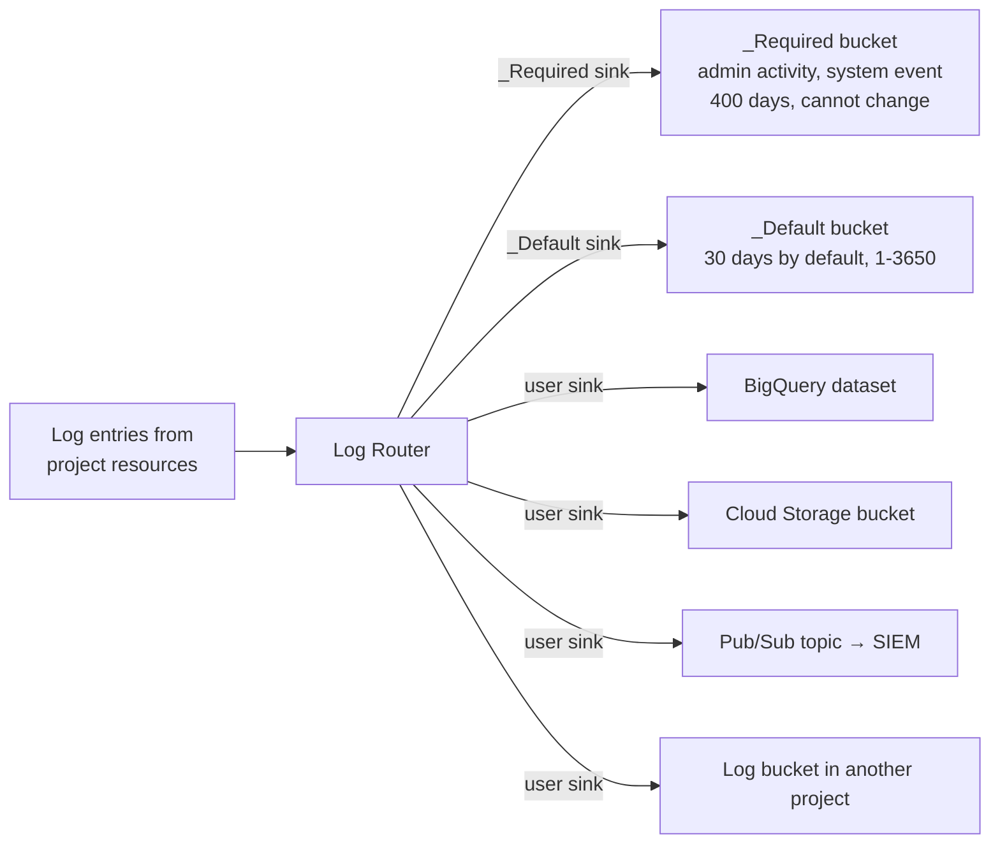

Objective **6.2** lists three considerations: **monitoring and logging**, **profiling and
benchmarking**, and **alerting strategies**. The product family is called **Google Cloud
Observability** (the old "Stackdriver" and "operations suite" names are gone). Expect questions
that describe a symptom and ask which tool finds it, and questions about where logs must go to meet
a retention or audit requirement.

## 1. The product map

| Question you are asking | Product | Notes |
|---|---|---|
| "Is it up? How busy is it? Is it within SLO?" | **Cloud Monitoring** | Metrics, dashboards, uptime checks, SLOs, alerting |
| "What happened, and who did what?" | **Cloud Logging** | Log Router, log buckets, sinks, Log Analytics, Cloud Audit Logs |
| "Which service in the call chain is slow?" | **Cloud Trace** | Distributed tracing; instrument with **OpenTelemetry** |
| "Which function is burning CPU or memory in production?" | **Cloud Profiler** | Continuous, low-overhead CPU and heap profiling; flame graphs |
| "Which exceptions are new or increasing?" | **Error Reporting** | Groups stack traces from logs, counts them, notifies on new groups |
| "We already use Prometheus" | **Managed Service for Prometheus** | Managed collection on GKE, PromQL, global storage; no Prometheus servers to run |
| "VM memory, disk and app metrics, plus VM logs" | **Ops Agent** | Hypervisor metrics do not include memory or app metrics |

> [!WARNING]
> **Cloud Debugger** was shut down in May 2023 (and its open-source successor, Snapshot Debugger,
> is archived). If an option suggests it for inspecting production state, it is a distractor; use
> structured logging, Error Reporting, Cloud Profiler or Cloud Trace instead.

## 2. Monitoring

- **Metrics** arrive automatically from Google Cloud services. Compute Engine VMs need the **Ops
  Agent** for memory, disk usage and third-party application metrics (Nginx, MySQL, JVM).
- **Custom metrics** come from your code through OpenTelemetry or the Monitoring API; **log-based
  metrics** turn log entries into counters or distributions (for example, count of `payment_failed`
  entries).
- **Metrics scopes** let one **scoping project** view and chart metrics from many monitored projects.
  This is the answer to "a central operations team needs one view across 40 projects".
- **Uptime checks** probe a public HTTP(S) or TCP endpoint from several locations around the world
  (and private endpoints through Service Directory), feeding dashboards and alerts. They measure
  availability from the user's side, which internal metrics cannot.
- **Managed Service for Prometheus** lets teams keep Prometheus exporters, PromQL and Grafana
  dashboards while Google runs the storage and scaling. Cloud Monitoring itself can also be queried
  with PromQL.

## 3. Logging and the Log Router

Every log entry passes through the **Log Router**, which applies sinks. Each sink has an inclusion
filter, optional exclusion filters, and a destination.

| Destination | Choose it when |
|---|---|
| **Log bucket** (Cloud Logging) | Interactive search; set retention 1–3,650 days; upgrade to **Log Analytics** to query with SQL without copying |
| **BigQuery** | Heavy SQL analysis or joining logs with business data |
| **Cloud Storage** | Cheapest long-term archive (for example 7 years for compliance), with lifecycle rules, Archive class and Bucket Lock retention policies |
| **Pub/Sub** | Streaming to a third-party SIEM or custom processor |
| **Another project / log bucket** | Central logging project |

Key facts:

- **`_Required`** bucket holds Admin Activity, System Event and Access Transparency logs for
  **400 days**; it cannot be excluded or modified, and it is free.
- **`_Default`** bucket holds everything else, **30 days** by default, configurable.
- **Exclusion filters** drop noisy logs (for example health-check 200s) before storage to cut cost.
  Excluded logs are lost unless another sink routes them elsewhere.
- **Aggregated sinks** at **organisation or folder** level with `includeChildren` route logs from
  every project underneath to one destination. This is how a security team centralises audit logs
  without configuring every project, and new projects are covered automatically.
- **Cloud Audit Logs**: Admin Activity and System Event logs are always on. **Data Access** audit
  logs are **off by default** (except BigQuery) and must be enabled per service, and they can be
  large.

## 4. Profiling and benchmarking

These are different activities, and the guide names both.

| | Profiling | Benchmarking |
|---|---|---|
| Question | *Where* inside my code is time or memory spent? | *How fast* is this system or machine type under a defined, repeatable workload? |
| Tool | **Cloud Profiler** (continuous, statistical, in production, a few percent overhead) | **PerfKit Benchmarker** for infrastructure; load tools such as Locust for application throughput |
| Output | Flame graphs by function, comparable across versions | Throughput and latency numbers you can compare across options |
| Use | Reduce CPU cost, find a memory leak, explain a latency regression after a release | Choose a machine family, size a database, prove a design meets targets before launch |

Cloud Trace sits between them: it shows which *service* or *span* in a request is slow; Profiler then
shows which *function* inside that service is responsible.

## 5. Alerting strategies

An alerting policy has **conditions** (metric threshold, metric absence, forecast, or a log match for
log-based alerts), a **notification channel** list, and **documentation** (a runbook link and
context that appear in the notification). When a condition is met, Monitoring opens an **incident**.

Principles of a good alerting strategy:

1. **Alert on symptoms users feel, not on causes.** Page on SLO burn rate, uptime-check failures and
   high error rates. Put CPU, queue depth and disk on dashboards, or alert only when they predict a
   user impact (a **forecast** condition on disk filling is a good example).
2. **Every page must be actionable and urgent.** If nobody needs to act now, it is a ticket or a
   dashboard, not a page. Noisy alerts get ignored (EHR Healthcare's case study describes exactly
   this: email alerts that are "often ignored").
3. **Use multiwindow, multi-burn-rate SLO alerts** (lesson 1): fast burn pages, slow burn tickets.
4. **Route by severity to the right channel**: pages to PagerDuty, the Cloud Monitoring mobile app or
   SMS; tickets and low-severity to email, Slack, or Pub/Sub/webhooks into a ticketing system.
5. **Alert on absence** for things that should report regularly (a batch job's heartbeat metric).
6. **Attach a runbook** in the policy documentation and use labels to route to the owning team.
7. **Log-based alerts** for rare, specific events where a metric is overkill, for example a
   specific IAM policy change or a known fatal error message.

## Worked example: EHR Healthcare's observability redesign

**Situation.** EHR Healthcare runs dozens of projects (one per environment and per product line).
Monitoring uses scattered open-source tools and alerts go by email that operators ignore. The
business wants **consistent logging, log retention, monitoring and alerting**. For this example,
assume the compliance team also requires audit logs to be kept for **6 years**, tamper-resistant; the security team uses a third-party
SIEM; GKE teams already have Prometheus exporters and Grafana dashboards.

**Design.**

1. **Central monitoring:** a dedicated monitoring project as the **metrics scope** for all
   production projects; **Managed Service for Prometheus** with managed collection on the GKE
   clusters, so existing exporters and Grafana dashboards keep working with no Prometheus servers
   to run.
2. **Logs:** an **aggregated sink at the organisation** level, with `includeChildren`, routing audit
   logs to a **Cloud Storage** bucket with a 6-year **retention policy locked with Bucket Lock** (so
   nothing can delete them early). A second aggregated sink sends security-relevant logs to
   **Pub/Sub** for the SIEM. Enable **Data Access** audit logs for the services holding patient data.
3. **Operational logs:** keep in log buckets with 30–90 days retention, upgraded to **Log Analytics**
   for SQL troubleshooting; **exclusion filters** drop load-balancer health-check noise.
4. **Alerting:** define SLOs for each customer-facing service (99.9%, lesson 1); **fast-burn alerts
   page via PagerDuty**, **slow-burn alerts open tickets**; **uptime checks** on public endpoints;
   every policy has a runbook link. Retire email-only paging.
5. **Debugging performance:** **Cloud Trace** with OpenTelemetry across services to find slow hops,
   **Cloud Profiler** to find hot functions, **Error Reporting** to spot new exception groups after a
   release.

## Check yourself

1. Security wants every project's admin and data access audit logs, including projects created next
   year, in one BigQuery dataset. What is the least-effort design?
2. A Compute Engine-based app shows normal CPU but users report errors; operators cannot see memory
   use. What is missing?
3. After a release, p99 latency of one microservice doubled. Which two tools, in which order, will
   locate the cause fastest?

Answers

1. An **aggregated sink at the organisation (or relevant folder) level** with `includeChildren`,
   filtered to audit logs, with the BigQuery dataset as destination, plus Data Access audit logs
   enabled. New projects are covered automatically.
2. The **Ops Agent**. Hypervisor-level metrics do not include memory or application metrics.
3. **Cloud Trace** to confirm which span or downstream call got slower, then **Cloud Profiler** to
   compare the flame graph of the new version with the old one and find the hot function.

> [!NOTE]
> **Sources.** Exam guide §6.2; Google Cloud Observability, Cloud Monitoring, metrics scopes,
> alerting, uptime checks and Ops Agent docs; Log Router, log buckets, aggregated sinks, Log
> Analytics, log-based metrics and Cloud Audit Logs docs; Cloud Trace, Cloud Profiler, Error Reporting
> and Managed Service for Prometheus docs; OpenTelemetry; the SRE workbook on alerting on SLOs and
> Cloud Monitoring's burn-rate guide; PerfKit Benchmarker.
