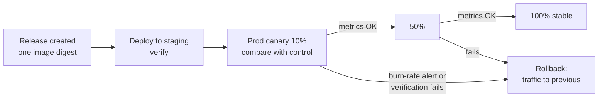

Objective **6.3** is "deployment and release management". Section 5 asked which *pattern* to
choose; this lesson is about *mechanics*: how each compute platform splits traffic, how a release
is promoted, and how to roll back in seconds rather than hours. A useful distinction runs through
the whole lesson: **deploying** puts a new version on infrastructure; **releasing** sends users to
it. Platforms that separate the two (Cloud Run revisions, Kubernetes services, load balancer
weights) make safe releases easy.

## 1. Recap: the patterns

| Pattern | Traffic to new version | Rollback | Capacity cost |
|---|---|---|---|
| Rolling | Grows as instances are replaced | Roll back (re-rolls) | Small surge |
| Blue/green | 0% then 100% at once | Switch back instantly | 2× during cut-over |
| Canary | Small % of random users, then increased | Shift % back instantly | Small |
| A/B | Chosen cohort by header, cookie or attribute | Remove variant | Small |
| Shadow | Copy of traffic; responses discarded | Not needed | 2× processing |

Google SRE's canarying guidance adds: the canary population must be **large enough to show a
statistically meaningful difference**, the evaluation must **compare canary against a control** (the
current version under the same load at the same time), and the canary should run **long enough to
cover the failure modes you care about** (memory leaks need hours, not minutes).

## 2. Cloud Run: revisions and traffic

Every Cloud Run deployment creates an immutable **revision**. Traffic is assigned to revisions by
percentage, and **tags** give a revision its own URL without giving it any production traffic.

```bash
# Deploy v2 but send it no production traffic; give it a test URL (green---svc-xyz.a.run.app)
gcloud run deploy checkout --image=europe-docker.pkg.dev/acme/app/checkout:2.0 \
  --no-traffic --tag=green

# Canary: 10% of production traffic to the tagged revision
gcloud run services update-traffic checkout --to-tags=green=10

# Promote: all traffic to the newest revision
gcloud run services update-traffic checkout --to-latest

# Roll back: all traffic to the previous known-good revision
gcloud run services update-traffic checkout --to-revisions=checkout-00041-abc=100
```

| Goal on Cloud Run | How |
|---|---|
| Test in production without users | `--no-traffic` plus a **tag** URL |
| Canary or gradual rollout | `update-traffic` with percentages, step by step |
| Blue/green | Deploy green with no traffic, test via tag, then move 100% in one command |
| Rollback | `update-traffic` back to the old revision: seconds, no rebuild |

> [!TIP]
> Cloud Run rollback is a **traffic change**, not a redeploy. Any answer that rebuilds an old image
> to roll back Cloud Run is slower than necessary.

## 3. GKE: Deployments, Gateway API and Cloud Deploy

**Rolling updates** are the Kubernetes default. A Deployment's `RollingUpdate` strategy replaces pods
gradually, controlled by:

- **`maxSurge`**: how many extra pods may be created above the desired count;
- **`maxUnavailable`**: how many may be unavailable during the update;
- **readiness probes**, which stop traffic reaching a new pod until it reports ready. Without them a
  rolling update can send traffic to pods that are still starting.

Rollback: `kubectl rollout undo deployment/checkout` returns to the previous ReplicaSet.

**Blue/green on GKE**: run two Deployments (`checkout-blue`, `checkout-green`) and switch either the
Service's label selector or, better, the **Gateway API `HTTPRoute`** backend.

**Canary on GKE**: an `HTTPRoute` with **weighted `backendRefs`** splits traffic precisely,
independent of pod counts:

```yaml
apiVersion: gateway.networking.k8s.io/v1
kind: HTTPRoute
metadata: { name: checkout }
spec:
  parentRefs: [{ name: external-gateway }]
  rules:
  - backendRefs:
    - { name: checkout-v1, port: 8080, weight: 90 }
    - { name: checkout-v2, port: 8080, weight: 10 }
```

HTTPRoute rules can also match on **headers**, which is how A/B routing (for example
`x-cohort: beta`) is done.

**Cloud Deploy** automates all of this. A delivery pipeline's target can use a **canary strategy**
with phases (for example 10%, 50%, then stable 100%) for GKE (via Gateway API or service networking)
and Cloud Run (via traffic percentages). Between phases, a **verification** job can run tests and
fail the rollout, promotion can require **approval**, and **rollback** redeploys the previous release
to the target with one command. Automation rules can advance phases or promote releases
automatically.

**Cluster upgrades are releases too.** GKE node pools upgrade with **surge upgrades** (rolling, with
`maxSurge` / `maxUnavailable` per pool) or **blue-green upgrades**, which create a new set of nodes,
drain the old pool in batches, keep it during a **soak time**, and allow rollback before it is
deleted.

## 4. Compute Engine managed instance groups

A MIG updates from one **instance template** to another:

```bash
# Canary: 10% of the group on the new template
gcloud compute instance-groups managed rolling-action start-update web-mig \
  --version=template=web-v1 \
  --canary-version=template=web-v2,target-size=10% \
  --max-surge=3 --max-unavailable=0 --zone=europe-west1-b

# Full rollout once metrics look good
gcloud compute instance-groups managed rolling-action start-update web-mig \
  --version=template=web-v2 --max-surge=3 --max-unavailable=0 --zone=europe-west1-b
```

Rollback is another rolling update back to `web-v1`. `maxUnavailable=0` with a positive `maxSurge`
keeps full serving capacity during the update. Blue/green with MIGs means two MIGs behind the load
balancer and switching the backend service (or weighting them).

## 5. Designing releases you can roll back

Traffic rollback is only safe if the **old version still works with the current data**.

- **Expand and contract database changes.** Release 1 *adds* the new column or table (expand) and
  writes both formats; release 2 reads the new format; only release 3 *removes* the old column
  (contract). At every step, the previous version still runs.
- **Backward-compatible APIs and messages**: add optional fields; do not remove or rename until all
  consumers have moved.
- **Feature flags** separate deploying code from enabling behaviour; turning a flag off is a rollback
  that needs no deployment.
- **Build once, promote the same artifact** (digest) through environments; hermetic, reproducible
  builds (SRE release engineering) mean "the old version" really is the old version.
- **Automate the rollback decision** where you can: Cloud Deploy verification failing, or an SLO
  burn-rate alert during a canary, should stop promotion.



## Worked example: Altostrat Media's recommendation service

**Situation.** Altostrat Media runs a content recommendation API on GKE and a metadata-extraction
service on Cloud Run. Its case study asks for modernised, centralised CI/CD for containers and more
reliable operations. A new recommendation model (v2) changes response ranking; a bad model must not
reach all users, and the product team wants to measure watch-time gains among premium subscribers.
The Cloud Run service also needs a new version, which must be testable in production before users
see it.

**Plan.**

1. **Cloud Deploy pipeline** dev → staging → prod for both services, one release per build, with an
   approval on prod.
2. **Recommendation API (GKE):** canary strategy through Gateway API: 5% → 25% → 100%, with a
   verification job and SLO burn-rate alerts (latency and error rate) gating each phase.
   Separately, an **A/B** rule in the `HTTPRoute` sends requests with a premium-cohort header to v2
   so the product team can compare watch time; that is a business experiment, not the safety
   canary.
3. **Metadata service (Cloud Run):** deploy with `--no-traffic --tag=next`, run integration tests
   against the tag URL, then shift 10% → 100%. Rollback = send 100% back to the previous revision.
4. **Schema:** the new model writes an extra field to Bigtable; v1 ignores unknown columns, so the
   change is expand-only and rollback is safe.

## Check yourself

1. A Cloud Run release is causing errors. What is the fastest rollback?
2. During a Kubernetes rolling update, users get errors from pods that have started but not finished
   loading their cache. What is missing?
3. Why must a database column removal wait until a later release when using canary or rolling
   deployments?

<details>
<summary>Answers</summary>

1. `gcloud run services update-traffic SERVICE --to-revisions=PREVIOUS_REVISION=100`. Revisions are
   immutable and still exist, so rollback is a traffic change taking seconds.
2. A **readiness probe**. Without it, Kubernetes sends traffic to a pod as soon as its container is
   running.
3. Because old and new versions run **at the same time** during the rollout, and the old version
   must keep working if you roll back. Expand first, contract only after the old version is gone.

</details>

> [!NOTE]
> **Sources.** Exam guide §6.3; Cloud Run rollouts, rollbacks and traffic migration; Cloud Deploy
> canary and verification docs; Kubernetes Deployments; Gateway API traffic splitting; GKE node pool
> upgrade strategies; MIG rolling and canary updates; Google's application deployment and testing
> strategies; the SRE workbook on canarying and the SRE book on release engineering.
