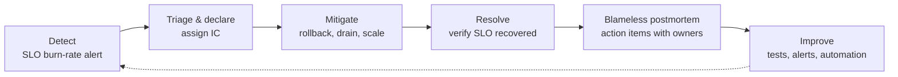

Objectives **6.4** (assisting with the support of deployed solutions), **6.5** (evaluating quality
control measures) and **6.6** (ensuring reliability in production: chaos engineering, penetration
testing, load testing) are about life after launch. Questions here are often judgement questions:
"what should you do FIRST", "what is the BEST way to verify". Google's answers follow its SRE
practice and the Well-Architected Framework: clear roles, blameless learning, measured quality, and
deliberately testing failure before it happens on its own.

## 1. Supporting deployed solutions (6.4)

### Incident management

Google SRE's incident management model separates responsibilities so nobody tries to fix, coordinate
and communicate at once:

| Role | Responsibility |
|---|---|
| **Incident Commander (IC)** | Owns the incident: declares it, assigns roles, keeps the big picture, decides. Does not debug |
| **Operations lead** | The only person (or team) changing production during the incident |
| **Communications lead** | Regular updates to stakeholders and customers |
| **Planning lead** | Longer-running work: tracking follow-ups, handoffs, ordering supplies |

Practices that go with it: **declare early** (it is cheaper to stand down than to declare late),
keep **one live incident document**, hand off explicitly across time zones, and **mitigate first,
root-cause later**. Rolling back the last release, draining a bad zone or shifting traffic restores
service; finding *why* can wait for the postmortem.

> [!TIP]
> **Memory aid: "Detect, Declare, Mitigate, Resolve, Learn."** In a "what should you do FIRST"
> question during an outage, **mitigate user impact** (for example roll back the release that
> correlates with the errors) beats "find the root cause" or "open a postmortem".

### Blameless postmortems

A postmortem is written for significant incidents (user-visible downtime beyond a threshold, data
loss, on-call intervention, long resolution). It records the timeline, impact, root causes and
trigger, what went well and badly, and **action items with owners and due dates** that are tracked to
completion. It is **blameless**: it assumes people acted reasonably with the information they had,
and looks for system and process fixes. Blame makes people hide problems, which makes the next
incident worse.

### Is it us or is it Google?

- **Personalized Service Health** shows Google Cloud incidents that affect *your* projects and
  services, can raise alerts, and has an API, so on-call can quickly rule a platform issue in or out.
- **Cloud Customer Care** (Standard, Enhanced, Premium) is how you escalate to Google. Higher tiers
  give faster response targets for critical (P1) cases; Premium adds a named Technical Account
  Manager. When a production outage depends on a Google-side issue, the paid tier you hold
  determines how fast Google responds, so a business-critical workload needs a tier to match.
- **Gemini Cloud Assist investigations** can analyse logs, errors and alerts to suggest causes, and
  the results can be attached to a support case.

### Day-two support artefacts

Runbooks linked from alert documentation, dashboards per service, on-call rotations with sustainable
load, and **toil reduction** (automating repetitive manual work) are the operational excellence
pillar's "manage incidents and problems" and "automate and manage change" principles in practice.

## 2. Evaluating quality control measures (6.5)

Quality control is layered: each gate catches what earlier gates miss.

| Stage | Quality measure | Google Cloud mechanism |
|---|---|---|
| Code | Code review, static analysis, unit tests | Pull-request checks in Cloud Build |
| Build | Reproducible builds, dependency and **vulnerability scanning** | Cloud Build, Artifact Registry with **Artifact Analysis** |
| Deploy | Only trusted, scanned artifacts run | **Binary Authorization** attestations |
| Release | Automated **verification**, canary analysis, approvals | **Cloud Deploy** verification and approvals |
| Production | SLO compliance, error budget, error trends | Cloud Monitoring SLOs, Error Reporting |
| Process | Delivery performance | **DORA metrics** |

**DORA's software delivery metrics** measure the process itself. Throughput: **change lead time**,
**deployment frequency**, **failed deployment recovery time**. Instability: **change fail rate** and
**deployment rework rate** (the original "four keys" plus rework rate). High performers do well on
both throughput and stability at the same time; speed and quality are not a trade-off when the
pipeline is automated.

How to *evaluate* a quality measure in an exam scenario: does it catch the failure **before users
see it**, is it **automated** (manual QA sign-off does not scale), and is it **measurable** (an SLO,
a change fail rate)? A measure that only inspects after the fact (a monthly report) is weaker than
one that blocks a bad release.

## 3. Reliability in production (6.6)

### Chaos engineering

Chaos engineering is **disciplined experimentation** to build confidence that the system withstands
turbulent conditions. The principles:

1. Define **steady state** with a measurable output (your SLIs).
2. **Hypothesise** that steady state continues when a fault is introduced.
3. Introduce **real-world events**: instance or zone loss, latency, dependency errors, a database
   failover.
4. Run in **production** (or as close as possible), starting in staging.
5. **Minimise blast radius**: start small, have an abort switch, and stay within error budget.
6. **Automate** experiments to run continuously.

Ways to inject faults on Google Cloud:

| Fault | How |
|---|---|
| Lose instances or a zone | Delete VMs in a MIG and watch autohealing; drain a zone; delete pods or cordon nodes on GKE |
| Database failover | Trigger a manual failover on a Cloud SQL high-availability instance |
| Latency or errors between services | **Fault injection** (delays, aborts) in Cloud Service Mesh / Istio route rules |
| Dependency outage | Block egress with a firewall rule in a test, or point at a failing stub |
| Open-source tooling | Chaos Mesh or Litmus on GKE |

### Load testing

Load tests answer whether the system meets its SLOs at expected and peak load, and where it breaks.
Run them against a **production-like environment** (same machine types, autoscaling settings,
quotas, data volumes), from **distributed generators** (Locust workers on GKE in Google's reference
architecture) in the regions your users come from, and watch Cloud Monitoring, Trace and Profiler on
the target while they run. Types: **load** (expected peak), **stress** (beyond peak, find the
breaking point), **soak** (hours at load, finds leaks), **spike** (sudden burst, tests autoscaling and
warm-up). Check **quotas** before a big test or launch: a test that hits a regional quota measures
the quota, not your design. **Benchmarking** with PerfKit Benchmarker compares machine types and
services under standard workloads.

### Penetration testing

- You **do not need to notify Google** before penetration testing your own Google Cloud projects.
- You **must** follow the **Acceptable Use Policy** and **Terms of Service**, and your tests must
  affect **only your own projects**, never other customers or Google's infrastructure.
- Complement manual or third-party pen tests with **Web Security Scanner** (Security Command Center),
  which scans public web apps on App Engine, GKE and Compute Engine for issues such as cross-site
  scripting, mixed content and outdated libraries.
- Test from outside (as an attacker on the internet) and inside (assume a compromised workload), and
  feed findings into the backlog with owners, like postmortem actions.

> [!WARNING]
> A frequent distractor: "Submit a request to Google and wait for approval before the penetration
> test." Google does not require notification for testing your own projects. The obligation is to
> stay within the AUP and your own resources.

## Worked example: KnightMotives' dealer ordering platform

**Situation.** KnightMotives' case study describes an online ordering system that dealers find
unreliable, a history of security breaches, and a requirement for strong incident response. The new
platform runs on GKE with Cloud SQL (high availability) and Pub/Sub. The model-year launch will bring
five times normal traffic. Leadership asks the architect how to be confident before launch and how
to run support after it.

**Plan.**

1. **Before launch, quality gates:** Cloud Build runs unit and integration tests; Artifact Analysis
   scans images; Binary Authorization admits only attested images; Cloud Deploy canaries with
   verification. Track change fail rate and failed deployment recovery time (DORA).
2. **Load test** in a production-like staging project with Locust on GKE at 5× and 7× normal peak
   (stress), plus a 12-hour soak. Request quota increases found during the test before launch.
3. **Chaos game day** in staging, then a controlled experiment in production within the error budget:
   delete a node pool zone's nodes, trigger a Cloud SQL failover, inject 2-second latency into the
   inventory service via Cloud Service Mesh. Hypothesis: checkout SLO holds. Each failed hypothesis
   becomes a fix.
4. **Penetration test** by a third party against KnightMotives' own projects only, under the AUP, no
   Google notification needed; Web Security Scanner runs on the dealer portal continuously.
5. **Support:** SLO burn-rate alerts page on-call; an incident command structure with IC, operations
   and communications leads (dealers get regular updates); Personalized Service Health alerts in the
   on-call channel; a Customer Care tier with a fast P1 response for the launch; blameless
   postmortems with tracked actions.

## Check yourself

1. Ten minutes after a release, checkout errors spike. The on-call engineer wants to find the bug in
   the new code. What should happen first, and who decides?
2. A team plans a penetration test of its own Cloud Run services. Must it notify Google?
3. Which measure is stronger quality control: a monthly report of production errors, or a Cloud
   Deploy verification step that fails the rollout when error rate rises during a canary? Why?

Answers

1. **Mitigate first**: roll back the release (traffic back to the previous revision). The
   **Incident Commander** makes the call; root-cause analysis follows in the postmortem.
2. **No.** It must follow the Acceptable Use Policy and Terms of Service and affect only its own
   projects.
3. The **verification step**: it is automated and blocks the bad change before most users see it.
   The monthly report detects problems only after users have been affected.

> [!NOTE]
> **Sources.** Exam guide §6.4–6.6; the Well-Architected Framework's operational excellence
> (including managing incidents and problems) and reliability pillars; the SRE book chapters on
> managing incidents and postmortem culture; Personalized Service Health and Cloud Customer Care;
> DORA metrics, Artifact Analysis and Cloud Deploy verification; Google's chaos engineering article
> with the Principles of Chaos and Istio fault injection; Google's distributed load-testing
> architecture and PerfKit Benchmarker; Google's penetration-testing FAQ, the Acceptable Use Policy
> and Web Security Scanner.
