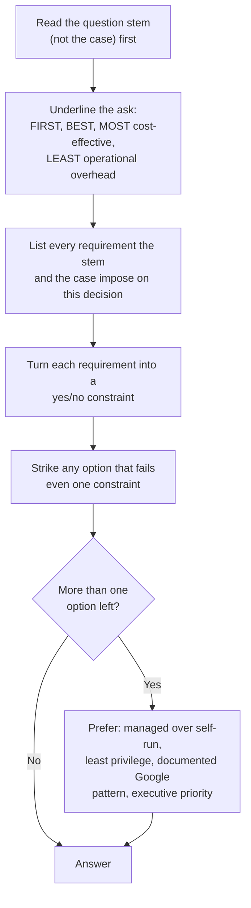

## Why case studies deserve their own module

Google publishes four fictional companies alongside the exam guide: **Altostrat Media, Cymbal
Retail, EHR Healthcare and KnightMotives Automotive** (version 6.1). Each sitting of the exam
uses **two of the four**, and the questions that cite them make up roughly **20–30% of the
50–60 questions**. That's somewhere between 10 and 18 questions where the "right" answer
depends on facts you either already know or have to dig out of a page of text under time
pressure.

The case text is available on screen while you answer those questions. Don't let that lull you
into reading it for the first time in the exam room. Two hours for up to 60 questions is about
two minutes each, and a case study takes four or five minutes to read properly. Candidates who
know the four companies well treat the on-screen copy as a lookup table, not a reading
assignment.

> [!IMPORTANT]
> The case studies change between exam versions. The current set is v6.1. Mountkirk Games,
> TerramEarth, Helicopter Racing League and Dress4Win are **retired**. Practice material that
> still uses them is teaching the right skills with the wrong facts.

## The anatomy of a case study

Every v6.1 case has the same five parts. Each part plays a different role when you answer.

| Part | What it tells you | How the exam uses it |
|---|---|---|
| Company overview | Industry, size, what they sell | Sets the regulatory context (health data, EU drivers, payment cards) |
| Solution concept | What they're trying to build | Tells you which family of products is "in scope" (gen AI, hybrid, data platform) |
| Existing technical environment | Today's estate: databases, clusters, on-prem systems, monitoring, identity | Defines the **migration source** and what must keep working. Wrong answers often ignore it |
| Business requirements | Outcomes: availability, cost, time to onboard, compliance, revenue | The graded goals. Often phrased vaguely ("reduce latency to all customers") |
| Technical requirements | Concrete constraints: hybrid links, container consistency, human review, auditability | **Hard filters.** An option that breaks one is wrong, however elegant |
| Executive statement | The CEO's priorities and pain | Tie-breaker. "Reliability and cost management are our top priorities" decides close calls |

Read the existing environment as carefully as the requirements. Many wrong options are
technically sound designs that throw away something the company said it already has or must
keep. EHR, for example, states plainly that its legacy insurer integrations stay on-premises
for now. Any answer that migrates them is wrong, however modern it is.

## The method: requirement → constraint → elimination → preference

### Step 1: read the stem before the case

The stem tells you which slice of the case matters. A question about database migration
doesn't need you to reread the gen AI section. Go to the case only to confirm a specific
fact: which databases, which identity system, what availability target.

### Step 2: find the ask

Words like **FIRST**, **BEST**, **MOST cost-effective** and **LEAST management overhead**
change the answer. "What should you do first" often wants assessment, a contract or a
foundation step (a BAA, Migration Center discovery, a landing zone), not the end-state
architecture. "Least overhead" pushes you hard towards serverless and managed services.

### Step 3: turn requirements into constraints

Fuzzy requirements become testable ones. Here is how the common phrasings translate.

| Case or stem says | Constraint to test each option against |
|---|---|
| "Minimum 99.9% availability" | Survives a zone failure: multi-zone or regional resources, no single VM, no single zonal database |
| "Secure, high-performance connection to on-premises" | Private, high-bandwidth link (Dedicated or Partner Interconnect), with HA VPN as backup or interim. Not the public internet, not a single VPN tunnel |
| "Maintain legacy interfaces" / "no plan to move these" | The legacy system stays where it is and gets connected, not rewritten |
| "Consistent management of container environments" | One control plane for many clusters: GKE fleets with GitOps config and policy |
| "Reduce infrastructure administration" | Managed or serverless beats self-managed VMs |
| "Auditable and explainable" | Decisions logged with evidence; explanations available; nothing silently deleted |
| "Comply with EU data protection" / "health records" | Residency controls, contractual coverage (BAA), de-identification, least privilege |
| "Human review before publishing" | Generated output goes to a staging state, never straight to production data |
| "Dealers have no budget for new equipment" | Browser-based or SaaS delivery; nothing that needs new on-site hardware |

### Step 4: eliminate

Strike every option that fails a constraint. On most case questions this leaves one or two
options. The traps are usually one of these:

- **Right service, wrong scope.** For example, Managed Microsoft AD when the requirement is
  only console single sign-on, which federation solves.
- **Right idea, too much operation.** Self-hosted Prometheus with Thanos when Managed Service
  for Prometheus does the same job.
- **Ignores the existing estate.** It rebuilds something the company said it keeps.
- **Breaks a hidden constraint.** Spot VMs for a customer-facing tier that needs 99.9%, or a
  US multi-region bucket for EU driver data.
- **Solves tomorrow, not today.** A five-year refactor offered for a data-centre lease that
  expires in months.

### Step 5: prefer

When two options both pass, Google's own guidance breaks the tie, in this order:

1. **Managed over self-run.** The Well-Architected Framework's operational excellence and
   cost pillars both favour removing undifferentiated work.
2. **Least privilege and defence in depth.** Predefined roles at the narrowest scope, perimeters
   around sensitive data.
3. **The documented Google pattern.** For example, Interconnect for hybrid at scale, GitOps for
   fleets, BigQuery for analytics, Pub/Sub for decoupling.
4. **The executive statement.** If the CEO says reliability and cost come first, the more
   reliable or cheaper of two valid designs wins.

> [!TIP]
> If an option names a product you've never heard of, don't assume it's the clever answer.
> The exam rewards mainstream, documented patterns. Unfamiliar-sounding options are as likely
> to be invented distractors or retired names.

## Worked example

Here is an original question in exam style. Work it before reading the walk-through.

> **Case study: EHR Healthcare.** EHR's customer-facing web applications run on Kubernetes in
> a colocation facility whose lease expires soon. The legacy insurer integrations will stay
> on-premises for several years. Leadership wants the move done quickly and wants to keep at
> least 99.9% availability. What should you do?
>
> - **a.** Refactor every application to Cloud Run before migrating, so that no clusters need
>   to be managed.
> - **b.** Move the containerised applications to regional GKE clusters, connect to the
>   remaining on-premises systems over redundant Dedicated Interconnect, and leave the insurer
>   integrations in place.
> - **c.** Move the applications and the insurer integrations to a single zonal GKE cluster to
>   reduce cost, and connect to insurers over the public internet.
> - **d.** Extend the colocation lease and deploy Google Distributed Cloud there, so the
>   applications never have to move.

**Constraints.** (1) It must be fast, because the lease is expiring. (2) The insurer
integrations stay on-premises. (3) It must deliver at least 99.9% availability. (4) The link
to on-premises must be secure and high-performance, a technical requirement in the case.

**Eliminate.**

- **a** fails (1). A full refactor before migration is the slow path, and the apps are
  already containerised, so GKE takes them as they are.
- **c** fails (2) and (3). It moves the integrations the case says stay put, and a single
  zonal cluster can't survive a zone outage.
- **d** fails the solution concept. Google Cloud was chosen to *replace* colocation, and
  extending the lease doesn't address the business driver.

**Answer: b.** It keeps the containers as they are (fast), uses regional clusters
(availability), uses Interconnect (secure and high-performance) and leaves the legacy
systems alone (respects the existing estate).

> [!WARNING]
> Notice that **a** isn't a *bad* architecture. Cloud Run might well be where some of these
> services end up. It's wrong because it fails *this* question's time constraint. Case
> questions are graded against the constraints, not against your favourite design.

## Pacing and note-taking in the exam

- **Before the exam:** know each company's one-line identity, its hard constraints and its
  existing estate. Lessons 2–5 give you all three.
- **In the exam:** when a case question appears, glance at the case only to confirm a fact.
  If you need more than 30 seconds of reading, mark the question for review and move on.
- **Look for the decisive requirement:** most case questions turn on one line of the case
  (a database list, an availability number, an identity system). Find that line and the
  answer usually follows.

### A memory aid: **E-B-T-X**

**E**xisting estate (what must be kept or migrated) → **B**usiness outcome (what's graded) →
**T**echnical constraint (what can't be broken) → e**X**ecutive priority (the tie-breaker).
Run every case question through these four in that order.

## How the four cases differ

Before you study each company, see how they contrast. Questions often feel similar across
cases (every one has hybrid connectivity and monitoring), but the deciding constraint is
different in each.

| Company | Core theme | Deciding constraints you'll keep meeting |
|---|---|---|
| Altostrat Media | Gen AI on a media library already mostly in Google Cloud | Storage cost at scale, hybrid ingestion, auditable AI moderation, reliability first |
| Cymbal Retail | Gen AI for catalogue enrichment and conversational commerce | Human review of AI output, catalogue scale, customer data security, call-centre and data-centre cost |
| EHR Healthcare | Leaving colocation, healthcare SaaS | 99.9% availability, healthcare compliance, legacy insurer integrations stay on-prem, AD identity |
| KnightMotives Automotive | Long-horizon digital transformation of a carmaker | EU data protection, security after breaches, weak connectivity, mainframe and ERP, dealers with no budget |

## Check yourself

1. A case-study question asks what you should do **first** to begin a migration. Two options
   describe complete target architectures and one describes running a discovery and
   assessment of the current estate. Which kind of answer does the word "first" usually
   favour, and why?
2. Two options both meet every stated requirement. One runs Prometheus yourself on
   Compute Engine and the other uses Managed Service for Prometheus. Which do you choose, and
   which principle decides it?
3. Why is an option that migrates EHR's legacy insurer integrations to Google Cloud wrong,
   even if the proposed design is secure and scalable?

Answers

1. "First" usually favours the foundation or assessment step, here discovery and assessment
   (for example with Migration Center). You can't plan waves, size targets or find
   dependencies until you know what you have. End-state architectures answer a different
   question.
2. Managed Service for Prometheus. When both options meet the requirements, prefer the
   managed service that removes operational work. That's the operational excellence and
   cost guidance in the Well-Architected Framework.
3. The case says those systems will be replaced over the next several years and there's no
   plan to move them now. The technical requirement is to *maintain* those interfaces with
   connectivity to on-premises and cloud. An option that ignores a stated constraint of the
   existing estate is wrong regardless of its other merits.

## Sources

- Google Cloud, *Professional Cloud Architect exam guide* and *certification page* (exam
  format, the case-study list and weighting).
- Google Cloud, *Well-Architected Framework* (managed-first, operational excellence and cost
  pillars).
- Google Cloud, *Altostrat Media* and *EHR Healthcare* case studies v6.1 (the examples used
  above).
- Google Cloud, *Hybrid and multicloud patterns*, *Cloud Interconnect* and *Cloud VPN*
  overviews (the hybrid-connectivity constraint).
