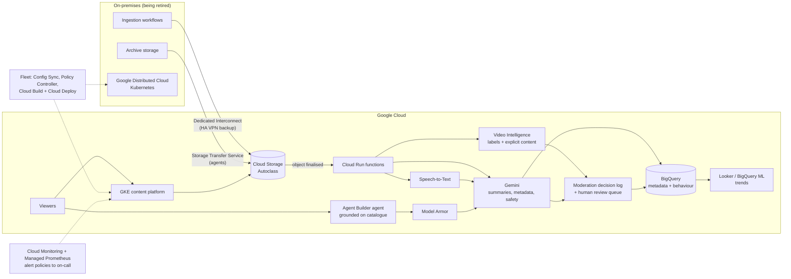

> Read the official case (linked in Sources) at least once. This lesson summarises it in our
> own words and adds the architecture thinking the exam expects.

## The company in brief

Altostrat is a media company with a large, growing library of audio and video: podcasts,
interviews, news broadcasts and documentaries. It wants generative AI to change how people
find and interact with that content (personalised recommendations, natural-language
conversation and self-service support) and to drive revenue through targeted marketing and
dynamic pricing.

What makes Altostrat different from the other three cases is that **it's already mostly in
Google Cloud**. The exam isn't asking you to plan a data-centre exit. It's asking you to
**optimise and extend** an existing Google Cloud estate and finish a small hybrid migration.

**Existing estate, in short**

| Area | Today |
|---|---|
| Content platform | GKE, chosen for scale and availability |
| Media library | Cloud Storage (documents, audio, video) |
| Analytics | BigQuery as the main warehouse (behaviour, consumption, demographics) |
| Event-driven tasks | Cloud Run functions for transcoding, metadata extraction and recommendations |
| On-premises | Legacy ingestion and archive workflows, due to be modernised and moved to Google Cloud |
| Identity | Google identity plus third-party identity providers |
| Monitoring | Cloud Monitoring plus open-source Prometheus; alerts mainly by email |

**Executive priority:** the executive statement names **reliability and cost management** as
the top priorities, alongside gen AI ambitions. Use that to break ties.

## Requirements mapped to Google Cloud

### Business requirements

| Requirement (paraphrased) | Services and patterns | Why |
|---|---|---|
| Faster, more reliable operational workflows across cloud and on-premises | GKE fleet spanning cloud and on-prem clusters (Google Distributed Cloud on-prem); Config Sync; Cloud Deploy | One way to configure, deploy and observe both environments, so on-prem workflows get the same reliability tooling |
| Simpler infrastructure for rapid deployment | GKE Autopilot for new services; Cloud Run for stateless APIs; centralised CI/CD | Autopilot and Cloud Run remove node management; pipelines remove hand-built releases |
| Lower storage cost while keeping availability and scale | Cloud Storage **Autoclass** (or lifecycle rules where access is predictable); dual- or multi-region only for hot content | Autoclass moves each object to a colder class when it stops being read and back when it's read again, with no retrieval or early-deletion fees on those moves |
| Natural-language interaction and 24/7 support | Agent Builder conversational agent grounded in Altostrat's catalogue and help content; Gemini models | A grounded agent answers from Altostrat's own data around the clock without building a model |
| Automatic summaries of media | Speech-to-Text for transcripts; Gemini (multimodal) for summaries, triggered by Cloud Run functions on upload | Gemini accepts audio and video directly; transcripts also feed search and captions |
| Rich metadata through NLP and computer vision | Video Intelligence API (labels, shots, on-screen text), Gemini for entities and topics, results to BigQuery | Pretrained APIs give dependable, structured metadata without custom training |
| Detect and filter inappropriate content | Video Intelligence explicit-content detection; Gemini safety ratings; Model Armor on the chatbot; human review queue for borderline items | Layered signals with a human escalation path, all recorded |
| Analyse content for trends and insight | BigQuery joining content metadata with consumption data; BigQuery ML and Gemini in BigQuery; Looker dashboards | Keeps analytics where the data already is; SQL-based ML keeps operations light |
| Data-driven content strategy | Same BigQuery foundation, plus governed sharing to editorial teams | Decisions come from one trusted dataset |

### Technical requirements

| Requirement (paraphrased) | Services and patterns | Why |
|---|---|---|
| Modern CI/CD for containers with central management | Cloud Build → Artifact Registry → Cloud Deploy to fleet clusters; Binary Authorization | One pipeline and one promotion model for every cluster; only attested images deploy |
| Secure, high-performance hybrid connectivity for ingestion | **Dedicated Interconnect** (or Partner Interconnect) in a redundant topology; HA VPN as interim or backup; MACsec or HA VPN over Interconnect if traffic must be encrypted in transit | Large media files need bandwidth and predictable latency that the public internet and single VPN tunnels can't give |
| Scalable Kubernetes on-prem and in cloud | GKE in cloud, Google Distributed Cloud (software-only) on-prem, all registered to one fleet | Same Kubernetes, same policy and same tooling in both places |
| Storage cost for growing volume | Autoclass; object lifecycle deletion of transient transcode outputs; Storage Transfer Service to retire on-prem archive | Cost scales with *access*, not just volume |
| AI detection of harmful content | Pretrained moderation APIs plus Gemini safety settings; custom classifier only if needed | Start with managed models; customise when the pretrained categories don't fit |
| Auditable and explainable AI decisions | Log every decision (input reference, model and version, scores, threshold, outcome, reviewer) to BigQuery; Explainable AI for any custom model; Cloud Audit Logs for access | An auditor can reconstruct *why* an item was removed |
| LLMs and conversational AI for personalisation | Gemini through Agent Platform; Agent Builder with grounding; recommendations from BigQuery features | Managed models; grounding cuts hallucination |
| Chatbots with natural-language understanding | Agent Builder or Conversational Agents, with tools that call Altostrat's APIs (account, subscriptions) | Personalised help needs actions, not just answers |
| Automated summarisation of diverse media | Gemini multimodal pipeline: event → Cloud Run function → Gemini → BigQuery and the content record | Event-driven, serverless, scales with uploads |

> [!TIP]
> Autoclass versus lifecycle rules is the classic Altostrat storage question. **Predictable**
> ageing ("news clips are rarely watched after 60 days") suits lifecycle rules. **Unpredictable**
> access (an old documentary that goes viral) suits Autoclass, because lifecycle rules would
> leave a revived object in a cold class with retrieval fees on every read.

## Reference architecture

Three ideas carry the design:

1. **Event-driven enrichment.** Uploading a file is the trigger. Serverless functions call
   managed AI services and land structured results in BigQuery. Nothing runs when nothing is
   uploaded.
2. **Moderation as a recorded decision, not a filter.** Every automated decision is written
   down with its evidence. Borderline scores go to a human queue. This is how you meet
   "auditable and explainable" with generative and pretrained models, which don't give
   per-feature attributions the way a custom tabular model can.
3. **One fleet.** On-prem and cloud Kubernetes are managed together, so the remaining on-prem
   workflows get the same deployment pipeline and observability as cloud workloads while they
   wait to be migrated.

## Worked example: storage cost for a media library

Altostrat stores several petabytes of video. Recent news content is watched heavily for about
a week. Documentaries are watched unpredictably, sometimes years after release. Transcoding
leaves intermediate renditions that are never read again after the final versions are made.

| Data | Access pattern | Best fit |
|---|---|---|
| Intermediate transcode outputs | Never read after 7 days | Lifecycle rule: **delete** after 7 days |
| News clips | Hot for a week, then rarely and predictably | Lifecycle rule to Nearline at 30 days, Coldline later, or Autoclass |
| Documentaries and back catalogue | Unpredictable spikes | **Autoclass** on the bucket |
| Legal hold or masters kept for rights reasons | Almost never read, kept for years | Archive class (365-day minimum storage duration) |

The trap would be "move everything older than 30 days to Archive". It's cheap on paper, but a
documentary that trends would pay retrieval fees on every play and still be subject to
Archive's minimum storage duration.

## Likely exam angles and traps

| Angle | What the right answer looks like | Trap |
|---|---|---|
| Storage cost | Autoclass for unpredictable access; lifecycle delete for transient objects | Blanket move to Archive; moving media to Filestore or persistent disks |
| Hybrid ingestion | Redundant Dedicated or Partner Interconnect; HA VPN as backup | A single Cloud VPN tunnel for bulk video; Direct Peering (it reaches Google APIs, not your VPC privately, and has no SLA) |
| Archive migration | Storage Transfer Service with on-prem agents (or Transfer Appliance if bandwidth can't do it in time) | Hand-written `gcloud storage cp` scripts with no verification or scheduling |
| CI/CD | Cloud Build + Artifact Registry + Cloud Deploy to the fleet; Binary Authorization | Separate Jenkins per environment; `kubectl apply` from laptops |
| Moderation | Pretrained APIs plus logged decisions plus human review | Silent auto-delete with no record; training a custom vision model from scratch first |
| Chatbot safety | Model Armor screening prompts and responses; grounding | Relying on the system prompt alone to stop prompt injection |
| Monitoring | Managed Service for Prometheus (keeps PromQL and dashboards) and alert policies routed to on-call channels | Self-hosting Prometheus at scale; keeping email-only alerts |
| Summaries | Gemini multimodal on the asset, event-driven | Building and training a summarisation model yourself |

> [!WARNING]
> "Explainable" is a trap word. Explainable AI feature attributions apply to **custom
> models**. For generative and pretrained-API decisions, explainability on the exam means
> **recording the evidence** (scores, model version, threshold, prompt, policy rule) and
> keeping a human in the loop for disputed cases. An option that simply says "use a larger
> model" doesn't make anything more explainable.

## Check yourself

1. Altostrat's back catalogue has unpredictable access and is growing fast. Which Cloud
   Storage feature best reduces cost without ongoing tuning, and why not a fixed lifecycle
   rule to Archive?
2. Which two things together make an AI moderation decision auditable at Altostrat?
3. Altostrat wants one deployment process for clusters both on-premises and in Google Cloud.
   Name the components of that pipeline.

Answers

1. Autoclass. It moves each object based on its own access, cooling idle objects and
   re-warming ones that are read, with no retrieval or early-deletion charges for those
   transitions. A fixed rule to Archive would charge retrieval fees whenever an old title
   becomes popular, and would keep it cold.
2. A durable decision record (asset reference, model and version, scores and threshold,
   outcome, reviewer) stored somewhere queryable such as BigQuery, plus a human-review path
   for borderline or appealed items. For custom models, add Explainable AI attributions.
3. Cloud Build to build and test, Artifact Registry to store images, Binary Authorization to
   admit only attested images, and Cloud Deploy promoting releases to clusters registered in
   a GKE fleet (cloud GKE and Google Distributed Cloud on-prem), with Config Sync keeping
   cluster configuration consistent.

## Sources

- Google Cloud, *Altostrat Media case study v6.1* (all facts about the company).
- Google Cloud docs: *Storage classes*, *Autoclass*, *Storage Transfer Service* (storage
  cost and archive migration).
- Google Cloud docs: *Cloud Interconnect* and *Cloud VPN* overviews (hybrid ingestion).
- Google Cloud docs: *Fleet management*, *Google Distributed Cloud*, *Cloud Build*,
  *Cloud Deploy*, *Binary Authorization* (CI/CD and hybrid Kubernetes).
- Google Cloud docs: *Gemini and Imagen models*, *Speech-to-Text*, *Video Intelligence
  explicit content detection*, *safety filters*, *Explainable AI*, *Model Armor*,
  *Agent Builder* (AI features and moderation).
- Google Cloud docs: *BigQuery ML*, *Google Cloud Observability*, *Managed Service for
  Prometheus* (analytics and monitoring).
