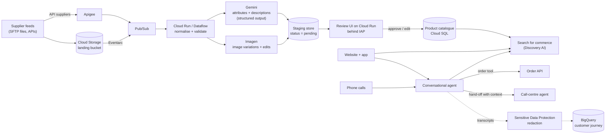

> Read the official case (linked in Sources) at least once. This lesson summarises it in our
> own words and adds the architecture thinking the exam expects.

## The company in brief

Cymbal is a fast-growing online retailer selling across several retail sub-verticals. Its
catalogue is huge, and keeping it accurate is a constant struggle. Cymbal wants three things:

1. **Catalogue enrichment.** Use gen AI to produce product attributes, descriptions and images
   from whatever suppliers send, consistently across every sales channel.
2. **Conversational commerce.** Virtual agents on the website and app that understand natural
   language and use Google's **Discovery AI** to find the right products.
3. **Stack modernisation.** Cut the cost of manual work, data transfers and error handling with
   cloud infrastructure, secure data handling, third-party integration and proactive
   monitoring.

**Existing estate, in short**

| Area | Today |
|---|---|
| Hosting | A mix of on-premises and cloud |
| Databases | MySQL, Microsoft SQL Server, Redis, MongoDB (catalogue and customer data) |
| Compute | Kubernetes clusters for containerised apps |
| Integrations | Legacy file-based: SFTP transfers and batch ETL with on-prem systems |
| Storefront | Custom web app whose catalogue search queries relational databases by name and category |
| Customer service | IVR routes calls; call-centre agents key in orders by hand when customers can't finish online |
| Monitoring | Open-source tools (Grafana, Nagios, Elastic) |

Stated pain: manual, error-prone processes; data silos that hide the customer journey; and
difficulty adopting new technology.

## Requirements mapped to Google Cloud

### Business requirements

| Requirement (paraphrased) | Services and patterns | Why |
|---|---|---|
| Automate catalogue enrichment accurately and consistently | Gemini (multimodal) with structured output constrained to Cymbal's taxonomy; batch inference for the backlog; human review before publishing | Gen AI does the drafting; schemas and reviewers keep it consistent and correct |
| Improve product discoverability | **Search for commerce** (Discovery AI for retail) fed with the catalogue and user events | Purpose-built semantic retail search and recommendations, tuned on Cymbal's own shopper behaviour, instead of SQL `LIKE` queries |
| More engaging, personalised shopping (and fewer returns) | Conversational agents on web and app that call Search for commerce and recommendations | Shoppers describe needs ("waterproof boots for a wide foot") and get relevant products, which reduces wrong purchases |
| Drive conversion | Same: better search relevance, personalisation, richer product content | Better content and discovery convert better |
| Reduce call-centre staffing cost | Conversational Agents (Dialogflow CX) on the phone channel replacing or fronting the IVR, with tools that place orders through APIs; hand-off to humans with context | Calls that end in a manually keyed order are exactly what an agent with an order tool can complete |
| Reduce data-centre hosting cost | Migrate databases to managed services (Cloud SQL, Memorystore, Firestore with MongoDB compatibility or MongoDB Atlas) and Kubernetes to GKE; retire on-prem hardware | Managed services remove hardware and much of the admin labour |

### Technical requirements

| Requirement (paraphrased) | Services and patterns | Why |
|---|---|---|
| Accurate attribute generation from titles, descriptions and images, aligned to category and catalogue structure | Gemini prompt that includes the category's attribute schema and examples; **structured output** (JSON schema or enum) so values are valid; validation step against the catalogue | Constrained output stops the model inventing attributes or formats |
| Image variations, background changes, colour changes, text overlays | **Imagen** on Agent Platform: mask-based editing, background replacement, product image editing; overlays composited in the pipeline | Managed image models; no GPU fleet to run |
| Natural-language product discovery | Search for commerce, called directly by the site and by the conversational agent | One relevance engine behind both channels |
| Scale with the catalogue and growth | Batch inference for the backlog and re-runs; event-driven online calls for new supplier items; serverless pipeline (Pub/Sub, Cloud Run, Dataflow) | Batch is cheaper and avoids online quota pressure for millions of items |
| Human-in-the-loop review UI | Generated content written to a **staging** store with status (pending, approved, rejected, edited); reviewer UI on Cloud Run behind IAP; only approved items publish to the catalogue | Nothing gen AI produces reaches customers unreviewed; edits become future examples |
| Secure, compliant handling of customer data and agent interactions | Sensitive Data Protection to redact PII and card numbers in transcripts and logs; VPC Service Controls around data stores and AI APIs; CMEK where required; least-privilege IAM; never let agents capture card numbers in free text | Conversations collect PII; payment data brings PCI DSS scope |

> [!IMPORTANT]
> Human-in-the-loop (HITL) is a **hard constraint** in this case. Any option that writes
> generated attributes, descriptions or images straight into the live catalogue fails the
> technical requirements, however accurate the model is claimed to be.

## Reference architecture

Points to notice:

- **Two entry paths for suppliers.** Files still arrive (suppliers won't all change overnight),
  but they now land in Cloud Storage and trigger an event-driven pipeline with retries and
  dead-letter topics, instead of a nightly ETL batch someone has to babysit. Suppliers that
  can call an API go through Apigee.
- **The staging store is the hinge.** Generation and publication are separate steps, with a
  human decision between them.
- **One discovery engine for every channel.** The website, the app and the conversational
  agent all query Search for commerce, so a shopper gets the same results everywhere.
- **Data silos dissolve in BigQuery.** Redacted conversation data, orders and browsing events
  land together, which gives the unified customer-journey view the case says Cymbal lacks.

## Worked example: enriching one supplier product

A supplier uploads a spreadsheet row and two photos for a jacket. The title is "MENS JKT WPF
NVY L" and the description is two lines of supplier jargon.

1. **Normalise.** The pipeline maps the row to Cymbal's category, Outerwear > Jackets, and
   loads that category's attribute schema: `colour` (enum), `size` (enum), `waterproof`
   (boolean), `material` (string), `fit` (enum).
2. **Generate.** Gemini receives the title, the description, both photos and the schema, and
   is told to return JSON matching the schema exactly. It returns `colour: navy`,
   `waterproof: true`, `fit: regular`, `material: polyester` and a 60-word customer-facing
   description.
3. **Images.** Imagen produces a clean white-background version of the main photo and
   variants in the other colours the supplier lists.
4. **Stage.** Everything is written as `pending`, with the model version and prompt template
   ID recorded.
5. **Review.** An associate sees that the photo shows a hood the model didn't capture, adds
   `hood: detachable` and approves. The edited item is published, and the correction is saved
   as an example for future prompts.

The reviewer took 30 seconds instead of writing the record from scratch, and nothing reached
the storefront unchecked. That's the balance the case asks for: less manual effort, with
accuracy kept by a person.

## Database and integration migration at a glance

| Today | Target | Tool |
|---|---|---|
| MySQL | Cloud SQL for MySQL | Database Migration Service (continuous replication, short cutover) |
| SQL Server | Cloud SQL for SQL Server | Database Migration Service |
| Redis | Memorystore for Redis | Re-point clients; caches can be warmed rather than migrated |
| MongoDB | Firestore with MongoDB compatibility, or MongoDB Atlas on Google Cloud | Native MongoDB tooling or the partner's migration tools |
| Kubernetes clusters | GKE (Autopilot where possible) | Redeploy manifests; Migration Center to assess first |
| SFTP and batch ETL | Cloud Storage landing + Eventarc + Pub/Sub + Dataflow; Apigee for API partners | Incremental, one integration at a time |
| Grafana, Nagios, Elastic | Google Cloud Observability; Managed Service for Prometheus (Grafana can keep querying it) | Consolidate alerting into alert policies with on-call routing |

## Likely exam angles and traps

| Angle | What the right answer looks like | Trap |
|---|---|---|
| Attribute accuracy | Gemini with structured output and the category schema in the prompt, then HITL | Free-text generation parsed with regex; fine-tuning before trying prompting and schemas |
| Images | Imagen editing (background, colour variants, inpainting) | Running an open-source diffusion model on self-managed GPU VMs |
| Product search | Search for commerce with catalogue and user events | Adding full-text indexes to MySQL; building a custom embeddings search when a retail product exists |
| Call-centre cost | Conversational agent with an order tool on voice and web; human hand-off | Hiring and training more agents; an IVR menu with more options |
| Scale | Batch inference for the backlog, event-driven for new items | One synchronous loop over millions of items from a single VM |
| HITL | Staging plus reviewer UI; publish only on approval | Auto-publish with a "confidence above 0.9" rule |
| Data security | Sensitive Data Protection redaction, VPC Service Controls, least privilege | Treating default encryption at rest as the whole compliance answer |
| Hosting cost | Managed databases via DMS; GKE | Lift-and-shift databases onto Compute Engine VMs and keep administering them |

> [!TIP]
> When a Cymbal question mentions "Discovery AI", "relevant products" or "natural-language
> product search", the expected family is **Search for commerce** (Discovery AI for retail).
> When it mentions "virtual agent", "conversation" or "phone", the expected family is
> **Conversational Agents** (Dialogflow CX), which then *calls* the search.

## Check yourself

1. Why does an option that writes Gemini-generated descriptions straight into the live
   catalogue fail Cymbal's requirements, even if it is accurate in testing?
2. What two techniques keep generated attributes aligned with Cymbal's catalogue structure?
3. Cymbal wants to reduce call-centre staffing cost. Which call pattern in the existing
   environment is the best target, and what does the virtual agent need in order to handle it?

Answers

1. The technical requirements demand a human-in-the-loop UI where associates approve,
   reject or edit suggestions *before* the catalogue is updated. Skipping review breaks a
   stated constraint, so accuracy claims don't rescue it.
2. Putting the category's attribute schema (and good examples) in the prompt, and using
   structured output (a JSON schema or enum) so the model can only return valid fields and
   values. A validation step against the catalogue then catches anything left over.
3. Calls the IVR transfers to agents who key in orders by hand because the customer couldn't
   finish online. The virtual agent needs a tool or webhook that can look up products (via
   Search for commerce) and place the order through Cymbal's order API, plus a hand-off to a
   human with the conversation context when it can't finish.

## Sources

- Google Cloud, *Cymbal Retail case study v6.1* (all facts about the company).
- Google Cloud docs: *Gemini models*, *structured output*, *batch inference*, *Imagen*
  (catalogue enrichment).
- Google Cloud docs: *Search for commerce*, *Conversational Agents (Dialogflow CX)*
  (discovery and conversational commerce).
- Google Cloud docs: *Sensitive Data Protection*, *VPC Service Controls*, *CMEK* (data
  security).
- Google Cloud docs: *Database Migration Service*, *Memorystore*, *Firestore with MongoDB
  compatibility*, *Migration Center*, *Pub/Sub*, *Dataflow*, *Apigee*, *Observability*,
  *Managed Service for Prometheus* (modernisation).
