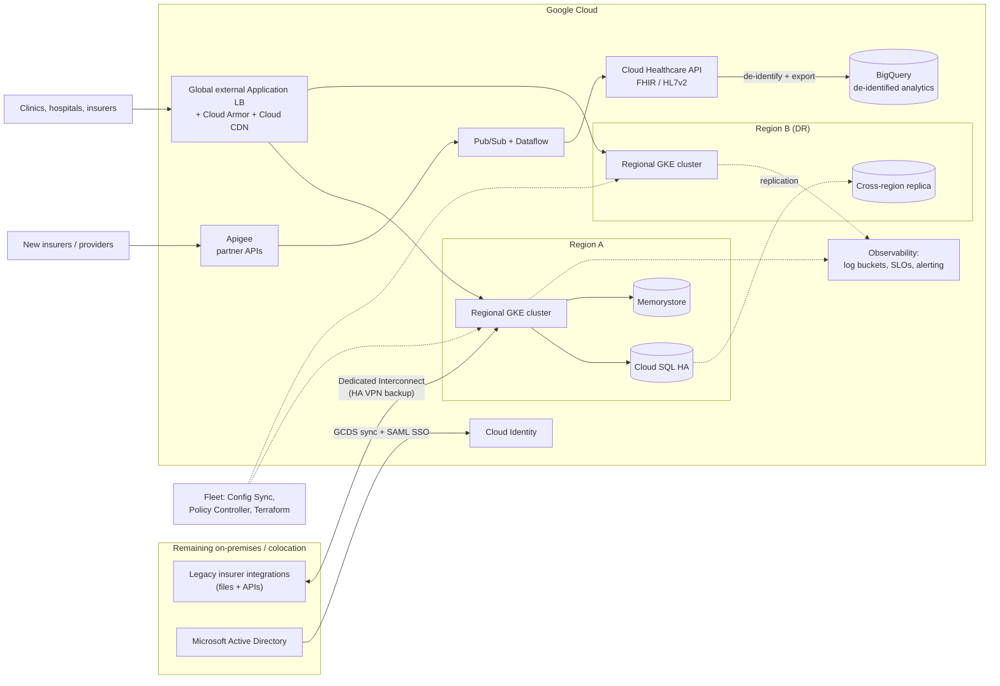

> Read the official case (linked in Sources) at least once. This lesson summarises it in our
> own words and adds the architecture thinking the exam expects.

## The company in brief

EHR Healthcare sells electronic health record software as a service to medical offices,
hospitals and insurers in several countries. The business is growing very fast. It needs to
scale, rework its disaster recovery plan and deploy software updates much more often.
Google Cloud has been chosen to **replace its colocation facilities**, and the lease on one of
those data centres is about to expire.

EHR is the classic **migration and operations** case: time pressure, a regulated industry,
legacy systems that must stay put, and an executive who blames outages on misconfiguration,
traffic spikes and inconsistent monitoring.

**Existing estate, in short**

| Area | Today |
|---|---|
| Hosting | Several colocation facilities; one lease expiring soon |
| Applications | Web-based and customer-facing; many recently containerised onto several Kubernetes clusters |
| Databases | MySQL, MS SQL Server, Redis, MongoDB (relational and NoSQL) |
| Insurer integrations | Legacy file-based and API-based, on-premises; to be replaced over several years, **no plan to move or upgrade them now** |
| Identity | Microsoft Active Directory |
| Monitoring | Assorted open-source tools; alerts by email, often ignored |

**Executive priority:** a scalable, resilient platform that spans environments consistently
and ends the outages caused by misconfiguration, capacity shortfalls and patchy monitoring.

## Requirements mapped to Google Cloud

### Business requirements

| Requirement (paraphrased) | Services and patterns | Why |
|---|---|---|
| Onboard new insurers as fast as possible | Apigee in front of EHR's APIs (developer portal, keys, quotas, analytics); standard FHIR/HL7v2 endpoints through the Cloud Healthcare API; event-driven ingestion | A self-service, standards-based interface turns onboarding into configuration, not a project |
| At least 99.9% availability for customer-facing systems | Regional GKE clusters across zones; Cloud SQL high availability; global external Application Load Balancer; multi-region design for DR | Removes single-zone failure points; the load balancer routes around failures |
| Central visibility and proactive action on performance and usage | Google Cloud Observability: dashboards, SLOs, alert policies with on-call notification channels; Managed Service for Prometheus for existing metrics | One place to look, and alerts that reach someone who acts |
| More insight into healthcare trends | Cloud Healthcare API streaming FHIR data to BigQuery; de-identified analytics datasets; Looker | Analytics on de-identified data, separated from production |
| Reduce latency for all customers | Global load balancing with Cloud CDN for static content; regional deployments close to customers | Users are served by the nearest healthy backend |
| Stay compliant | Google's Business Associate Agreement (BAA) and only covered products for health data; Assured Workloads where a control package applies; VPC Service Controls; CMEK; audit logs with retention | Contract plus controls plus evidence |
| Lower infrastructure admin cost | Managed services (GKE, Cloud SQL, Memorystore, managed MongoDB-compatible store); IaC | Fewer servers to patch; fewer hand-built environments |
| Predictions and reports on industry trends | BigQuery ML (forecasting) or Agent Platform models on the de-identified dataset | ML where the data lives, low operational load |

### Technical requirements

| Requirement (paraphrased) | Services and patterns | Why |
|---|---|---|
| Keep legacy insurer interfaces, connected to on-prem and cloud | Leave them on-premises; connect over Cloud Interconnect; expose them to cloud apps privately (and through Apigee if partners need a modern façade) | The case says they stay for years; connect them, don't move them |
| Consistent management of container-based customer apps | GKE fleets with Config Sync (GitOps) and Policy Controller | Every cluster built from Git, so configuration can't drift silently |
| Secure, high-performance on-prem ↔ Google Cloud connection | **Dedicated Interconnect** in a redundant topology (or Partner Interconnect); HA VPN as interim or backup | Private, high-bandwidth, SLA-backed |
| Consistent logging, retention, monitoring and alerting | Aggregated log sinks to central log buckets with set retention (locked where regulation requires); alerting policies; Managed Service for Prometheus | One standard for every environment |
| Maintain and manage multiple container environments | Fleet, separate projects per environment, the same pipelines and policies | Dev, test and prod look the same |
| Dynamically scale and provision environments | GKE cluster autoscaler and Horizontal Pod Autoscaler (or Autopilot); Terraform modules for new environments | Handles traffic spikes; new environments in minutes |
| Interfaces to ingest and process data from new providers | Apigee + Pub/Sub + Dataflow (or Healthcare API HL7v2/FHIR stores) | Decoupled, scalable ingestion with validation and dead-letter handling |

> [!WARNING]
> **Active Directory is a trap.** "Users are managed in AD" usually wants **federation**:
> Google Cloud Directory Sync provisions users and groups into Cloud Identity, and SAML single
> sign-on authenticates against AD FS or Entra ID, so AD stays the source of truth. **Managed
> Service for Microsoft Active Directory** is a different thing: domain controllers *in* Google
> Cloud for workloads that need to join a domain (Windows servers, SQL Server with Windows
> authentication). Pick it only when the question is about AD-dependent workloads, not about
> how staff sign in to Google Cloud.

## Reference architecture

## Worked example: the migration plan

The lease forces a sequence. A plan the exam would recognise:

1. **Foundation (weeks).** Resource hierarchy with environment folders; Cloud Identity
   federated with AD; a BAA in place and only covered services approved for health data;
   Interconnect ordered (lead time!) with HA VPN as the bridge until it's live; landing-zone
   IaC in Terraform.
2. **Assess.** Migration Center discovery of the expiring facility, so the dependency map shows
   which apps call which databases and which call the insurer systems.
3. **Move the expiring site first.** Containerised apps redeploy to regional GKE clusters
   unchanged. Databases move with Database Migration Service (MySQL and SQL Server to Cloud
   SQL with continuous replication, then a short cutover). Redis goes to Memorystore. MongoDB
   goes to a managed MongoDB-compatible service. Insurer integrations stay where they are,
   reached over the hybrid link.
4. **Stabilise operations.** Central log buckets and retention, SLOs and alert policies routed
   to on-call (no more ignored email), Config Sync so every cluster matches Git.
5. **Then optimise.** Move the remaining facilities, add the analytics platform and the Apigee
   onboarding portal, and plan the eventual replacement of the insurer integrations.

The order matters: identity, compliance contract and connectivity come **before** health data
moves. Questions that ask what to do **first** usually point at one of those.

> [!TIP]
> 99.9% allows about 43 minutes of downtime a month. A single zonal anything (cluster, VM,
> database) can't reliably promise it, because one zone incident can use the whole budget.
> Regional GKE plus Cloud SQL HA is the minimum shape; a second region is for **disaster
> recovery**, which the case also asks EHR to rework.

## Likely exam angles and traps

| Angle | What the right answer looks like | Trap |
|---|---|---|
| Lease deadline | Rehost containers on GKE, databases via DMS; refactor later | Rewrite everything as serverless first |
| Legacy insurer systems | Leave on-prem, connect via Interconnect | Migrate or rebuild them now |
| Hybrid link | Redundant Dedicated Interconnect; HA VPN backup | Public internet with TLS only; one VPN tunnel |
| Identity | GCDS + SAML SSO to AD | Managed Microsoft AD for console sign-in; creating users by hand in Cloud Identity |
| Availability | Regional GKE, Cloud SQL HA, global load balancer | Bigger single VM; Spot nodes for customer-facing tiers |
| Compliance | BAA first, covered products, de-identification for analytics, VPC Service Controls, audit logs | Assuming encryption at rest alone makes it compliant |
| Logging | Aggregated sinks to central buckets with retention (locked if required) | Per-project defaults; exporting logs to an analyst's bucket |
| Alerts ignored | SLO and symptom-based alert policies to on-call tools; fewer, actionable alerts | More email recipients |
| Misconfiguration outages | GitOps with Config Sync, Policy Controller, Terraform | Runbooks telling engineers to "double-check" changes |
| Insurer onboarding | Apigee portal and standard APIs (FHIR) | Building a bespoke SFTP drop for every new insurer |

## Check yourself

1. EHR's staff sign in with Active Directory accounts. What is the recommended way to let them
   use Google Cloud, and when would Managed Service for Microsoft AD be the right answer
   instead?
2. Name two design choices that together give EHR's customer-facing tier a realistic path to
   99.9% availability.
3. Before any patient data is moved into Google Cloud, what contractual step must EHR take,
   and what does it **not** do on its own?

Answers

1. Federate. Use Google Cloud Directory Sync to provision users and groups from AD into Cloud
   Identity, and SAML SSO against AD FS or Entra ID for authentication, so AD remains the
   source of truth. Managed Microsoft AD is right when workloads running in Google Cloud need
   real domain controllers (domain-joined Windows VMs, Windows-authenticated SQL Server).
2. Regional GKE clusters (control plane and nodes spread across zones) and Cloud SQL in a
   high-availability configuration with automatic failover, behind a global external
   Application Load Balancer.
3. Accept Google's Business Associate Agreement and use only the products it covers for
   health data. The BAA doesn't configure anything for you. Under shared responsibility EHR
   must still apply access control, encryption choices, logging, retention and
   de-identification correctly.

## Sources

- Google Cloud, *EHR Healthcare case study v6.1* (all facts about the company).
- Google Cloud docs: *Cloud Interconnect*, *Cloud VPN* (hybrid connectivity).
- Google Cloud docs: *GKE regional clusters*, *Cloud SQL high availability*, *Cloud Armor*
  (availability and protection).
- Google Cloud docs: *Fleet management*, *Config Sync* (consistent environments).
- Google Cloud docs: *HIPAA on Google Cloud*, *Cloud Healthcare API*, *Sensitive Data
  Protection*, *VPC Service Controls* (compliance and analytics).
- Google Cloud docs: *Federating with Active Directory*, *Managed Microsoft AD* (identity).
- Google Cloud docs: *Observability*, *Logging routing and storage*, *Migration Center*,
  *Database Migration Service*, *Memorystore*, *Firestore with MongoDB compatibility*,
  *Apigee*, *BigQuery ML*.
