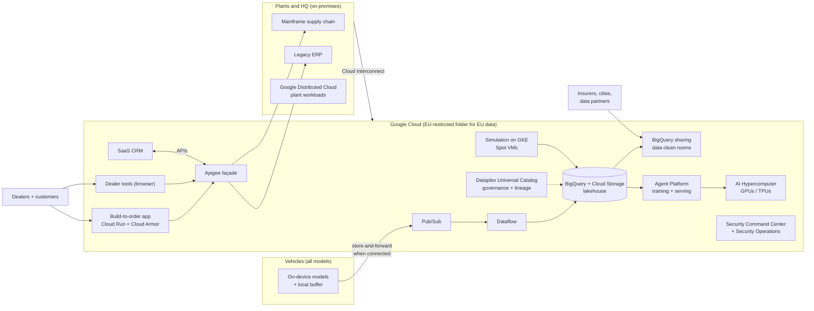

> Read the official case (linked in Sources) at least once. This lesson summarises it in our
> own words and adds the architecture thinking the exam expects.

## The company in brief

KnightMotives builds autonomous vehicles in three powertrains: battery-electric (BEV), hybrid
and internal combustion (ICE). Its BEVs have a modern in-car experience; the hybrid and ICE
models don't, critics and drivers have noticed, and sales and satisfaction are falling. The
company wants to:

- deliver a **consistent, AI-powered experience across every model within five years**;
- turn itself from a car maker into an "automotive experience" company;
- fix an **unreliable online build-to-order system** that is straining relations with dealers;
- give dealers, salespeople and service technicians better tools;
- **monetise its data** to fund the new technology;
- invest heavily in fully autonomous driving, starting where regulation is favourable.

KnightMotives is the broadest and most **strategic** of the four cases. Expect more
business-process questions here (upskilling, buy versus build, stakeholder communication) as
well as security, EU compliance and data-platform design.

**Existing estate, in short**

| Area | Today |
|---|---|
| Hosting | Mostly on-premises, with some apps on major public clouds |
| Supply chain | An outdated mainframe |
| ERP | Outdated, which makes new promotions and dealer discounts hard to launch |
| Vehicle software | Several code bases across vehicle lines; heavy technical debt from backwards compatibility |
| AI infrastructure | Obsolete; corporate data siloed |
| Networks | Poor connectivity to manufacturing plants; weak vehicle connectivity in rural areas |
| Dealers | No budget for new equipment |
| Security | Past data breaches |

**Executive priority:** safety, using a large body of driving, road, behavioural and crash
data to build digital experiences, consistently across all models.

## Requirements mapped to Google Cloud

### Business requirements

| Requirement (paraphrased) | Services and patterns | Why |
|---|---|---|
| Personalised driver relationship; cohesive experience across models | One connected-vehicle platform: telemetry through Pub/Sub into BigQuery; shared AI services (Gemini) behind APIs; a common in-car software layer | One platform, one data model, one set of AI features across all lines |
| Better build-to-order, less time on the lot, transparency | Reliable web configurator on Cloud Run or GKE behind a global load balancer and Cloud Armor; Apigee APIs over ERP and inventory; dealer-facing order status | Fix reliability at the front, and expose legacy data through managed APIs |
| Monetise corporate data | BigQuery as the analytics store; **BigQuery sharing (formerly Analytics Hub)** listings and data clean rooms; Dataplex Universal Catalog for governance | Partners query governed, aggregated data in place, without copies leaving KnightMotives' control |
| Replace obsolete AI infrastructure; break data silos | Agent Platform for training and serving; AI Hypercomputer GPUs and TPUs; Dataplex across BigQuery and Cloud Storage | Managed ML platform on a governed lakehouse |
| Security is paramount after breaches | Security Command Center for posture and threat detection; Google Security Operations (SIEM and SOAR) for cloud and on-prem logs; least privilege; VPC Service Controls | Detect, investigate and respond across the hybrid estate |
| EU data protection, especially for autonomous platforms | Resource-location organisation policy limited to EU regions for EU data; Assured Workloads EU data-boundary controls; CMEK or external key management; Sensitive Data Protection for pseudonymisation | Residency, key control and minimisation, enforced by policy rather than habit |
| Autonomous-driving investment, starting in favourable regions | Simulation and training platform in Google Cloud; region choice per regulation | Scale compute on demand; place data and services where rules allow |
| Upskilling, talent, business–technical communication | Structured training and certification plan; a cloud centre of excellence; shared KPIs and regular joint reviews | Business-process objectives (§4.2) are graded too |

### Technical requirements

| Requirement (paraphrased) | Services and patterns | Why |
|---|---|---|
| Consistent in-vehicle UX with AI across models; update legacy hardware and software | Common software platform with over-the-air updates; on-device models for latency-critical features; cloud Gemini for richer features when connected | Same experience regardless of model; graceful when offline |
| Reliable connectivity in rural areas for real-time AI | Edge-first design: on-device inference, local buffering, store-and-forward telemetry to Pub/Sub when a link is available | You can't buy coverage for every rural road; design for intermittent links |
| Network upgrades between plants and HQ | Cloud Interconnect (Dedicated or Partner) at HQ and major plants; HA VPN for smaller sites; Network Connectivity Center as a hub | Predictable, high-bandwidth, SLA-backed links |
| Hybrid cloud; modernise or replace legacy gradually | Migration Center assessment; Google Distributed Cloud at plants for local, low-latency workloads; Apigee façade over mainframe and ERP; strangler-fig replacement | Incremental, reversible modernisation rather than a risky big bang |
| Autonomous development: cutting-edge AI, simulation, regulatory compliance | AI Hypercomputer (GPUs and TPUs) for training; large simulation fleets on GKE with **Spot VMs** and checkpointing; Cloud Storage for sensor data; lineage and versioning for audit | Elastic capacity at the lowest price for fault-tolerant work; traceability for regulators |
| Data monetisation: robust data platform, strict privacy, scalable AI/ML | BigQuery + Cloud Storage lakehouse, Dataplex governance, BigQuery sharing and clean rooms, de-identification | Revenue from data without leaking personal data |
| Comprehensive security framework, incident response plan, awareness training | Security foundations blueprint (org policies, least privilege, VPC Service Controls); Security Command Center; Google Security Operations playbooks; a tested IR plan (with an IR retainer if needed); staff training | Technology, process and people, all three named in the case |
| Delightful dealer and customer experience: build-to-order, dealer tools, CRM | Browser-based dealer tools on Cloud Run (no new dealer hardware); Apigee over inventory and ERP; adopt a SaaS CRM integrated through APIs | Dealers have no budget; CRM is a buy, not a build |

> [!IMPORTANT]
> **"Dealers have no budget for new equipment"** is a hard constraint hiding in the existing
> environment section. Any dealer solution that needs servers, appliances or new hardware at
> the dealership fails. Browser-based, cloud-hosted tools pass.

## Reference architecture

## Worked example: monetising driving data under EU rules

KnightMotives wants to sell road-condition insights to municipal authorities in Germany and
France. The data comes from EU drivers' vehicles.

| Constraint | Design decision |
|---|---|
| EU personal data must stay under EU rules | Store in an EU-restricted folder: resource-locations organisation policy limited to EU regions, inside an Assured Workloads EU data-boundary environment |
| Buyers must not identify drivers | Aggregate to road segments and time windows; pseudonymise vehicle IDs with Sensitive Data Protection; share through a **data clean room** whose analysis rules only release aggregates above a minimum threshold |
| KnightMotives keeps control of the data | Buyers subscribe to a BigQuery sharing listing and query in place; no exports; revoke at any time |
| Breach risk | VPC Service Controls perimeter around the datasets; CMEK keys held by KnightMotives; access logged and reviewed |
| Revenue tracking | Listing usage metrics feed the business case for further investment |

The wrong instinct is to "export the data to the customer's bucket each night". It copies
personal data out of KnightMotives' control, and may move it out of the EU. That breaks both
the security and the regulatory requirement.

## Business-process questions (section 4.2) in this case

KnightMotives is where the exam most often tests the non-technical objectives.

| Situation in the case | What a good architect recommends |
|---|---|
| Engineers skilled only in on-prem and mainframe | A skills assessment, then a structured training and certification plan, pairing with experienced cloud engineers on a first low-risk workload |
| Poor communication between business and technical teams | Shared success measures (KPIs such as dealer lead time and order reliability), a cloud centre of excellence with business members, regular joint reviews |
| CRM needed | Buy (SaaS) and integrate; don't build a commodity system |
| Old ERP blocks promotions | Wrap it with APIs now; replace it in phases once the façade decouples consumers |
| Financial priorities must shift globally | A business case with TCO and ROI, phased by value, funded partly by data monetisation |

> [!TIP]
> The exam guide's **workload disposition** idea (build, buy, modify or deprecate) shows up
> here. Commodity capabilities (CRM, HR, email) are **buy**. Differentiators (the in-car
> experience, autonomous driving) are **build**. Legacy systems you can't replace yet are
> **modify** (wrap with APIs) until a planned **deprecation**.

## Likely exam angles and traps

| Angle | What the right answer looks like | Trap |
|---|---|---|
| EU data protection | Resource-locations constraint plus Assured Workloads EU controls, CMEK, pseudonymisation | A US multi-region bucket "with encryption"; relying on IAM alone for residency |
| Data monetisation | BigQuery sharing listings and clean rooms with aggregation rules | Nightly exports of raw data to buyers |
| Siloed data | Dataplex governance over a BigQuery and Cloud Storage lakehouse | Another copy of everything in a new warehouse with no catalogue |
| Autonomous training and simulation | GPUs or TPUs via AI Hypercomputer; simulation on Spot VMs with checkpoints | Cloud Run functions for multi-day training; on-demand VMs for fault-tolerant batch |
| Rural connectivity | On-device inference, buffering, store-and-forward | Assuming always-on 5G; cloud-only inference for safety features |
| Mainframe and ERP | Assess with Migration Center; Apigee façade; phased replacement | Big-bang rewrite; leaving them unreachable from new apps |
| Security after breaches | Security Command Center plus Security Operations, IR plan, training | Buying one tool and calling it a framework; skipping the human side |
| Dealer tools | Browser-based SaaS-style tools; Apigee APIs | On-site servers at each dealership |
| CRM | Buy and integrate | Build a custom CRM on GKE |
| Plant connectivity | Interconnect for large sites, HA VPN for small ones, hub-and-spoke | Public internet only |

## Check yourself

1. KnightMotives wants to sell aggregated road-condition data to cities without copying
   driver data out of its control. Which Google Cloud capability fits, and which feature
   protects individual drivers?
2. Why are Spot VMs a good fit for autonomous-driving simulation but a poor fit for the
   build-to-order website?
3. A proposal puts a small server in every dealership to run the new dealer tools offline.
   Which line of the case does it break, and what should replace it?

Answers

1. BigQuery sharing (formerly Analytics Hub), with the cities subscribing to a listing and
   querying in place. A data clean room with analysis rules (for example, minimum aggregation
   thresholds), plus pseudonymisation of vehicle identifiers, protects individuals.
2. Simulation jobs are fault-tolerant batch work. With checkpointing, a preempted job simply
   resumes, so the big Spot discount is pure saving. The build-to-order site is
   customer-facing and must be reliable. Preemption would cause the very unreliability the
   case complains about.
3. "Dealers have no budget for new equipment." Replace it with browser-based tools hosted in
   Google Cloud (for example on Cloud Run) that reach inventory and ERP data through Apigee
   APIs.

## Sources

- Google Cloud, *KnightMotives Automotive case study v6.1* (all facts about the company).
- Google Cloud docs: *Hybrid and multicloud patterns*, *Cloud Interconnect*, *Google
  Distributed Cloud*, *Migration Center*, *Apigee* (hybrid and legacy modernisation).
- Google Cloud docs: *Dataplex Universal Catalog*, *BigQuery sharing*, *Pub/Sub*, *Dataflow*
  (data platform and monetisation).
- Google Cloud docs: *Assured Workloads*, *resource locations constraint*, *CMEK*,
  *VPC Service Controls*, *Sensitive Data Protection* (EU data protection).
- Google Cloud docs: *Security Command Center*, *Google Security Operations*, *Cloud Armor*
  (security and incident response).
- Google Cloud docs: *AI Hypercomputer*, *Spot VMs*, *Gemini models* (AI and simulation).
- Google Cloud, *Well-Architected Framework* and *exam guide* (workload disposition and
  business-process objectives).
