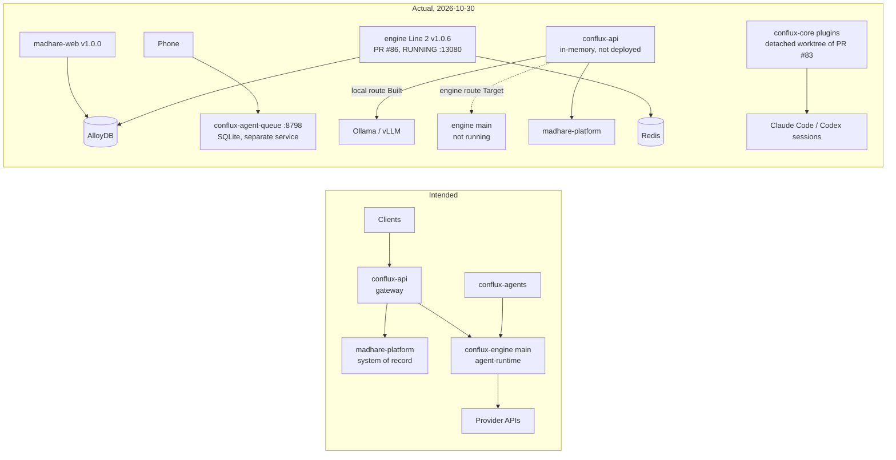

**Conflux** is the Mad Hare product: a system for running agent work (model turns, tools,
workflows) for any project or company. Mad Hare's own operations run on it too, so the same
pieces show up as both product and internal tooling. Before you change anything, you need
two pictures: the shape it is **designed** to have, and the shape it **actually** has. This
lesson draws both. Every status here is as of **2026-10-30**.

## The design in one sentence

Every client talks to **one public gateway** (`conflux-api`). The gateway reads and writes
the **system of record** (`madhare-platform`) and sends model work to the **engine**
(`conflux-engine`), which is the only place a provider SDK (Anthropic, Gemini, OpenAI) may be
called. The agents the engine runs are defined in **`conflux-agents`**.

Two rules hold that together, and both are written down:

1. **"Clients call only this API."** They never call madhare-platform's roughly 176 paths or
   the engine directly (conflux-api
   [`docs/architecture.md` line 30](https://github.com/madharedev/conflux-api/blob/44a3f09cecf20b4b8eb18415028d28c7b4a24d8e/docs/architecture.md)).
   The README calls it "the one public Conflux product endpoint" for iOS, Android, the
   home tablet hub, desktop clients and the CLI
   ([`README.md` line 3](https://github.com/madharedev/conflux-api/blob/44a3f09cecf20b4b8eb18415028d28c7b4a24d8e/README.md)).
2. **One prompt path.** In the engine's agent-runtime, `callModel` in `src/prompt-path.ts`
   is the only function that sends a prompt, and `npm run check:prompt-path` fails the build
   if any other file imports a vendor SDK
   ([agent-runtime README line 51](https://github.com/madharedev/conflux-engine/blob/13801f53295b082a26d8f9cd7cc425788d27535e/apps/agent-runtime/README.md)).
   Providers are called with API keys only. Start-up refuses OAuth and Vertex environment
   variables (line 54).

Why it matters: if every client goes through one gateway and every model call goes through
one function, you get one place to authenticate, one place to meter spend, and one place to
trace. Lose either rule and you get the duplication you will see in lesson 3.

## The tiers and what each one owns

| Tier | Repo | Owns (as designed) | Status, 2026-10-30 |
|---|---|---|---|
| Clients | `madhare-web`, Android/phone gateway, desktop, CLI | UI only. They call the gateway. | `madhare-web` v1.0.0 is **Built** (tagged). It reads AlloyDB directly for site copy. The others are **Target**. |
| Gateway | `conflux-api` | Sessions, routing, the public OpenAPI 3.1 surface (28 paths) | **Partial**: sessions are in memory, the local route is Built, the engine route is Target, and there is no CLI and no image ([README "Not built yet"](https://github.com/madharedev/conflux-api/blob/44a3f09cecf20b4b8eb18415028d28c7b4a24d8e/README.md)) |
| System of record | `madhare-platform` (`apps/mh-api`) | Identity, agents and memory, board, docs, traces | **Built**: the largest codebase, tagged v0.1.0 on 2026-10-15 ([tree](https://github.com/madharedev/madhare-platform/tree/f96f3148ea5816470cf5b4ea2eb1cde03f3e8c29/apps/mh-api/src)) |
| Engine | `conflux-engine` | Resource adapters (`apps/api`), model turns (`apps/agent-runtime`), the twin harness, the guard | **Partial**: main is a local API plus a turn service tested on a stub provider. The line that runs is an unmerged branch (below). |
| Agents | `conflux-agents` | Agent, role, skill, tool and profile definitions | **Partial**: Pemberton is merged; the role agents are on open [PR #83](https://github.com/madharedev/conflux-agents/pull/83) |
| Data | AlloyDB/Omni, Qdrant, Redis | Durable state, vectors, queues | Qdrant is used only by `madhare-platform`. Main's engine has **no** database client: its AlloyDB resource reads management metadata only ([`docs/resources/alloy.md` line 3](https://github.com/madharedev/conflux-engine/blob/13801f53295b082a26d8f9cd7cc425788d27535e/docs/resources/alloy.md)). |
| Models | Ollama/vLLM (local), provider APIs | Inference | The local route ran against Ollama `qwen3:0.6b` on 2026-10-23 (**Built**). The engine route to providers is **Target**. |

### The engine has two lines

This is the most important fact in the module. **conflux-engine has two unrelated codebases**
that split on 2026-10-15 (merge-base `554dd6c`, "Add proprietary LICENSE"):

- **Line 1, `main`** (`13801f5`, package `@madhare/conflux-engine` 1.1.1). It has a NestJS
  API on `127.0.0.1:8792` with 8 resource adapters (GCS, PostgreSQL, AlloyDB metadata, Gmail,
  GCE, Pub/Sub, Grafana, the docs registry). Its auth fails closed with a 503. It also has
  `apps/agent-runtime` (`POST /internal/v1/turns`, NDJSON), the twin harness and the guard.
- **Line 2, `feat/engine-consolidated`** (`5f6b308`, package `@conflux/engine` 1.0.6, open
  draft [PR #86](https://github.com/madharedev/conflux-engine/pull/86)). It has seven apps
  and extra API modules: dashboard, dispatcher, installer, jbc, mobile, portal, support,
  tenants, an access gate, a BullMQ flow dispatcher and a PostgreSQL/AlloyDB store.

The release issue [conflux-engine#87](https://github.com/madharedev/conflux-engine/issues/87)
says Line 2 is "the live line… serving madhare.ai" and that it "conflicts with main in about
160 paths". **Line 2 is the one that runs on the dev machine.** You will prove that in the
lab (lesson 2).

## Intended versus actual

Read the right-hand side carefully:

- **No client goes through the gateway today.** The website reads AlloyDB itself. The phone
  talks to a separate queue service (`conflux-agent-queue`, port 8798). conflux-api is
  not deployed anywhere: it has no image.
- **The engine that main describes is not running.** What runs is Line 2, from an unmerged
  branch.
- **The agents that sessions use are not from conflux-agents main.** They load from a
  detached worktree of an open PR (lesson 3).
- **The platform is real.** madhare-platform is the most complete tier, and it is the one
  the design leans on hardest.

> [!WARNING]
> **Finding: the gateway rule is not in force.** The design depends on "clients call only
> conflux-api", but no client does. The website, the phone and agent sessions each reach
> their back end another way. **Severity: high.** **Fix:** decide which clients go through
> the gateway in v1.0.0 (#87). Build the engine route and persistent sessions, then move one
> client (the phone is the simplest) onto it and retire its private path.

## Where the docs disagree about the turn service

Before you rely on a README, check whether another README contradicts it. For the engine's
turn service, four documents give three different answers:

| Document | Says |
|---|---|
| engine [`README.md` lines 10, 68](https://github.com/madharedev/conflux-engine/blob/13801f53295b082a26d8f9cd7cc425788d27535e/README.md) | `apps/agent-runtime` is a "process shell only" |
| [`apps/agent-runtime/README.md` line 5](https://github.com/madharedev/conflux-engine/blob/13801f53295b082a26d8f9cd7cc425788d27535e/apps/agent-runtime/README.md) | **Built**, with tests on the STUB provider. "No real provider call has been made from this service yet." |
| conflux-api README, "Not built yet" | "The engine's turn endpoint" |
| conflux-api `docs/architecture.md` line 57 | Engine endpoint **Target** |

The honest reading is that the code exists and passes stub tests, but no real turn has gone
through it, and nothing calls it. That is **Partial**. The general rule is to trust the
status that cites a run, and to treat a "Built" with no recorded run as Partial.

> [!TIP]
> When you read any Mad Hare architecture page, look for the status words next to each box.
> The documentation standard (the mh-documentation skill) says every element is marked
> **Built** (linked to code and evidence) or **Target** (linked to an issue). If a box has
> no mark, or a mark with no link, treat it as unverified.

## What "Built" means here

The course uses one status vocabulary, and the lessons hold to it:

- **Built**: on `main` and running, with evidence of a run.
- **Partial**: some of it is real (code, tests, or a run), but it is not on main, not
  running, or not joined up.
- **Target**: designed and planned, with an issue link.
- **Abandoned**: archived or a placeholder no one is building.

Under that vocabulary, the honest status of the whole design is **Partial**. The pieces
exist, the joins mostly do not. The largest single risk is the engine: the code that runs is
not the code on main, and the two lines cannot be merged without resolving about 160
conflicting paths.

## Why the design is still the right map

It is tempting to conclude the design is fiction. It is not. It is the target the release
issues are steering toward. Engine v1.0.0 (#87) exists to collapse the two lines into
"one engine line that runs agent workflows on any platform". The conflux-api epic #70 is
the one place where the whole method (release → epic → feature → code/test/docs tasks) ran
cleanly (Module 5). When you pick up work, place it on the intended map first, then note
which actual component it touches. If those two differ, say so in the issue.

## Check yourself

1. A new mobile feature needs to fetch a user's agents. Under the design, which service does
   the app call, and which service holds the data?
2. Why does the design insist that provider SDKs run only in the engine's agent-runtime?
3. The agent-runtime README says "Built". Why does this course mark the turn service
   Partial?

Answers

1. The app calls **conflux-api** only. The gateway reads the agent records from
   **madhare-platform**, the system of record. The app never calls the platform's own paths
   or the engine directly ("Clients call only this API", `docs/architecture.md` line 30).
   Today the phone actually uses the separate `conflux-agent-queue` service, which is a
   finding.
2. One prompt path gives one place to enforce budget refusals, API-key-only providers and
   tracing. `check:prompt-path` fails the build if any other file imports a vendor SDK. If
   SDKs are called from several services, spend and traces scatter, and the rules can be
   bypassed.
3. Its own README admits "No real provider call has been made", and nothing calls it: the
   conflux-api engine route is Target and the engine's main README calls it a process shell.
   Code plus stub tests, with no real run and no consumer, is Partial.

