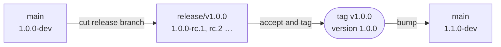

A version number is how anyone (Andrew, a client, an agent picking up a task) answers "what is
this, exactly?". Mad Hare's process gives each repo one version source of truth and a strict
pre-release scheme. On 2026-10-30, Conflux answers that question four different ways. This
lesson teaches the policy first, then the reality, then how to close the gap.

## The policy

From the global process
([Mad Hare Operations, "Releases" and "Versions"](https://github.com/madharedev/madhare-support/blob/865da77acbc2b7eba46ed22d2ba722ff5a39b7a2/agents/AGENTS.md)):

- **All work is a release, and releases are semver.** Patch for fast delivery (bug fixes,
  incidents, workflow, templates, the process file itself, and configuration changes, even
  with no deployment). Minor for new agents, skills and tools in Conflux, or single endpoints
  and small components elsewhere. Major for new process across repos, multiple endpoints, or
  redesigns.
- **Each repo has one version source of truth** (for the Node repos, `package.json`).
- **`main` carries `X.Y.Z-dev`.** The release branch `release/vX.Y.Z` carries
  `X.Y.Z-rc.N`. The tag `vX.Y.Z` is created at release.
- **Published tags are never rewritten.** The superseded pre-reset tags (conflux-engine
  `v1.1.0` and `v0.9.95`) stay, and their GitHub releases are marked "pre-reset, superseded".

The pre-release suffixes come straight from [Semantic Versioning 2.0.0](https://semver.org/spec/v2.0.0.html):
`1.0.0-dev` and `1.0.0-rc.1` both sort **below** `1.0.0`. That is the point. Anything built
from main or a release branch announces itself as not-yet-released, and only the tagged commit
says plain `1.0.0`.



## The reality: four identities at once

Run these against the conflux-engine clone (read-only) and you get four answers:

```bash
cd /srv/conflux/projects/madhare/repos/conflux-engine
for b in main feat/engine-consolidated chore/version-reset-20261027-main chore/version-1.0.0-dev; do
  echo "$b $(git show origin/$b:package.json | jq -r .version)"
done
/usr/bin/conflux version | jq -r .productVersion
```

```text
main 1.1.1
feat/engine-consolidated 1.0.6
chore/version-reset-20261027-main 0.1.0-dev.0
chore/version-1.0.0-dev 1.0.0-dev
0.1.0-dev.0
```

| Identity | Where it lives | Status |
|---|---|---|
| **1.1.1** | `main` `package.json` (`@madhare/conflux-engine`) | What main says. Not running. Out of policy (main should be `-dev`). |
| **1.0.6** | Line 2, `@conflux/engine` ([package.json at 5f6b308](https://github.com/madharedev/conflux-engine/blob/5f6b308ddd69f31f9d53caf22a59a783be622d01/package.json)) | What **runs** on :13080. Lower than main's number although it is newer. |
| **0.1.0-dev.0** | the 10-27 reset branch, and the installed `/usr/bin/conflux` (.deb `conflux-runtime 0.1.0~dev.0`) | What is packaged and installed. Unmerged. |
| **1.0.0-dev** | `chore/version-1.0.0-dev` (draft [PR #88](https://github.com/madharedev/conflux-engine/pull/88)) | The **agreed** target. Unmerged. |

Note that the Debian package spells the version `0.1.0~dev.0`. Debian uses `~` to sort a
pre-release below the release, the same job semver's `-` does. It is the same number.

### Two namespaces: product and component

The GitHub releases make it worse, because they use **two** version namespaces:

```bash
gh release list -R madharedev/conflux-engine
```

```text
Conflux 0.9.95 — Engine 1.1.1                       Latest  v0.9.95  2026-10-24
Conflux 0.1.0 — three-tier monorepo architecture    Draft   untagged-…  2026-10-23
Conflux Engine 1.1.0 — local API foundation                 v1.1.0   2026-10-23
```

`v0.9.95` is a **product** version (Conflux) whose engine **component** is 1.1.1. `v1.1.0`
is a **component** version (the engine alone). Both are tags on the same repo, so the tag
list reads `v1.1.0` then `v0.9.95` and looks like it went backwards. The installed .deb
carries both fields, too: `productVersion` and `componentVersion`, both `0.1.0-dev.0`.

The process has a single namespace: one version per repo. Release v1.0.0 makes that
explicit: "Version: `1.0.0`, major: a new engine line on main"
([#87, "Version and baseline"](https://github.com/madharedev/conflux-engine/issues/87)).

## How the reset unfolded

| Date | Event | Evidence |
|---|---|---|
| 2026-10-15 | Engine lines split at `554dd6c` ("Add proprietary LICENSE") | `git merge-base origin/main origin/feat/engine-consolidated` |
| 2026-10-19 | `snapshot/reset-20261019/*` tag set preserves the pre-reset `andrew/review` lines | `git tag -l 'snapshot/*'` |
| 2026-10-23 | `v1.1.0`, "Conflux Engine 1.1.0 — local API foundation" (component namespace) | `gh release list` |
| 2026-10-24 | `v0.9.95`, "Conflux 0.9.95 — Engine 1.1.1" (product namespace), marked Latest; main's HEAD `13801f5` is "Release Conflux 0.9.95 (Engine 1.1.1)" | `gh release list`, `git log -1 origin/main` |
| 2026-10-27 | Identity reset to `0.1.0-dev.0` ("reset current product identity"). This is what got packaged and installed. madhare-support also reset to `0.1.0-dev.0` (commit `18fe06c`). | branch `chore/version-reset-20261027-main` |
| 2026-10-29 | Decision: main `1.0.0-dev`, `release/v1.0.0` → `1.0.0-rc.N`, tag `v1.0.0`; pre-reset tags stay | #87 line 18, line 112 |
| 2026-10-29 | About 12 "chore: set version 1.0.0-dev" PRs opened across repos; several closed unmerged (madhare-web#38, code-a-zone#23, madhare-gcp#12, madhare-support#70, madhare-infra-local#168) | `gh pr list -R madharedev/<repo> --state closed --search "1.0.0-dev"` |
| 2026-10-30 | Neither engine version branch is merged. main still says 1.1.1, `v0.9.95` is still Latest, and neither pre-reset release is marked superseded. | `gh release list` |

The reset was a reasonable response to two lines and two namespaces. The problem is that it
happened **three times in ten days** (snapshot, 0.1.0-dev.0, 1.0.0-dev), and each step left
something behind: a tag, an installed package, an open PR.

> [!WARNING]
> **Finding: version chaos.** Four live identities (1.1.1, 1.0.6, 0.1.0-dev.0, 1.0.0-dev), two
> namespaces (product 0.9.95 versus engine 1.1.1), `main` not at `-dev` in conflux-engine
> (1.1.1) or conflux-api (1.0.0), and pre-reset releases not marked
> "pre-reset, superseded", with `v0.9.95` still **Latest**. **Severity: high.** Anyone asking
> "what version is running?" gets a wrong or ambiguous answer. **Fix:** merge #88 so main is
> `1.0.0-dev`; edit the `v1.1.0` and `v0.9.95` releases to "pre-reset, superseded" and clear
> Latest; make every binary's `version` output report the one repo version plus its
> `sourceRevision`; and rebuild the .deb from main after #88 so the installed package agrees.

### Other repos

| Repo | `main` version | In policy? |
|---|---|---|
| conflux-engine | 1.1.1 | No |
| conflux-api | 1.0.0 | No (should be `1.0.0-dev` or later `-dev`) |
| madhare-web | `1.0.1-dev`, after tag `v1.0.0` | **Yes.** Tagged at release, then main moved to the next `-dev`. (The morning audit recorded 1.0.0; the re-check while writing this lesson found `1.0.1-dev`.) |
| madhare-platform | 0.1.0, tag "Release v0.1.0 (platform)" | Main should be `-dev` |
| madhare-api | 0.0.1 | Starter default |
| conflux-agents | no version file | No source of truth at all |

`madhare-web` v1.0.0 is the one clean example to copy: a release branch, a tag, a GitHub
release. Start there when you cut your first release.

## Release issues: where a release actually starts

Versions are only half of it. A release also has an **issue** (type Release) in
`madhare-support`, then one per participating repo, and its own GitHub Project. The engine's
release issue is [#87](https://github.com/madharedev/conflux-engine/issues/87). Read its
"Version and baseline" section before touching versions in that repo: it records the
decision, the draft PR and the 160-path conflict in one place. Module 5 covers the release
issue structure and how consistently it is followed (hub release issues v1.1.0 and v1.2.0,
for example, were created on 10-29 and closed "completed" on 10-30 without being delivered).

> [!TIP]
> Before you report a version anywhere (a PR's "Version bump" section, a status update, a
> bug), run the binary's own `version` command and quote `version` **and**
> `sourceRevision`. A number alone is ambiguous in this codebase today. A number plus a SHA
> is not.

## Check yourself

1. You are about to cut the engine's first release candidate. What version goes in
   `package.json` on `release/v1.0.0`, and what does `main` carry?
2. Why is it misleading that `v0.9.95` is the "Latest" release while `v1.1.0` exists?
3. The running engine reports 1.0.6 and main says 1.1.1. Which is newer, and why does the
   number not tell you?

<details>
<summary>Answers</summary>

1. `release/v1.0.0` carries `1.0.0-rc.1` (then rc.2 and so on). `main` carries `1.0.0-dev`
   until the release, then the next `-dev`. The tag `v1.0.0` is created at release. This was
   decided on 2026-10-29 in #87.
2. They are in different namespaces: `v0.9.95` is the Conflux *product* version (engine
   component 1.1.1), and `v1.1.0` is the engine *component* version. Both are pre-reset and
   should be marked "pre-reset, superseded", and neither should be Latest, because the agreed
   line is 1.0.0.
3. 1.0.6 (Line 2, built 2026-10-29) is the newer code. The numbers come from two different
   packages (`@conflux/engine` vs `@madhare/conflux-engine`) on lines that split on
   2026-10-15, so they are not comparable. Only the commit and its date tell you.

</details>
