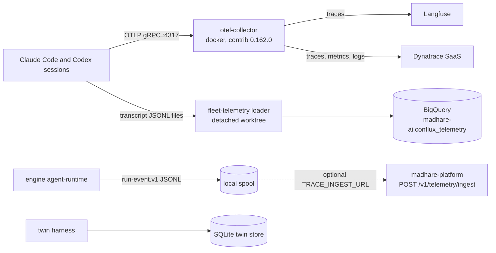

Tracing answers "what did this agent run do, what did it cost, and what did it touch?".
Audit answers "did the work follow the process?". Mad Hare needs both for its own fleet
and, as a product, for every client that runs Conflux. As of 2026-10-30 there are **four**
trace mechanisms, none joined to the others, and audits are files plus hand-run scripts.

## The contract: what a trace is meant to be

The house standard is the `mh-trace-telemetry` skill (in the `mh-ai` marketplace,
`/srv/conflux/claude/plugins/marketplaces/mh-ai/skills/mh-trace-telemetry/SKILL.md`). It defines:

- an event union (`run`, `step`, `model_call`, `tool_call`, …) carrying OpenTelemetry span
  ids, a per-run sequence number and a **version vector** (agent definition, skill version,
  prompt template hash, model and provider);
- **"Payloads are hashes."** Prompts, context, tool I/O and responses are stored as sha256,
  not as text. No client text goes into traces;
- **fail-closed trace stores**: if a trace cannot be written, a `trace_missing` record is
  written instead, so a gap is visible rather than silent.

The engine's agent-runtime follows the same rule in its own words: "Message content is never
traced"
([agent-runtime README line 53](https://github.com/madharedev/conflux-engine/blob/13801f53295b082a26d8f9cd7cc425788d27535e/apps/agent-runtime/README.md)).

The reason is client data. Sabai and JBC work goes through these sessions. Prompts and tool
output routinely contain client documents, addresses and code. A trace store that holds only
hashes can be shared, retained and queried without becoming a second copy of client data.

## The four trace paths



| # | Path | What it carries | Where it lands | Status |
|---|---|---|---|---|
| 1 | **Claude Code OTel** | Spans, metrics and log events from every Claude Code session | Collector → traces to **Langfuse and Dynatrace**; metrics and logs to Dynatrace | **Built**, running. Content logging is on (see the warning). |
| 2 | **Fleet telemetry** | Parsed session transcripts: Claude and Codex turns, agent runs, PR links, session cost, hooks | BigQuery `madhare-ai.conflux_telemetry` | **Partial**: runs from an unmerged worktree; last run 2026-10-30 03:10 loaded 1,044 rows; the timer is disabled |
| 3 | **Engine run-event spool** | `run-event.v1` (`run.accepted`, `model.call.started/finished`, `run.error`, `run.closed`) in `mh.trace.envelope/v1` | JSONL spool; optional POST to the platform's [trace-ingest](https://github.com/madharedev/madhare-platform/tree/f96f3148ea5816470cf5b4ea2eb1cde03f3e8c29/apps/mh-api/src/trace-ingest) | **Built on the stub provider only**. No real turn has produced one. |
| 4 | **Twin store** | Claude-arm vs Conflux-arm runs, steps, model and tool calls, judge labels | SQLite with append-only triggers ([schema.sql](https://github.com/madharedev/conflux-engine/blob/13801f53295b082a26d8f9cd7cc425788d27535e/libs/harnesses/twin/src/conflux_twin/schema.sql)) | **Partial**: specs dated 10-23, no store database found |

Only path 3 follows the contract fully (hashes, envelope, `trace_missing`), and it is the one
that has not run for real. Path 1 is the one that runs all the time, and it breaks the
contract.

### Path 1 in detail

The Claude configuration (`/srv/conflux/claude/settings.json`, `env` block) sets the OTLP
exporters for traces, metrics and logs to `localhost:4317`. The collector config
(`/opt/otel-collector/config.yaml`) has one `otlp` receiver and three pipelines:

```yaml
service:
  pipelines:
    traces:  { receivers: [otlp], processors: [batch], exporters: [otlp_http/langfuse, otlp_http/dynatrace] }
    metrics: { receivers: [otlp], processors: [cumulative_to_delta, batch], exporters: [otlp_http/dynatrace] }
    logs:    { receivers: [otlp], processors: [batch], exporters: [otlp_http/dynatrace] }
```

(Condensed from the real file. See the
[collector configuration docs](https://opentelemetry.io/docs/collector/configuration/) for
how receivers, processors and exporters compose.) The collector's health endpoint is
`http://127.0.0.1:13133/`. On 2026-10-30 it reported `"Server available"`, up since
2026-10-27.

The same settings file also sets three content switches: `OTEL_LOG_USER_PROMPTS=1`,
`OTEL_LOG_TOOL_CONTENT=1` and `OTEL_LOG_RAW_API_BODIES=1`. Claude Code leaves prompt and tool
content **out** of telemetry by default, and these switches opt in
([Claude Code monitoring docs](https://docs.anthropic.com/en/docs/claude-code/monitoring-usage)).

> [!WARNING]
> **Finding: raw prompts, tool content and API bodies are exported to Langfuse and
> Dynatrace.** Dynatrace is a SaaS endpoint, so full session content, including client
> material, leaves Mad Hare's machines. This contradicts `mh-trace-telemetry` ("No client
> text goes into traces") and the agent-runtime ("Message content is never traced").
> **Severity: high.** The Dynatrace ingest token is also one of the two tokens queued for
> rotation in [madhare-support#93](https://github.com/madharedev/madhare-support/issues/93).
> **Fix:** turn the three `OTEL_LOG_*` content switches off in the shared settings (a patch
> release with an issue, since it is configuration); add a collector processor that drops
> content attributes as a second guard; ask the vendors to purge retained content; and record
> the decision in the process file, not in a session.

### Path 2 in detail

```bash
journalctl --user -u conflux-fleet-telemetry -n 3 --no-pager
```

```text
… {"rows":1044,"by":{"claude/agent_run":71,"claude/turn":270,"claude/pr_link":52,
   "claude/session_cost":8,"codex/turn":322,"journal/state_checkpoint":228,"hooks/hook":93},
   "skipped":{"missingRoots":[],"partialTails":0,"corruptLines":0,…}}
… Finished conflux-fleet-telemetry.service - Conflux fleet telemetry loader (fleet sessions -> BigQuery madhare-ai.conflux_telemetry).
```

This is the most useful fleet-wide record of turns and cost that exists today, and it is the
only one that sees Codex turns. Its `WorkingDirectory` is
`/srv/conflux/projects/madhare/worktrees/conflux-engine/deploy-fleet-telemetry`, a worktree
detached at `cdd62ac` on `task/e3-fleet-telemetry`. Nothing merged produces it, and its timer
is disabled, so it runs only when someone starts it.

### Where the platform fits

`madhare-platform/apps/mh-api` has `trace-ingest`, `agent-run-trace` and `telemetry`
modules. By design it is the **system of record for traces**. Today nothing in the
running system posts to it: the engine path that would (path 3) runs only on the stub. So
Mad Hare has a designed trace store that is empty, plus two live stores (Langfuse/Dynatrace
and BigQuery) that the design does not mention.

## Audit: how it is done today

There is no audit service. Audit is four kinds of file and a few scripts:

1. **Session-entry receipts.** The agentd workspace's `./scripts/session-start` (a wrapper for
   `scripts/workspace.py bootstrap`) writes
   `/srv/work/dev/agentd/conflux/state/bootstrap-<fingerprint>-<role>.json`. There were 151
   on 2026-10-30. Fields include `status` (`WORKSPACE_READY`), `dispatch`
   (`APPROVED_BOUNDED` or `LOCKED`), `instruction_version` and `adapter_enforcement`.
2. **Evidence folders.** JSON files plus a `MANIFEST.json` listing each file's sha256, for
   example `/srv/work/dev/agentd/conflux/evidence/aud-019/MANIFEST.json` (2026-10-22).
3. **Hand-run checks.** `scripts/check-release-reviews.py`, `check-release-workers.py` and
   `measure-issue-work.py` read `/proc/<pid>` and the receipts. Nobody schedules them.
4. **Agent-dispatched audits.** The process's board audit, doc audit and time report are
   performed by dispatched agents (the `doc-auditor` plugin), not by automation. The process
   says the doc auditor "runs as a dispatched agent now, and as a GitHub Action later".

### What a receipt proves

Every receipt says `"adapter_enforcement": "NOT_VERIFIED"`. Read that literally: the receipt
proves that `session-start` ran with a given role, session id and instruction hash. It
does **not** prove that anything stopped the session from doing what the role forbids. Since
2026-10-22 all Claude hooks have been disabled on Andrew's direction (Module 3), so nothing
enforces it at the tool level either. And every recent receipt says `"dispatch": "LOCKED"`,
because the approval file's `expires_at` is 2026-10-22T22:00Z.

> [!WARNING]
> **Finding: receipts record entry, not enforcement.** A reviewer reading a receipt can
> mistake "WORKSPACE_READY" for "this session was constrained". **Severity: medium.**
> **Fix:** label the receipt plainly (for example `enforcement: none`), and decide in the
> process whether policy is enforced by a monitor. The engine's `conflux-guard`
> ([README](https://github.com/madharedev/conflux-engine/blob/13801f53295b082a26d8f9cd7cc425788d27535e/libs/python/guard/README.md))
> is designed for this: a policy-as-JSON monitor with five rules (secrets, merge without
> Andrew, production writes, repo scope, new instruction files) that "never blocks a tool
> call and installs no hooks". It fits the no-hooks direction, but nothing shows it running.

## What good looks like

The pieces for a coherent design already exist:

| Need | Existing piece | What is missing |
|---|---|---|
| One trace schema | `mh-trace-telemetry` event union; `run-event.v1` envelope | Make Claude/Codex session telemetry map onto it |
| One trace store of record | platform `trace-ingest` | Route fleet telemetry there (or declare BigQuery the store, in the process) |
| No client text | the hash rule; Claude Code's defaults | Turn the `OTEL_LOG_*` switches off |
| Continuous audit | `conflux-guard` rules; the doc-auditor agent | Run the guard; schedule the checks; the GitHub Action |

> [!TIP]
> When you add tracing to anything, start from `mh-trace-telemetry`, not from what the
> nearest service does. Store hashes, write `trace_missing` on failure, and put the run id
> from the gateway on every record. If you are tempted to log a prompt "just for debugging",
> log its sha256 and keep the text in the session transcript, which is already archived.

## Check yourself

1. A Claude Code session reads a client's site plan and summarizes it. Which trace stores
   receive the plan's text today, and which should?
2. What does the engine's agent-runtime write when its POST to the platform's ingest fails,
   and why?
3. A receipt says `WORKSPACE_READY`, `dispatch: LOCKED`, `adapter_enforcement:
   NOT_VERIFIED`. What may you conclude?

<details>
<summary>Answers</summary>

1. Today the text goes through the OTel collector to **Langfuse and Dynatrace** (because of
   `OTEL_LOG_USER_PROMPTS`, `OTEL_LOG_TOOL_CONTENT` and `OTEL_LOG_RAW_API_BODIES`), and the
   transcript is also parsed into BigQuery by fleet telemetry. Under the contract, **no**
   trace store should hold the text: only hashes, with the text kept in the archived
   transcript.
2. A `trace_missing` gap record in `trace-missing.jsonl` in the spool. The trace store is
   fail-closed: a missing trace is recorded as a gap rather than disappearing silently, so
   audits can see that something was not captured.
3. That `session-start` ran for that role and the workspace checks passed. It does not
   authorize dispatch (LOCKED, because the approval expired on 2026-10-22), and it does not
   show that any policy was enforced (NOT_VERIFIED, and hooks are off).

</details>
