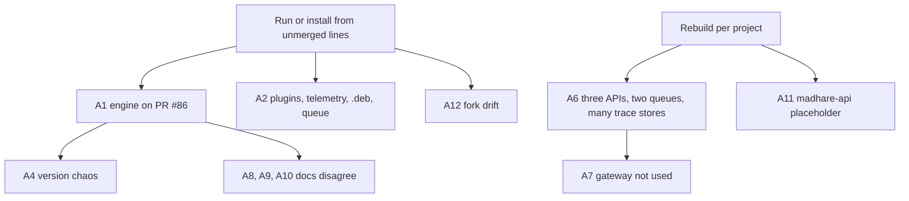

This lesson collects every architecture finding from the module in one table. Read the
findings as engineering facts with a fix, not as blame. Most of them come from a week of fast
recovery work (Module 5 tells that story). Each finding was true on **2026-10-30**. Re-check
the evidence before you act on one, because some will have been fixed by the time you read
this. One already has: madhare-web's main moved from 1.0.0 to `1.0.1-dev` while this module
was being written.

## The findings

| # | Finding | Evidence | Severity | The fix |
|---|---|---|---|---|
| A1 | **The running engine is an unmerged branch.** `conflux-engine-local` runs `5f6b308` (`@conflux/engine` 1.0.6), which conflicts with main in about 160 paths. Main's code is not what serves. | Lab steps 2–4; [PR #86](https://github.com/madharedev/conflux-engine/pull/86) (draft); [#87](https://github.com/madharedev/conflux-engine/issues/87) "Version and baseline" | High | Deliver release v1.0.0 (#87): choose the line, port what the other line has that must survive (main's agent-runtime, twin and guard are not on Line 2), merge, then redeploy from the release tag. |
| A2 | **Deploys and installs come from unmerged branches, detached worktrees and plan folders**: the .deb (`d4ee1ab`, deployment-package branch), fleet telemetry (detached `cdd62ac`), conflux-core plugins (detached `f721fc0`), the agent queue (`candidates/cfe95922…`), the local runner (`plans/…`). | Lab step 9; `/srv/conflux/claude/plugins/known_marketplaces.json`; unit `WorkingDirectory` lines | High | Add one sentence to the process: "Only a merged commit or a release tag is installed or run." Then reinstall each item from its merged line. Merge [PR #83](https://github.com/madharedev/conflux-agents/pull/83) and install conflux-core from a tagged path. |
| A3 | **Raw prompts, tool content and API bodies are exported** to Langfuse and to Dynatrace SaaS, contradicting the trace contract and the agent-runtime. | `OTEL_LOG_USER_PROMPTS`, `OTEL_LOG_TOOL_CONTENT`, `OTEL_LOG_RAW_API_BODIES` in `/srv/conflux/claude/settings.json`; `/opt/otel-collector/config.yaml` pipelines; [support#93](https://github.com/madharedev/madhare-support/issues/93) (token rotation) | High | Turn the three switches off (patch release with an issue), add a collector processor that drops content attributes, request vendor purges, and finish the rotation in #93. |
| A4 | **Version chaos**: four live identities (1.1.1, 1.0.6, 0.1.0-dev.0, 1.0.0-dev), two namespaces (product 0.9.95 vs component 1.1.1), main not `-dev` in conflux-engine or conflux-api, pre-reset releases not marked superseded, `v0.9.95` still Latest. | Lesson 4; [releases](https://github.com/madharedev/conflux-engine/releases); process "Versions" | High | Merge #88 (main to `1.0.0-dev`), mark `v1.1.0` and `v0.9.95` "pre-reset, superseded" and clear Latest, use one namespace, rebuild the .deb from main. |
| A5 | **The engine binds 0.0.0.0:13080** while its README says "Keep this release local until those controls exist". | `ss -ltnp`; [engine README line 34](https://github.com/madharedev/conflux-engine/blob/13801f53295b082a26d8f9cd7cc425788d27535e/README.md) | High | Bind to 127.0.0.1, or to the tailnet address only if the phone needs it, and record that decision in #87. |
| A6 | **Rebuilt per project**: three NestJS "APIs" with overlapping scope (`conflux-api`, `madhare-api`, `madhare-platform/apps/mh-api`), engine `apps/api`, and a fifth surface on Line 2; two queues (BullMQ on Line 2, SQLite fleet queue); three live or designed trace stores plus the twin SQLite; two binaries called `conflux`. | Lessons 2, 3 and 5 | High | One owner per concern, written in each README: platform for records, conflux-api for client routes, one queue, one trace store of record. Archive or define `madhare-api`. Rename or retire one `conflux` binary. |
| A7 | **The gateway rule is not in force.** No client calls conflux-api: the site reads AlloyDB, the phone uses the agent queue, sessions use plugins. conflux-api has in-memory sessions, no image and no CLI. | [conflux-api README "Not built yet"](https://github.com/madharedev/conflux-api/blob/44a3f09cecf20b4b8eb18415028d28c7b4a24d8e/README.md); lesson 1 | Medium | Build the engine route and persistent sessions, ship an image, and move one client (the phone) onto the gateway first. |
| A8 | **Docs contradict each other on the turn service**: "process shell" (engine README), "Built" (agent-runtime README), "Not built yet" and "Target" (conflux-api). | Lesson 1 table | Medium | Mark it **Partial** in all four places, with a link to the stub-run evidence and to the issue for the first real provider call. |
| A9 | **`libs/README.md` says the libs "contain no runtime library implementation"**, but `harnesses/twin` and `python/guard` are full Python packages with tests. | [libs/README.md line 30](https://github.com/madharedev/conflux-engine/blob/13801f53295b082a26d8f9cd7cc425788d27535e/libs/README.md) | Medium | Update the README to list both packages with their status (Partial: not run). |
| A10 | **conflux-agents README says every directory is empty** and that records live in "the configured database". Pemberton is merged, and no database is named anywhere. | [conflux-agents README](https://github.com/madharedev/conflux-agents/blob/b15c16210e93e312b97bc4a789be570068285d49/README.md) | Medium | Name the database (or drop the claim) and list what main actually holds. |
| A11 | **`madhare-api` is a hello-world.** PR #18, "expose GitHub CRUD endpoints…", merged documentation only. | [app.controller.ts](https://github.com/madharedev/madhare-api/blob/c5ac55822838c141b86a96acba7840a8d0e590fb/src/app.controller.ts); `git log --stat` | Medium | Archive it, or open an issue that defines it. A PR title should describe what it merged. |
| A12 | **Fork drift**: `andrew-hodsdon/agent-runtime` is 6 commits ahead of upstream main, including docs retrieval from PostgreSQL (#66). Which copy is canonical is unstated. | [compare](https://github.com/andrew-hodsdon/agent-runtime/compare/madharedev:main...main) | Medium | Decide canonical (upstream, per the process's "one canonical clone"); open a PR upstream for the six commits or record why not. |
| A13 | **Receipts record entry, not enforcement**: `adapter_enforcement: "NOT_VERIFIED"` on all 151, `dispatch: "LOCKED"` since the approval expired on 2026-10-22. | `/srv/work/dev/agentd/conflux/state/bootstrap-*.json` | Medium | Label receipts plainly; run `conflux-guard` as the monitor; retire or renew the expired approval file. |
| A14 | **Tests live in product repos** (29 spec/test files in conflux-engine main, specs in conflux-api), against "No tests in product repos". | `git ls-files \| grep -cE '\.(spec\|test)\.'`; process "Testing" | Low | Move them to `madhare-testing/projects/<repo>/` as each area is touched. |
| A15 | **14 epic branches (`epic/40…53`) all point at `6b103da`** with zero commits. They are ceremony with no delivery. | `git ls-remote --heads origin 'epic/*'` | Low | Delete empty epic branches, or close their epics as not started. |
| A16 | **Dead or retired units are still installed**: `mh-executive`, `mh-marlowe`, `mh-warren` (archived repo), `vllm-chat32b`, `conflux-runtime-local` (a script under `state/`), `conflux-local-runner`, and a failed `mh-state-refresh`. Port 8001 (vLLM) is reused by a docs server. | Lab step 9; `systemctl --user list-unit-files` | Low | Remove retired units through an infra issue, and keep a port registry. |
| A17 | **`telegraf:latest`** runs unpinned on the dev machine. | `docker ps` | Low | Pin by digest, per the mh-container-images standard. |

## The common causes

Most of the 17 findings come from two habits.

**1. Running what is not merged.** A1, A2, A4 and A12 are the same problem in different
places: the thing that runs, and the thing people install, is a branch, worktree, fork or
candidate directory. Main is then not the source of truth, so main's documentation is
wrong about what runs (A8, A9, A10), and versions stop meaning anything (A4). The process rule
"Nothing is deployed from a commit that isn't pushed" is too weak: pushed is not the same as
reviewed and merged.

**2. Rebuilding per project.** A6, A7 and A11 come from starting a new service instead of
extending the one that owns the concern. Every new API, queue or trace store needs its own
auth, tracing, error codes, tests and docs, and each one ends up Partial. The process's own
engineering standard says "Libraries and packages are preferred over custom code" and "Like
products are designed in like ways". The fix is the same idea at the service level: one
owner per concern.

## The order of fixes

Some fixes unblock others. A sensible order:

1. **A3 first.** It is a client-data exposure, and the fix is a configuration change. It
   does not wait for anything.
2. **A5 next.** It is one line in the service's environment and a decision.
3. **A1 and A4 together, through release v1.0.0 (#87).** Choosing the engine line settles
   the version, the docs and which binary is "conflux".
4. **A2.** Once there is a release tag, reinstall the engine, the .deb, telemetry and the
   plugins from merged commits.
5. **A6, A7, A11.** Decide one owner per concern and write it down. Then the gateway can
   become real.
6. **The rest** as each area is touched.

> [!IMPORTANT]
> Labs and this course are read-only. If you are asked to fix one of these findings, it is
> work like any other: an issue in the right repo (triaged in `madhare-support`), a branch, a
> PR with **Ran It** and a cross-model review, and Andrew's approval to merge. Do not fix a
> finding from a lab session.

## Related findings in other modules

Architecture problems connect to process problems covered elsewhere:

- **Module 3 (agents):** the installed agents come from a detached worktree (the agent side
  of A2), hooks are disabled fleet-wide, and the local judge does not exist.
- **Module 5 (how we work):** the org templates sit in a **private** `madharedev/.github`
  repository. GitHub serves org-default templates only from a public one
  ([GitHub docs](https://docs.github.com/en/communities/setting-up-your-project-for-healthy-contributions/creating-a-default-community-health-file)),
  so the process's templates are probably not applied. Branch schemes and board status sets
  also vary per repo.

## Check yourself

1. Which single release would resolve the most findings at once, and which findings?
2. Why is "the commit is pushed" not enough to satisfy the intent of the deploy rule?
3. Why should A3 be fixed before the v1.0.0 release, rather than as part of it?

Answers

1. Engine release v1.0.0 (#87). Choosing and merging one engine line resolves A1 directly,
   and with #88 and the release edits it resolves A4. It also gives the docs (A8, A9) one
   line to describe, and gives A2 a tag to reinstall from.
2. Pushed only means the commit is on GitHub. A commit on an open PR or a detached
   worktree has not been reviewed, accepted or merged, so what runs is not what the process
   approved, and main's docs and versions no longer describe it.
3. A3 exposes client text to a third-party SaaS every time a session runs, so the harm grows
   every day. The fix is a configuration change that depends on nothing else, while v1.0.0
   is a multi-week release.

