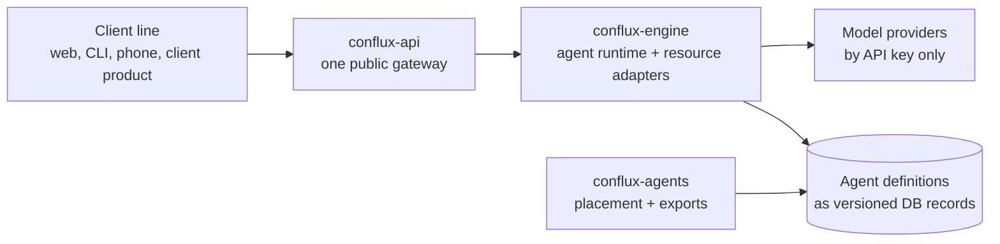

This module covers three things that share a name in conversation but very little in code: **Conflux**, the product; **Code A Zone**, the site-plan review line built for the client JBC3; and **Sabai**, the auditable AI platform built for the client Sabai Global. Module 1 went deep on the Conflux architecture. This lesson gives you just enough of Conflux to judge the other two against it: what it is meant to be, what actually runs, and how a client project is supposed to reuse it.

All facts are as of 2026-10-30.

## What Conflux is meant to be

The engine README states the design in one paragraph ([conflux-engine README](https://github.com/madharedev/conflux-engine/blob/13801f53295b082a26d8f9cd7cc425788d27535e/README.md)):

- **One NestJS monorepo.** A central planner delegates to an orchestrator (local triage), which manages ephemeral, isolated workers.
- **Reusable libraries live with the runtime.** Anything a client line needs (resource adapters, guards, harnesses, persistence) is meant to be a library in that monorepo.
- **Agent definitions are immutable, versioned database data.** Markdown files and plugin bundles are *generated exports* of those records, not the source.

Around the engine sit two more repos with defined jobs:

| Repo | Its job in the design | Status (2026-10-30) |
|---|---|---|
| `conflux-api` | The **one public endpoint** for every client ([README](https://github.com/madharedev/conflux-api/blob/44a3f09cecf20b4b8eb18415028d28c7b4a24d8e/README.md)) | **Partial**: in-memory sessions; the route to the engine is "not built yet" |
| `conflux-engine` | The only place a provider SDK runs; resource adapters; the agent runtime | **Partial**: main is a local API plus a turn service on a stub provider |
| `conflux-agents` | Placement of agents, roles, skills, tools and profiles; canonical records "live in the configured database" ([README](https://github.com/madharedev/conflux-agents/blob/b15c16210e93e312b97bc4a789be570068285d49/README.md)) | **Partial**: Pemberton merged; the role agents are on an open PR |



That diagram is the **Target**. Read every arrow as "designed", not "running".

## What is Built on main

On `main` (`13801f5`, package version 1.1.1), the engine has two apps:

- **`apps/api`**: a NestJS API on `127.0.0.1:8792` with eight resource adapters (Google Cloud Storage, PostgreSQL, AlloyDB metadata, Gmail metadata, Compute Engine, Pub/Sub, Grafana reads, the docs registry). Its authentication boundary **fails closed**: a missing credential returns 401, and the default, unconfigured authenticator returns 503 for any well-formed credential. The README ends the section with "Keep this release local until those controls exist."
- **`apps/agent-runtime`**: `POST /internal/v1/turns`, streaming NDJSON. Providers are called by API key only; OAuth and Vertex environment variables are refused. It has budget refusals (`BUD-001`, `BUD-002`), a single prompt path enforced by a check script, and writes `run-event.v1` envelopes to a JSONL spool ([agent-runtime README](https://github.com/madharedev/conflux-engine/blob/13801f53295b082a26d8f9cd7cc425788d27535e/apps/agent-runtime/README.md)). Its own status line: Built, tested on the STUB provider, "No real provider call has been made".

The main README also says the agent runtime "is a process shell" and that the 0.1.0 architecture release "does not … implement worker orchestration" ([0.1.0 architecture](https://github.com/madharedev/conflux-engine/blob/13801f53295b082a26d8f9cd7cc425788d27535e/docs/architecture/0.1.0/README.md)). So the planner, orchestrator and workers are **Target**.

## What actually runs

The engine serving on the dev machine is **not main**. It is the `feat/engine-consolidated` line, package `@conflux/engine` 1.0.6 at `5f6b308`, open as [PR #86](https://github.com/madharedev/conflux-engine/pull/86). It split from main on 2026-10-15 and conflicts with it in about 160 paths ([release issue #87](https://github.com/madharedev/conflux-engine/issues/87)). It adds apps and modules main does not have: portal, tenants, JBC, installer, a BullMQ dispatcher and an AlloyDB store.

You check this yourself with three read-only commands (Module 1 has the full lab):

```bash
readlink ~/.local/opt/conflux-engine/current
~/.local/opt/conflux-engine/bin/conflux version
~/.local/opt/conflux-engine/bin/conflux health --url http://127.0.0.1:13080
```

Expected output, trimmed:

```text
{"product":"Conflux Engine","version":"1.0.6","sourceRevision":"5f6b308ddd69…"}
{"url":"http://127.0.0.1:13080/health","httpStatus":200,"healthy":true,…}
```

> [!WARNING]
> **Finding (High): the running engine is an unmerged branch.** What serves is `5f6b308` (PR #86, open), not `main`. Anyone reading `main` to understand the running system reads the wrong code. It also binds `0.0.0.0:13080`, while main's README says to keep the release local. Fix: decide the line in #87, merge or retire PR #86 through the normal review, and bind to loopback until the authentication controls exist.

Versions are in four states at once: main says 1.1.1, the packaged `/usr/bin/conflux` says 0.1.0-dev.0, the running engine says 1.0.6, and the agreed target (decided 2026-10-29 in #87) is `1.0.0-dev` on main, which only open PRs carry. The global process wants one version source of truth per repo, with `main` at `X.Y.Z-dev` ([global process, Versions](https://github.com/madharedev/madhare-support/blob/865da77acbc2b7eba46ed22d2ba722ff5a39b7a2/agents/AGENTS.md)).

## How Conflux is meant to be reused

The process file draws a clear line between product and client lines:

- **Conflux is the product.** Minor releases of Conflux add agents, skills and tools. "Products should expose configuration rather than code whenever possible" ([global process, Releases](https://github.com/madharedev/madhare-support/blob/865da77acbc2b7eba46ed22d2ba722ff5a39b7a2/agents/AGENTS.md)).
- **Engineering standards** say "Libraries and packages are preferred over custom code" and "Like products are designed in like ways".
- A client line should therefore *consume* Conflux: call the gateway (or the engine) for model turns, take agent definitions from the agent database, use the engine's resource adapters and guards, and add only its domain logic (site-plan criteria for JBC, document reconciliation for Sabai).

Here is what "reuse" would look like for a client line, against what exists:

| A client line needs | Conflux piece meant to provide it | Usable by a client today? |
|---|---|---|
| A model turn with a budget | `apps/agent-runtime` turns endpoint | No: stub provider only, and the gateway route to it is Target |
| An agent definition | Versioned DB records via `conflux-agents` | No: "the configured database" is not named in any repo |
| A public API with auth | `conflux-api` | No: in-memory sessions, no image, no deploy |
| Cloud resource access | Engine resource adapters | Partly: built, but local only and fail-closed by design |
| A CLI with exit codes and build stamps | The 2026-10-22 Python `cflx` CLI | It *was*, and Sabai copied it. That generation no longer exists |

The honest conclusion: **as of 2026-10-30 there was nothing in Conflux a client line could depend on as a package or a service.** The two client lines therefore built their own stacks. Lessons 2 and 4 show what they built, and lesson 6 compares the three.

> [!WARNING]
> **Finding (High): Conflux has no consumable surface for client lines.** No published package, no deployed gateway, no named agent database. Each client project fills the gap by rebuilding. Fix: publish one versioned interface first (a turns API behind `conflux-api`, or a library package), even if small, and make the next client feature consume it instead of rebuilding.

## How to tell the three apart in conversation

People say "Conflux" loosely. Use these tests:

- If it is **TypeScript under `apps/` and `libs/`** in `conflux-engine` or `conflux-api`, it is Conflux proper.
- If it is **`jbc`, `site_plan_review`, the Review Portal or `permitme.dev`**, it is Code A Zone, whatever the session title says.
- If it is **`sabai`, `sabai_engine`, Azure, or the ADO repo `Sabai AI Platform`**, it is Sabai.
- If something called `conflux` is installed on the machine, check its version and source revision before trusting it: there are two binaries with that name and different ports.

> [!TIP]
> Before you describe any part of these systems as working, ask three questions: Is it on `main`? Is it running? What evidence shows it ran with real input? Most of the confusion in this module comes from answering only one of them.

## Check yourself

1. The engine README says agent definitions are "immutable, versioned database data". What does that make the Markdown and plugin files, and why does it matter when you compare Conflux with Code A Zone?
2. You run `conflux version` on the dev machine and get 1.0.6. Is that the code on `conflux-engine` `main`? How would you prove it?
3. A new client project asks, "Which Conflux package should we depend on for model turns?" What is the honest answer as of 2026-10-30?

<details>
<summary>Answers</summary>

1. They are generated exports, not the source of truth. Code A Zone takes the opposite approach: its agents are `agent.yaml` files committed in the engine repo. So the two cannot share agent definitions without a conversion.
2. No. Main is 1.1.1 at `13801f5`. The running engine reports `sourceRevision 5f6b308`, which is only on `feat/engine-consolidated` (PR #86, open). `git branch -r --contains 5f6b308` in the canonical clone shows only that branch.
3. None yet. The turns endpoint is Built on a stub provider only, the gateway route to the engine is Target, and nothing is published as a package. The fix is to publish one versioned interface before the next client feature, not to copy code again.

</details>
