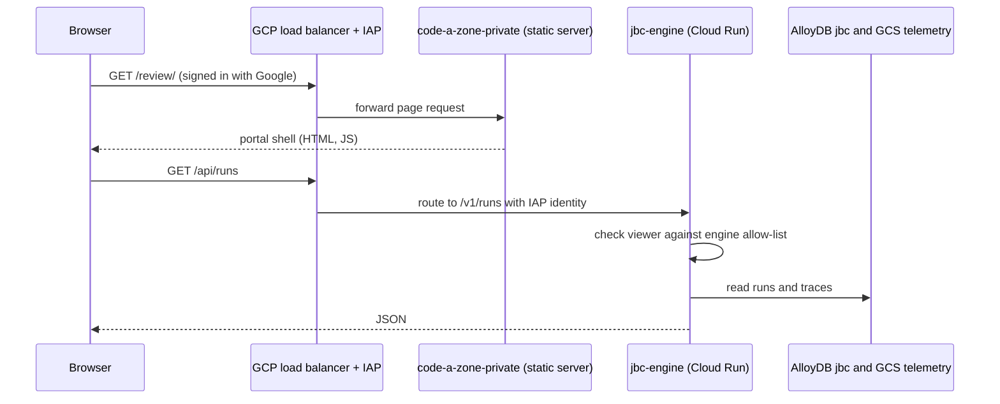

**Code A Zone (CAZ)** is Mad Hare's commercial brand for AI site-plan compliance review for municipal review boards. Its pilot client is **JBC3** (Boca Raton, Florida). "PermitMe" is the earlier pilot brand, and it survives in host names. This lesson explains what each repo does, how a request flows, and where the code that runs in production actually comes from. All facts are as of 2026-10-30.

## The repos and what each one owns

The first thing to learn is that the `code-a-zone` repo is **not the runtime**. It holds static sites and a portal. The thing that reviews site plans is a separate Python engine.

| Repo | What it holds | Status |
|---|---|---|
| `code-a-zone` | Public marketing site (`public/`), private static workspaces (`dist/`: investor model, founder worksheet, mock screens), and the **Review Portal** (`review/`, Vite + React), plus build, serve and package scripts | **Built**; main `3fda7a5` |
| `jbc-site-plan-review-engine` | The runtime: Python 3.12, CLI `jbc`, HTTP API `jbc serve` (`/v1/*`), four agents | **Built**; runs on Cloud Run `jbc-engine` |
| `jbc-site-plan-review-portal` | The old pilot portal (Next.js, `web/apps/internal`) | **Built**, but no longer routed after the 10-30 cutover |
| `jbc-gcp-infra` | Terraform for the GCP project `jbc3-platform` | Built; no canonical clone noted in state memory |
| `madhare-testing/projects/jbc` | Engine test scenarios S-00 to S-25 | **Partial**: engine only, stale pin |

Evidence: [code-a-zone README](https://github.com/madharedev/code-a-zone/blob/3fda7a5e627ea6667f8786417ee1d1fe8afbb1c9/README.md), [engine pyproject](https://github.com/madharedev/jbc-site-plan-review-engine/blob/aed486b7680349b7538688ce3413b5729844fcf9/pyproject.toml).

### The JBC engine

The engine's package is `mh-site-plan-review` (0.1.0.dev0 on main at `aed486b`), and its script is `jbc = site_plan_review.cli:main`. Its agent runtime is **Google ADK 2.10.0 plus LiteLLM 1.102.1**, pinned in the `agents` extra. It does not use Conflux.

It has four agents, each defined as a YAML file committed in the repo under `agents/<name>/agent.yaml`: `criteria`, `evidence`, `review` and `report`. The criteria agent, for example, uses `gemini_vertex/gemini-2.5-pro` at temperature 0 with a budget and output limits ([criteria agent.yaml](https://github.com/madharedev/jbc-site-plan-review-engine/blob/aed486b7680349b7538688ce3413b5729844fcf9/agents/criteria/agent.yaml)).

One design rule worth knowing because it shapes every report: **code decides, models recommend.** A requirement that cannot be decided by code (interpretive, subjective, unresolved applicability, or no stated threshold) is stored as `needs_interpretation`, with the model's recommendation beside it. A subjective criterion is never marked `met` ([engine README, status vocabulary](https://github.com/madharedev/jbc-site-plan-review-engine/blob/aed486b7680349b7538688ce3413b5729844fcf9/README.md)).

The engine also carries its own runtime, registry, telemetry and trace store, config loader, database migrations (AlloyDB, row-level security, append-only tables) and more than fifty `cli_*.py` modules. Every one of those is something Conflux also intends to provide. Lesson 6 returns to that.

A second CLI, `caz` (`caz --config engine-bld1 … run --submittal … --out report.pdf`), exists only on the experiment branch `experiment/team-2-build2-local-caz`. It is **Target**, and neither `jbc` nor `caz` is on the dev machine's `PATH`.

### The Review Portal

The Review Portal (Runs, Run view, Trace, Compare, Reports, Evaluations) arrived in `code-a-zone` on 2026-10-30 by **copy**. Its `review/package.json` describes it as ported from `jbc-site-plan-review-portal` at `andrew/review` `dd742bf` ([review/package.json](https://github.com/madharedev/code-a-zone/blob/3fda7a5e627ea6667f8786417ee1d1fe8afbb1c9/review/package.json)). Next.js modules it depended on were replaced by hand-written shims in `review/src/shims/`. Its compiled output is committed under `dist/review/`.

## How a request flows

The private site is served behind Google Cloud Identity-Aware Proxy (IAP). The portal holds no token: the transport sends `/api/x` on its own origin, and the load balancer routes that to the engine's `/v1/x` with the viewer's IAP session ([transport.ts](https://github.com/madharedev/code-a-zone/blob/3fda7a5e627ea6667f8786417ee1d1fe8afbb1c9/review/src/lib/engine/transport.ts), [REVIEW-PORTAL.md](https://github.com/madharedev/code-a-zone/blob/3fda7a5e627ea6667f8786417ee1d1fe8afbb1c9/docs/REVIEW-PORTAL.md)).

Three points to remember:

- **Pages and data are separate services.** Pages come from the static Python server; data comes from the engine. Locally there is no engine, so `/api/*` returns 503 by design (you will see this in the lab).
- **Authorization lives in the engine**, which checks the viewer against its own allow-list. IAP authenticates; the static server only guards against foreign Host headers.
- **Data** is in the AlloyDB database `jbc` plus a GCS telemetry bucket. The AlloyDB trial ends **2026-11-06** ([cloud-move PLAN.md](https://github.com/madharedev/code-a-zone/blob/3fda7a5e627ea6667f8786417ee1d1fe8afbb1c9/docs/cloud-move/PLAN.md)). Uploads use signed GCS URLs.

### Hosts and services

| Audience | Host | Cloud Run service | Content |
|---|---|---|---|
| Public | permitsme.com | `code-a-zone-public` | Marketing site from `public/` |
| Private (IAP) | permitme.dev (also codeazone.com) | `code-a-zone-private` | `dist/` workspaces and the Review Portal |
| API | same origin, `/api/*` | `jbc-engine` | Engine `/v1/*` |

All three run in the GCP project `jbc3-platform`, behind the URL map `jbc3-portal-urlmap`. Images are built by hand from a clean SHA with two Dockerfiles (base image pinned by digest, non-root UID 65532).

## Branches: the model is inverted

The global process says Code A Zone's long-running `andrew/review` line is to be folded into `main` "through its own reconciliation plan", carefully and with no history rewrites ([global process, Product-line variations](https://github.com/madharedev/madhare-support/blob/865da77acbc2b7eba46ed22d2ba722ff5a39b7a2/agents/AGENTS.md)). Here is what happened instead:

- On 2026-10-29, the release issue [#1](https://github.com/madharedev/code-a-zone/issues/1) cut `release/v1.0.0` from `andrew/review`, "not main, which is far behind".
- On 2026-10-30, feature work was merged **straight to `main`** ([PR #37](https://github.com/madharedev/code-a-zone/pull/37), "Merge the live site build … to main"), skipping the release, epic and feature chain.
- On GitHub today, `main` (`3fda7a5`) contains all of `andrew/review` (`69fa5d3`) and is **15 commits ahead** of it; `release/v1.0.0` equals `main`.
- The canonical clone's *local* `main` is stale at `e6bb0e1`, where `package.json` is still `code-a-zone-investor-model` and `npm run build` fails with "Missing script". State memory still says "never treat main as current", which is now false for CAZ and still true for the old portal (225 commits ahead on `andrew/review`).

So the reconciliation has in effect happened, but by bypassing the flow, and the local signals contradict GitHub. Always fetch and compare `origin/main` before trusting a ref.

## Production runs on unmerged PRs

On 2026-10-30, the private site's live revision is `code-a-zone-private-review-d6566ae`, built from [PR #52](https://github.com/madharedev/code-a-zone/pull/52) (head `d6566ae`, **open**). The URL map was changed live; the cutover is recorded on [issue #51](https://github.com/madharedev/code-a-zone/issues/51). The engine was promoted the same day from an unmerged engine PR (#595). The state journal records that both merges "await Andrew".

> [!WARNING]
> **Finding (High): production differs from `main`.** The live private site and the live engine both come from unmerged PRs. A reviewer reading `main` sees different code from what clients use, and a rollback to `main` would silently revert the cutover. Fix: get Andrew's approval and merge #52 and engine#595 (or revert the deploy to `main`), and from then on deploy only from a merged commit.

> [!WARNING]
> **Finding (High): the project's instructions point at the wrong place.** The local `/srv/conflux/projects/code-a-zone/AGENTS.md` and `plan/README.md` call it a "site-planning-jbc entry", link a ChatGPT Page, and tell agents to read `/srv/conflux/projects/site-planning-jbc/state.json`, which does not exist. The global process forbids process pointers to ChatGPT Pages and `state.json` plans. Fix: replace both files with a pointer to `/srv/conflux/AGENTS.md` and repo structure only.

## Release, tests and CI

- **Versions disagree.** `package.json` is `0.1.0-dev.0` and [release/config.json](https://github.com/madharedev/code-a-zone/blob/3fda7a5e627ea6667f8786417ee1d1fe8afbb1c9/release/config.json) targets 0.1.0, but the release issue is v1.0.0, and the PR that would set `1.0.0-dev` was closed. There are no tags and no GitHub releases.
- **Packaging is good.** `scripts/package-release.py` builds deterministic public and private tarballs with manifests and `SHA256SUMS` (you run it in the lab). It produces no tag and no registry digest.
- **Tests are missing for CAZ.** There is no `madhare-testing/projects/code-a-zone`; the JBC suite covers the engine only and is pinned to engine `b6984dc`, about 2026-10-13 ([projects/jbc/PIN](https://github.com/madharedev/madhare-testing/blob/ecf3cc1bf3ff13863dd7fbb3aba5437b85f99a30/projects/jbc/PIN)).
- **CI is missing.** GitHub Actions runs CodeQL and a Copilot review only, despite the "minimal CI on every main" rule.

## The product result

Under all the process, the measured result is weak: the forensic session of 2026-10-30 cites the real engine result as "1/16 determinate" on the full 21-criterion run, and wave 2 depended on a 4096-dimension embedder on a home workstation, reached through a hand-held ssh tunnel. GCP work stopped for over three hours on 10-30 because `gcloud` auth expired until Andrew re-signed. These are operating facts a new team member needs: the system is live for a pilot, and fragile.

## Check yourself

1. A colleague says "the Code A Zone runtime is in the `code-a-zone` repo". What is wrong with that, and where is the runtime?
2. Why does `curl /api/runs` against a local preview return 503, while the same path works on permitme.dev?
3. Which ref is production built from on 2026-10-30, and why does that break the process?

Answers

1. `code-a-zone` holds static sites and the Review Portal. The runtime is `jbc-site-plan-review-engine` (CLI `jbc`, API `jbc serve`), on Cloud Run `jbc-engine` in `jbc3-platform`.
2. Locally there is no engine; the static server answers `/api/*` with 503 on purpose. In production the load balancer routes `/api/*` to the engine's `/v1/*` with the viewer's IAP identity, and the engine checks its allow-list.
3. The private site runs `d6566ae` from open PR #52, and the engine runs an unmerged engine PR (#595). The process requires every merge to have Andrew's approval and acceptance before Done; deploying first means production differs from `main` and from anything reviewed and accepted.

