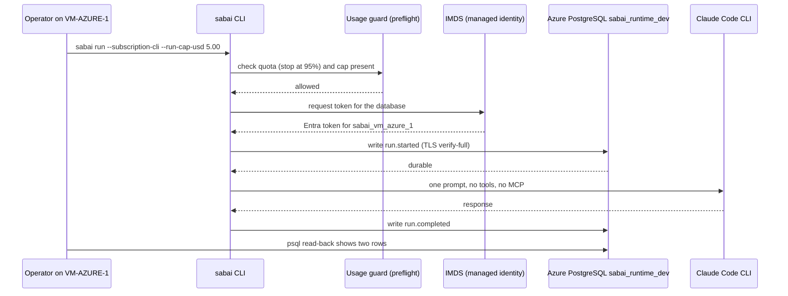

**Sabai** is a client engagement. Mad Hare is building an "auditable AI platform" for **Sabai Global**, contracted through PPT Strategies. The first use case is ICF document reconciliation, and Messina is the client's integrator. The platform's parts, as designed: an agent runtime, a tool surface that also acts as the audit boundary, an append-only audit store, retrieval, evaluations and a read-only dashboard. All facts are as of 2026-10-30.

## Where Sabai code lives

The global process has one rule specific to Sabai: "our `sabai-engine` repo is staging. Releases are promoted into Sabai's Azure DevOps repos" ([global process, Product-line variations](https://github.com/madharedev/madhare-support/blob/865da77acbc2b7eba46ed22d2ba722ff5a39b7a2/agents/AGENTS.md)). So there are two homes for the code, and the client only ever sees the second.

| Place | What is there | Status |
|---|---|---|
| GitHub `madharedev/sabai-engine`, `main` | One commit, `637b793` "Initial commit", README only ([tree](https://github.com/madharedev/sabai-engine/tree/637b79332c58d6a7906538b3c0fe12e98d8c61f9)) | **Built (empty)** |
| `sabai-engine` `release/v1.0.0` | `491285e`, 40 commits; [PR #130](https://github.com/madharedev/sabai-engine/pull/130) to `main`, **open** | **Partial** (unmerged) |
| ADO repo `Sabai AI Platform` (local clone `/srv/work/repos/sabai-ai-platform-azuredevops`) | `master`/`integration` at `fb6797c` (09-23): design set and a **SQL Server** audit DDL; unmerged branches `runtime/v0.1.0` (10-17) and `promote/2026-10-07-platform-libraries` | Built (design + DDL only) |
| VM-AZURE-1 (`ssh sabai`, resource group Dev_Box, centralus) | The installed wheel under `/data/artifacts/…/runtime-venv`, a rollback copy, Claude Code CLI, local containers | Built |
| Managed PostgreSQL `sabai-pgsql-ai-dev` (PG 18.6, private VNet, Entra-only) | Database `sabai_runtime_dev`, managed-identity role `sabai_vm_azure_1` | Built 2026-10-30 ([#120](https://github.com/madharedev/sabai-engine/issues/120)) |
| Archived GitHub repos | `sabai-platform`, `sabai-agent-platform`, `sabai-icf` | **Abandoned** |

`sabai-engine` is the **third** Sabai runtime. The first two (`sabai-platform`, then `sabai-agent-platform` with packages `sabai_cli`, `sabai_runtime`, `sabai_schemas` and an Azure AI Foundry provider) are archived. The ADO `runtime/v0.1.0` branch still carries that second generation.

## The `sabai` CLI

On the release branch, `sabai-engine` is a Python package, version 1.0.0, Python `>=3.12,<3.13`, with the entry point `sabai = sabai_engine.cli:main` ([pyproject.toml](https://github.com/madharedev/sabai-engine/blob/491285e33b18954b7cad75462e0b2a277e17b391/pyproject.toml)). Its dependencies are small: `jsonschema`, `pydantic`, `pyyaml`. A build hook stamps the git SHA and dirty flag into the wheel.

The commands you will meet:

| Command | Does |
|---|---|
| `sabai agent list`, `sabai agent show <id>` | Lists the two technical agents, `repo-reader` (synthetic only, one read tool) and `subscription-probe` (subscription CLI, **no tools**), with provenance |
| `sabai schema show --sha256` | Prints the bundled telemetry schema hash |
| `sabai run --synthetic --scenario <s> --events <file>` | A fake run that writes NDJSON audit events; no provider is called |
| `sabai run --subscription-cli …` | The live path: one guarded prompt to the local Claude Code CLI, audit rows written to PostgreSQL |

Agents here are **JSON locator files bundled in the wheel** (`src/sabai_engine/data/agents/*.json`), not database records as Conflux intends, and not YAML in the repo as Code A Zone does. Personas are explicitly excluded.

### Exit codes and refusals

The CLI refuses early and with a coded message. These came from real runs on 2026-10-30:

| Situation | Message | Exit |
|---|---|---|
| Synthetic success | JSON summary, `"outcome": "succeeded"` | 0 |
| Synthetic failure | `"outcome": "failed"` | 1 |
| Synthetic timeout | — | 124 |
| Events file already exists | `CLI-004: refusing to overwrite existing events path` | 78 |
| Unknown agent | `AGT-001: unknown technical agent_id 'nope'` | 78 |
| Live run without a cap | `CLI-006: a per-run cap is required (--run-cap-usd); there is no default` | **1** |

The README says configuration refusals exit 78. `CLI-006` exits 1. That mismatch is a small, real finding you will reproduce in the lab.

## A live run, end to end

The one live audited run happened on VM-AZURE-1 on 2026-10-30 at 01:52Z (run_id `bdee7d89…`, recorded on [#120](https://github.com/madharedev/sabai-engine/issues/120) and in `/srv/conflux/projects/sabai/communications/ran-it-123-20261030.md`). The command shape:

```bash
SABAI_SINK_DATABASE=sabai_runtime_dev sabai run --subscription-cli --synthetic-data \
  --agent-id subscription-probe --prompt-file request.txt --payload-file <abs>/payload.json \
  --events events.ndjson --ingest-script runtime-source/tools/demo/sabai-demo-ingest \
  --psql-argv-file psql-argv.json --run-cap-usd 5.00
```



What makes this design worth learning:

- **The guard runs before spend.** [claude_preflight.py](https://github.com/madharedev/sabai-engine/blob/491285e33b18954b7cad75462e0b2a277e17b391/src/sabai_engine/claude_preflight.py) stops at 95% of quota and requires `--run-cap-usd` with no default. Credits are allowed. Note that the cap is an *estimated*-cost threshold (a known defect deferred in #130).
- **No password exists.** [sabai_azure_pg.py](https://github.com/madharedev/sabai-engine/blob/491285e33b18954b7cad75462e0b2a277e17b391/tools/azure/sabai_azure_pg.py) gets a managed-identity token from the instance metadata service (IMDS) and connects with `sslmode=verify-full`. It refuses group- or world-writable config files (`SABAI-AZURE-PG-CONFIG-UNSAFE-FILE`).
- **Audit before action.** `run.started` must be durable before the provider is called. The first live attempt (`fd93f4f9…`) proved it: the umask had left the config group-writable, the transport refused, and the CLI stopped with `CLI-007: run.started not durable … no provider call`. That was an unplanned but real negative control.
- **Result.** Exit 0, model `claude-sonnet-5-5`, response `5`, and a psql read-back of two rows (`run.started|running`, `run.completed|succeeded`). The completed event records the subscription type, extra usage enabled, and the $5.00 cap.

The audit store's schema is in `db/migrations/audit/001–015`, a **PostgreSQL port** of the ADO T-SQL plane ([001_schemas.sql](https://github.com/madharedev/sabai-engine/blob/491285e33b18954b7cad75462e0b2a277e17b391/db/migrations/audit/001_schemas.sql)), with runtime migrations 104 and 105 and a migration tool, [`bin/sabai-db-migrate`](https://github.com/madharedev/sabai-engine/blob/491285e33b18954b7cad75462e0b2a277e17b391/bin/sabai-db-migrate), that checks each file against a checksum manifest.

> [!WARNING]
> **Finding (High): the client already accepted a different database.** ADO `master` ships a **SQL Server** audit plane (`sqlcmd`, `sys.schemas`, port 11433). Staging ships **PostgreSQL**. Promotion means replacing what the client has. Fix: get the client's written agreement to the Postgres store, then promote it through a reviewed ADO PR, with the SQL Server plane retired explicitly.

## Installing and deploying

Deployment is by hand: `uv build --wheel`, `uv venv --python 3.12 $SABAI_HOME/runtime-venv`, `uv pip install …whl`, keeping `umask 022` throughout (README). The wheel lands under `/data/artifacts/sabai-1.0.0-…/runtime-venv` on the VM, not on `PATH`, with a rollback directory kept. There is no container image and no pipeline.

## Promotion to ADO: what actually happens

There is no script, pipeline or ADO PR. Promotion is a manual copy:

1. Cut a worktree of the ADO clone on a `promote/<date>-…` or `runtime/vX` branch.
2. Copy the staging tree in.
3. Commit as `Andrew Hodson <ahodson@sabaiglobal.com>` (the client identity), with the source SHA in the message.
4. Push over SSH.
5. Merge `integration` → `master` by review, which has happened only for the design and DDL (up to 09-23).

**Nothing from `sabai-engine` has been promoted.** The two pushes that exist (10-07 and 10-17) are unmerged. Promotion is epic E7 on [#39](https://github.com/madharedev/sabai-engine/issues/39), still **Target**.

## Release state

> [!WARNING]
> **Finding (High): the release tag points at the wrong commit.** The pushed annotated tag `v1.0.0` resolves to `637b793`, the empty "Initial commit", not the release head `491285e`. The GitHub release is a draft that targets `main`, and PR #130 is unmerged. The process says published tags are never rewritten. Fix: since only a draft release depends on it, Andrew decides between deleting and re-creating the tag after #130 merges (recorded on the release issue) or leaving it and releasing as `v1.0.1`; either way the decision is written down.

Versions disagree across sources: `pyproject` 1.0.0, the worktree venv's metadata `1.0.0rc1` (built before the bump), the README body `0.1.0.dev0`, the live VM wheel `0.1.0.dev0`, `sabai-db-migrate` 1.1.0, `@sabai/runtime-postgres` 0.3.0, the ADO runtime 0.1.0. The README's pinned schema hash (`f631a3a5…`) is also stale: the bundled schema is `928fb27e…`.

Board: [#39](https://github.com/madharedev/sabai-engine/issues/39) says the wave-1 issues are on projects 94 and 93. Today project 94 holds **one** item (#131), and project 93 holds none. An older workspace still points at board 79.

## Hours

Sabai is billed in **15-minute increments** from a separate, private timekeeper ledger (service categories design, build, meeting; invoice stamps; QuickBooks-style exports). It lives in an `_attic-dev-reset-…` directory, not the hub. Per [#131](https://github.com/madharedev/sabai-engine/issues/131), the ledger has 129 records, **stops at 2026-10-17**, and three retained copies disagree on invoice stamps. Only #131 carries "Actual hours" on the board; PR #130 claims 2.0 hours that are on no task.

The process says hours go on every task, "Sabai included", and that a live time report must exist at all times ([global process, Time](https://github.com/madharedev/madhare-support/blob/865da77acbc2b7eba46ed22d2ba722ff5a39b7a2/agents/AGENTS.md)). For a billed client, a stale ledger is a revenue risk, not just a process gap.

## Who to know

Andrew Thomson is the client organizer; Jon Ogden and Rick Hart (Pelican Hart, SDLC and validation) are client-side; Jackson Ingle is at Messina. The Run API v1.0.0 contract was sent to Messina on 6 October and is unconfirmed, and Messina withdrew its OpenTelemetry design on 10-28, which breaks the planned audit join. Azure sign-in depends on one person: conditional access means only Andrew's interactive MFA works.

## Check yourself

1. Where is Sabai code staged, where is it supposed to end up, and how much has reached the destination?
2. In the live run, what prevents a provider call if the audit store is unreachable or the config is unsafe?
3. Why can't the `v1.0.0` tag simply be moved to `491285e`, and what are the two acceptable fixes?

<details>
<summary>Answers</summary>

1. Staged in GitHub `madharedev/sabai-engine` (all code on `release/v1.0.0`; `main` is a README). It is meant to be promoted into the ADO repo `Sabai AI Platform`. Nothing from `sabai-engine` has been promoted; ADO `master` has only the 09-23 design and SQL Server DDL, plus two unmerged older pushes.
2. `run.started` must be durable before the provider is called, and the transport refuses group- or world-writable config. The first live attempt was stopped exactly this way (`CLI-007 … no provider call`). The guard also refuses with no `--run-cap-usd` or above 95% quota.
3. The process says published tags are never rewritten, and the tag has been pushed. Acceptable fixes: Andrew explicitly approves deleting and re-creating it (only a draft release depends on it) and the decision is recorded, or the tag stays and the release ships as `v1.0.1` from the merged release commit.

</details>
