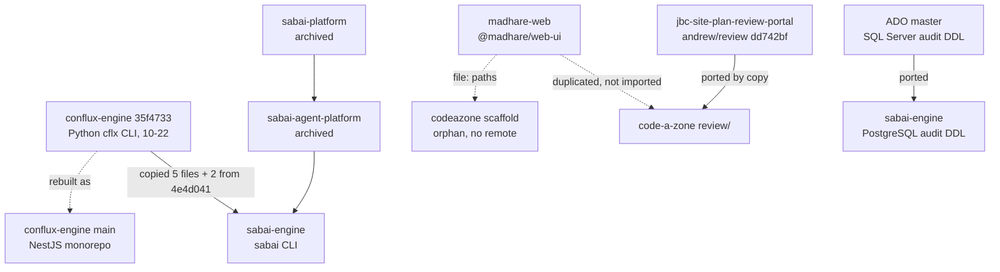

Lessons 1, 2 and 4 looked at each system on its own. This lesson puts them in one table and then names the pattern underneath: **each project rebuilt its stack instead of reusing Conflux, and where it reused, it copied.** Andrew's brief for this course says the methods work when tight but are precarious and inconsistent, and that each project rebuilds things. This lesson is the evidence for that. All facts are as of 2026-10-30.

## The comparison

| Axis | Conflux proper | Code A Zone (JBC) | Sabai |
|---|---|---|---|
| **What it is** | Mad Hare's product: an agent platform | Client line: AI site-plan compliance review for JBC3 | Client engagement: auditable AI platform for Sabai Global |
| **Design** | One NestJS monorepo: planner, orchestrator, ephemeral workers; libraries with the runtime ([README](https://github.com/madharedev/conflux-engine/blob/13801f53295b082a26d8f9cd7cc425788d27535e/README.md)) | Static sites + Vite/React portal (`code-a-zone`); CLI-first Python engine with an HTTP API (`jbc serve`) | One-shot Python CLI plus SQL migrations; one TypeScript store package not used live |
| **Language / stack** | TypeScript, NestJS (`apps/`, `libs/`), some Python libs | Python 3.12 engine; TypeScript portal | Python 3.12 `sabai_engine` |
| **Runtime and model access** | `apps/agent-runtime` turn service, API-key providers, **stub only**; worker orchestration Target ([agent-runtime](https://github.com/madharedev/conflux-engine/blob/13801f53295b082a26d8f9cd7cc425788d27535e/apps/agent-runtime/README.md)) | Google ADK 2.10 + LiteLLM 1.102, Gemini on Vertex ([pyproject](https://github.com/madharedev/jbc-site-plan-review-engine/blob/aed486b7680349b7538688ce3413b5729844fcf9/pyproject.toml)) | Local Claude Code CLI under a guard (95% stop, required cap) |
| **Agents** | Immutable, versioned **database records**; Markdown is an export | **YAML files in the repo** (`agents/<name>/agent.yaml`, four agents) | **JSON files in the wheel** (two technical agents, no personas) |
| **Data** | Resource adapters (GCS, Postgres, AlloyDB metadata…); running Line 2 adds an AlloyDB store | AlloyDB `jbc` (own migrations, RLS, append-only) + GCS telemetry | Azure PostgreSQL 18.6 `sabai_runtime_dev`, append-only `audit` schema; ADO `master` still SQL Server |
| **Cloud and auth** | Local; fail-closed authenticator, no verifier enabled | GCP `jbc3-platform`; IAP + engine allow-list; portal holds no token | Azure; private VNet, Entra-only, VM managed identity via IMDS |
| **Deploy** | Main: local only. Running: unmerged PR #86 on `0.0.0.0:13080` | Cloud Run ×3, images built by hand; live from **unmerged** PR #52 and engine#595 | Wheel installed by hand on VM-AZURE-1; no image, no pipeline; promotion to ADO is a manual copy |
| **Tests** | `madhare-testing/projects/conflux-engine`, plus 33 in-repo spec files (against the rule) | `madhare-testing/projects/jbc`, engine only, pinned to `b6984dc` (~10-13); nothing for CAZ | **None**: `projects/sabai/` holds only `.gitkeep`; proof is Ran-It comments |
| **CI** | Not audited here | CodeQL and Copilot review only | None (no `.github/`) |
| **Release** | Pre-reset tags `v1.1.0`, `v0.9.95` (still "Latest"); four live version identities | No tags; 0.1.0-dev.0 in code vs v1.0.0 release issue | Tag `v1.0.0` on the wrong commit; draft release; PR #130 open |
| **Hours** | Hub "Actual hours" field | Hub "Actual hours" field (not audited per task here) | Private timekeeper ledger in `_attic`, stale since 10-17; one task with Actual hours |

Read across any row and you see three different answers to the same question. The process says "Like products are designed in like ways" and "Libraries and packages are preferred over custom code" ([global process, Engineering standards](https://github.com/madharedev/madhare-support/blob/865da77acbc2b7eba46ed22d2ba722ff5a39b7a2/agents/AGENTS.md)). On the agents row alone, the three systems hold agent definitions in three incompatible ways: database records, repo YAML, wheel JSON. None can load another's agents.

## The rebuilt-every-time pattern

### Exactly what was copied

**Conflux into Sabai.** The `sabai-engine` README has a Provenance section that lists every file ([README, Provenance and Attribution](https://github.com/madharedev/sabai-engine/blob/491285e33b18954b7cad75462e0b2a277e17b391/README.md)):

| From `conflux-engine` | Commit | To `sabai-engine` | What it gives |
|---|---|---|---|
| `hatch_build.py` | `35f4733` | `hatch_build.py` | `BuildInfoHook`: stamps git SHA and dirty flag at build |
| `src/conflux_engine/build_info.py` | `35f4733` | `src/sabai_engine/build_info.py` | `CodeVersion`, `source_identity` |
| `src/conflux_engine/cli.py` | `35f4733` | `src/sabai_engine/cli.py` | `build_parser`, `main` |
| `src/conflux_engine/cli_agents.py` | `35f4733` | `src/sabai_engine/cli_agents.py` | `agent list`, `agent show` |
| `src/conflux_engine/cli_exits.py` | `35f4733` | `src/sabai_engine/cli_exits.py` | `EXIT_*`, `failure_exit_code` |
| `src/conflux_engine/cli_runtime/errors.py` | `4e4d041` | `src/sabai_engine/cli_exits.py` | `CliCode`, typed CLI errors |
| `src/conflux_engine/cli_runtime/stream.py` | `4e4d041` | `src/sabai_engine/telemetry.py` | `sanitize_provider_event` |

`sabai agent show subscription-probe` prints the same two commits under `provenance`. Those files came from the **Python `cflx` generation** of Conflux (2026-10-22). Conflux was then rebuilt as a NestJS monorepo, so none of these files exist in `conflux-engine` `main` today. Sabai carries a fork of a Conflux that no longer exists.

The attribution is good practice: it is honest and traceable. The problem is what it implies. A bug fix in Sabai's exit-code handling cannot flow back, and a Conflux improvement cannot flow forward, because there is no shared package for either to land in.

**Portal into Code A Zone.** The Review Portal was ported by copy from `jbc-site-plan-review-portal` at `andrew/review` `dd742bf` ([review/package.json](https://github.com/madharedev/code-a-zone/blob/3fda7a5e627ea6667f8786417ee1d1fe8afbb1c9/review/package.json)). To make Next.js code run under Vite, hand-written shims replace `next/navigation`, `server-only` and `node:crypto` (`review/src/shims/`). The engine's typed DTOs (`dtos.gen.ts`) say they are generated from the old portal's `openapi.json`, with a `--check` drift test, but that generator and check live in the **other** repo, so drift in Code A Zone goes undetected. UI primitives (`Button.tsx`, `Card.tsx`…) duplicate `madhare-web`'s `@madhare/web-ui`. That makes **three portal implementations**: the pilot Next.js app, the Vite port, and an orphan Next.js scaffold (`/srv/conflux/projects/code-a-zone/codeazone/`, one commit, no remote).

**SQL Server into PostgreSQL.** Sabai's audit DDL 001–015 is a port of the ADO T-SQL plane 001–012+ ([001_schemas.sql](https://github.com/madharedev/sabai-engine/blob/491285e33b18954b7cad75462e0b2a277e17b391/db/migrations/audit/001_schemas.sql)). The client accepted the SQL Server version.

### What each project rebuilt instead of reusing

| Capability | Conflux | Code A Zone / JBC | Sabai |
|---|---|---|---|
| Model runtime | `apps/agent-runtime` | ADK + LiteLLM runtime in `site_plan_review` | Claude Code provider in `sabai_engine` (third generation) |
| Agent definitions | DB records | `agent.yaml` | wheel JSON |
| Config loader | engine config | `config/` package | env vars and JSON files |
| Migrations tool | none shared | engine `db/` (≥0046) | `sabai-db-migrate` 1.1.0 |
| Telemetry / traces | `run-event.v1` spool, BigQuery loader, OTel | own trace store, `jbc traces cost` | NDJSON + psql ingest |
| API | `apps/api`, `conflux-api` | `jbc serve` `/v1/*` | none (CLI only) |
| Portal / UI | Line 2 portal module | Review Portal (copied) | doc site on the VM |
| Hours | hub field | hub field | private ledger |

### What is genuinely shared

Short list: the global process file, the org issue and PR templates, `mh-state` for `state.json`, the Claude Code CLI, and the `madhare-testing` repo as a location (with separate, unequal suites). No runtime code, no package, no schema and no agent definition is shared among the three.

> [!WARNING]
> **Finding (High): copying strands fixes.** Every copied file is a fork with no update path. When the source moves (as Conflux did, from Python to NestJS), the copy becomes the only surviving version and quietly diverges. Fix: when two projects need the same code, publish it once as a versioned package (for example, a small Python `mh-cli-base` with build stamping and exit codes, or a TypeScript `@madhare/review-ui`) and have both depend on it. Keep the Provenance habit for anything that must still be copied.

## Why it keeps happening

The research found three causes, none about individual effort:

1. **No consumable Conflux.** Lesson 1: there was no published package or deployed gateway for a client line to depend on, so client deadlines forced local builds.
2. **Client constraints differ.** JBC is on GCP with IAP and Gemini on Vertex; Sabai is on Azure with Entra-only access and the client's own repo. A shared runtime has to handle both; a local one only one.
3. **Nothing checks for duplication.** No review step asks "does this exist elsewhere?", and the cross-model review compares a PR with its own issue, not with other repos.

> [!TIP]
> Before you build anything in a client line, search the other repos first (`gh search code --owner madharedev '<symbol>'`) and the copied-file tables above. If it exists, propose a shared package on the release issue instead of copying. If you must copy, add a Provenance entry with the source commit, as Sabai does.

## Check yourself

1. Name three different ways the three systems store agent definitions, and say why that blocks sharing agents.
2. Sabai's CLI came from Conflux. From which Conflux generation, and why does that matter now?
3. What makes the Review Portal's `dtos.gen.ts` drift check ineffective in `code-a-zone`?

Answers

1. Conflux: immutable versioned database records (Markdown as export). Code A Zone: `agents/<name>/agent.yaml` files in the engine repo. Sabai: JSON files bundled in the wheel. Each loader reads only its own format, so an agent defined for one cannot run in another without a conversion.
2. From the Python `cflx` CLI at `conflux-engine` `35f4733` and `4e4d041` (around 2026-10-22). Conflux was then rebuilt as a NestJS monorepo, so the source files no longer exist on `main`; Sabai's copy is an orphaned fork that cannot receive fixes or send them back.
3. The generator and its `--check` run live in `jbc-site-plan-review-portal`, not in `code-a-zone`. Nothing in `code-a-zone` regenerates or checks the file, so if the engine's OpenAPI changes, the copy drifts silently.

