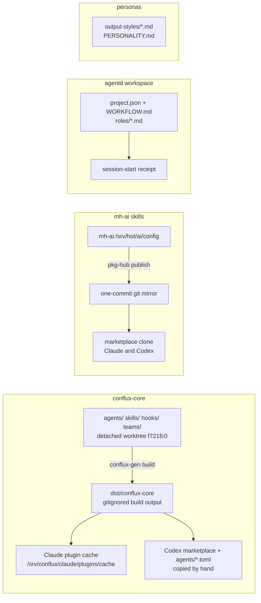

"Our agents" at Mad Hare is not one system. As of **2026-10-30** there are three separate agent
systems, built at different times for different purposes, plus a fourth layer of personas that
look like agents but are not. They overlap in names ("dispatcher", "tester") but not in
definitions. This lesson is the map.

## The inventory

| # | System | What it is | Defined in | Installed into | Status |
|---|---|---|---|---|---|
| 1 | **conflux-core** | Six generated role plugins: conflux-dispatcher, coder, tester, test-writer, doc-writer, doc-auditor | `madharedev/conflux-agents`, branch `feat/74-conflux-agents-v1.0.0` ([PR #83](https://github.com/madharedev/conflux-agents/pull/83)), checked out detached at `f721fc0` in `/srv/conflux/projects/madhare/worktrees/conflux-agents/install-f721fc0e9f2a` | Claude Code (plugins + subagents) and Codex (plugins + hand-copied agent tomls) | **Built**, from an unmerged branch |
| 2 | **mh-ai skills** | 19 one-skill plugins: house standards (mh-code-style, mh-api-construction, mh-config, …) and process skills (mh-dispatch, mh-merge-flow, …) | A directory on host mh-ai (`/srv/hot/ai/config`), published as a one-commit git mirror on madhare-pi | Claude and Codex; clone at `/srv/conflux/claude/plugins/marketplaces/mh-ai` | **Built**, not version-controlled in a repo |
| 3 | **agentd workspace roles** | Six roles: coordination, dispatcher, builder, docs-auditor, test-lead, custodian | `/srv/work/dev/agentd/conflux/project.json`, `instructions/WORKFLOW.md`, `instructions/roles/*.md`, `scripts/workspace.py` | Nowhere: an agent reads the briefs after running `session-start` | **Built (manual)**, stale since 10-25 |
| 4 | **Personas** | Bert, Calder, Kif, LaShonda, Reeve, Rook, Sabrina; a Codex personality | `/srv/conflux/claude/output-styles/*.md`, `/srv/conflux/codex/PERSONALITY.md`, a `calder` Codex plugin | Session output styles and session names | **Partial** ([PR #86](https://github.com/madharedev/conflux-agents/pull/86) open) |

And three more formats that exist but are not installed:

| Format | Where | Status |
|---|---|---|
| Vertex roles `roles/<slug>/role.yaml` (board-operator, code-executor, status-reporter) | conflux-agents [PR #82](https://github.com/madharedev/conflux-agents/pull/82) | Target, unmerged |
| 11 `agent.v1` packages (admin, architect, assistant, auditor, coder, designer, dispatcher, manager, reporter, tester, writer), only 5 with configs | install worktree `agents/` | Partial: only the 6 team members are built |
| "Definitions in the database" | conflux-agents `main` [README](https://github.com/madharedev/conflux-agents/blob/b15c16210e93e312b97bc4a789be570068285d49/README.md), agent-runtime [`libs/python/agents/README.md`](https://github.com/andrew-hodsdon/agent-runtime/blob/e9d46c2431759dfc87fbf93f05e24093ef421710/libs/python/agents/README.md) | Target: no database is referenced by anything installed |

The older `madharedev/madhare-agents` catalogue (`mha` loops: executive, marlowe, warren) is
**Abandoned**: archived, last pushed 2026-10-14, with inactive systemd units still on the host.

## System 1: conflux-core

This is the system that is meant to be the **product**: "agents as jobs… any project, system or
company can run" (install worktree `docs/README.md`). It is also the one you will use most,
because its agents show up in a Claude session as `subagent_type` values `coder:coder`,
`tester:tester`, `test-writer:test-writer`, `doc-writer:doc-writer`, `doc-auditor:doc-auditor`
and `conflux-dispatcher:conflux-dispatcher`.

### How one agent is defined

Each agent is a source package under `agents/<role>/`:

| File | Schema | What it holds |
|---|---|---|
| [`agent.yaml`](https://github.com/madharedev/conflux-agents/blob/f721fc0e9f2a30f9d91cc3509f5ef3e8da5f99de/agents/coder/agent.yaml) | `agent.v1` | Parameters, commands with input/output schemas, tools `[filesystem, git, gh, shell]`, skills, hooks, `model.prefer` |
| `charter.md` | Jinja template | The system prompt, for example `# Coder: {{ language }}…` with `` branches |
| `policy.yaml` | `policy.v1` | Intents (read/write allow; execute/network ask; destructive/credential/external-message/spend deny) and shell prefixes |
| `configs/<name>.yaml` | `agent-config.v1` | The bindings that fill the template, for example `language: typescript`, `frameworks: [nestjs]` |

Around them: `skills/<name>/{skill.yaml,SKILL.md}` (16 skills), `hooks/<name>/` (4 hooks plus a
shared `_lib`), 31 schemas in `libs/schema/`, and the team file
[`teams/core.yaml`](https://github.com/madharedev/conflux-agents/blob/f721fc0e9f2a30f9d91cc3509f5ef3e8da5f99de/teams/core.yaml).

### How it is built and installed

The generator `conflux-gen` (in `libs/generator`) renders those packages into
`dist/conflux-core/`, which contains a Claude marketplace (`.claude-plugin/marketplace.json`),
a Codex marketplace (`.agents/plugins/marketplace.json`), and per plugin a Claude agent
(`agents/<n>.md`), a Codex agent role (`codex/agents/<n>.toml`), skills, `hooks/hooks.json`,
`policy.json` and a `conflux.lock`. Lesson 3 is the lab where you run it.

Install chain, verified 2026-10-30:

- **Claude:** `/srv/conflux/claude/settings.json` → `extraKnownMarketplaces.conflux-core.source.path`
  points at `…/install-f721fc0e9f2a/dist/conflux-core`. The plugin cache under
  `/srv/conflux/claude/plugins/cache/conflux-core/<plugin>/1.0.0` was installed 2026-10-29.
- **Codex:** `/srv/conflux/codex/config.toml` `[marketplaces.conflux-core]` points at the same
  path. The agent roles are copied **by hand** into `/srv/conflux/codex/agents/*.toml`; the
  [install guide](https://github.com/madharedev/conflux-agents/blob/f721fc0e9f2a30f9d91cc3509f5ef3e8da5f99de/docs/install.md)
  says "the installer is Target ([#72](https://github.com/madharedev/conflux-agents/issues/72))".

### Where it really comes from

Here is the uncomfortable part. `conflux-agents` `main` (`b15c162`) "intentionally contains no
active agent implementations… after the v1.1.0 reset" and says canonical records "live in the
configured database". The source the agents are built from is the open PR #83 branch, checked out
as a **detached HEAD** in a worktree named `install-f721fc0e9f2a`, not a branch name. And
`dist/` is in `.gitignore`, so the exact files Claude and Codex load are **build output that is
not committed anywhere**. They are reproducible (lesson 3 proves it), but only from that
worktree.

> [!WARNING]
> **Finding (High): installed agents come from an unmerged, detached worktree.** AGENTS.md says
> "Nothing is deployed from a commit that isn't pushed" and "One worktree per task branch". The
> commit is pushed, but it is unmerged, the worktree is not a task branch, and the loaded files
> are gitignored build output. **Fix:** merge PR #83 and #85, tag a version, build into a
> versioned install path (for example `…/conflux-core/1.0.0`), and point both hosts at it.

### The coder is hard-wired

The coder config ([`configs/coder.yaml`](https://github.com/madharedev/conflux-agents/blob/f721fc0e9f2a30f9d91cc3509f5ef3e8da5f99de/agents/coder/configs/coder.yaml))
binds `language: typescript`, `frameworks: [nestjs]`, `review_branch: andrew/review` and
`check_command: TMPDIR=/srv/work/dev/agentd make check`. Its rendered charter begins "Coder:
typescript (nestjs), implementation". Yet the same coder is dispatched for Python engine work and
test work. The package format supports multiple configs per agent; only one was written.

## System 2: mh-ai skills

These are the **house standards**. Each plugin is one skill (`skills/<name>/SKILL.md`). The
marketplace is a git repo on the madhare-pi host, cloned at
`/srv/conflux/claude/plugins/marketplaces/mh-ai`. `git rev-list --count HEAD` is **1**: commit
`7e2e0e4`, "publish mh-ai from mh-ai:/srv/hot/ai/config", 2026-10-07, author `pkg-hub`.

| Enabled in Claude and Codex (8) | Disabled in both (11) |
|---|---|
| fastapi, mh-api-construction, mh-code-style, mh-config, mh-container-images, mh-database-migrations, mh-doc-site, mh-documentation | mh-dispatch, mh-checkpoint-reporting, mh-cross-model-review, mh-delivery-index, mh-docs-swarm, mh-feature-delivery, mh-merge-flow, mh-release-planning, mh-test-automation, mh-trace-capture, mh-trace-telemetry |

The standards skills are the ones AGENTS.md §Engineering standards names, and they are **Built**.
The process skills were superseded by conflux-core and AGENTS.md and are switched off, which is
correct, but they still sit in the marketplace. One oddity: plugin `fastapi` has source
`./skills/mh-dump`, whose SKILL.md is the official FastAPI skill.

**Product or internal?** Internal. They encode Mad Hare's NestJS/Python house style.

## System 3: agentd workspace roles

The agentd workspace (`/srv/work/dev/agentd/conflux`) predates the global process. It defines six
roles in `project.json` and gives each a short brief in `instructions/roles/*.md` (5–68 lines).
Every role brief says "Prepared only; no worker/session is launched by this brief." The rules are
in `instructions/WORKFLOW.md` (132 lines of dated amendments), `ENGINEERING.md` and `TESTING.md`.

An agent "becomes" a role by running `./scripts/session-start --role R --session ID`, which writes
a receipt (lesson 4). Nothing is installed into a host. The role is whatever the agent does after
reading the brief.

| agentd role | Nearest conflux-core agent |
|---|---|
| coordination | (the hub session itself) |
| dispatcher | conflux-dispatcher |
| builder | coder |
| docs-auditor | doc-auditor |
| test-lead | tester (+ test-writer) |
| custodian | none |

**Product or internal?** Internal tooling, rebuilt per workspace: there are six copies of
`workspace.py` in four variants across agentd projects (Module 5).

## Layer 4: personas

Personas are **not agents**. They are Claude output styles in
`/srv/conflux/claude/output-styles/`: Bert (web and docs), Calder (conflux-agents and engine), Kif
(Sabai), LaShonda (Mad Hare's own Conflux), Reeve (hub), Rook (Code A Zone) and Sabrina (company
ops). In practice a hub session forks named persona sessions that message each other and dispatch
conflux-core subagents. Codex has a `PERSONALITY.md` and a `calder` plugin. AGENTS.md says "Any
persona lives in a separate personality file, never in process", and that rule is followed.
PR #86 proposes versioning them in conflux-agents.

## Product vs internal, at a glance

| Piece | Product or internal | Status |
|---|---|---|
| conflux-core packages, `conflux-gen`, schemas, hooks | Product (intended) | Built on an unmerged branch |
| Vertex runtime `roles/*`, console | Product | Target (PR #82) |
| Twin-run harness (agent-runtime) | Internal R&D | Partial: "still needs its own execution evidence" |
| mh-ai skills | Internal standards | Built, no repo history |
| agentd workspace, `session-start`, leases | Internal, per workspace | Built (manual), stale |
| Personas | Internal | Partial (PR #86) |

> [!TIP]
> When someone says "the dispatcher", ask which one: the conflux-core plugin
> (`conflux-dispatcher:conflux-dispatcher`), the agentd `dispatcher` role brief, or the disabled
> mh-ai `mh-dispatch` skill. They have different branch rules (lesson 6).

## Check yourself

1. You see `coder:coder` in Claude's agent list. Which file on disk did its prompt come from, and
   which git commit built it?
2. Why can't you review the history of a change to the mh-code-style skill on GitHub?
3. Is Reeve an agent? What is she, and where is she defined?

Answers

1. From the Claude plugin cache `/srv/conflux/claude/plugins/cache/conflux-core/coder/1.0.0/agents/coder.md`,
   which is a copy of `dist/conflux-core/plugins/coder/` in the install worktree. That was built by
   `conflux-gen` from commit `f721fc0` on the open PR #83 branch, checked out detached. `dist/` is
   gitignored, so the built file itself is not committed.
2. mh-ai is a one-commit mirror published by `pkg-hub` from a directory on host mh-ai. There is no
   GitHub repo, no PR and no history for the skill.
3. No. Reeve is a persona: a Claude output style (`/srv/conflux/claude/output-styles/reeve.md`)
   used by the hub session. Personas name sessions; the agents those sessions dispatch are the
   conflux-core plugins.

