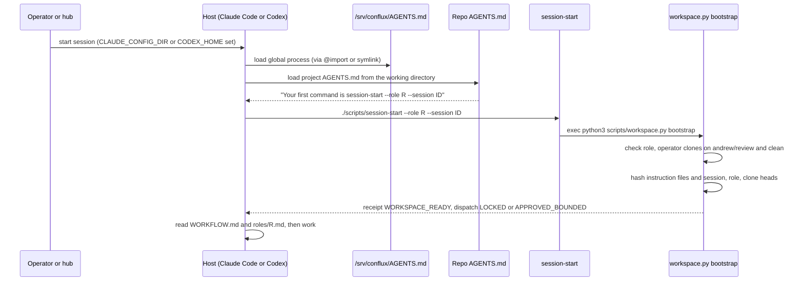

## Goal

Find out, from the files themselves, what an agent actually knows when its session starts: which
instructions it loads, which role it holds, and what it is allowed to do. There are two entry
paths, the **host load** (every session) and the **agentd session entry** (only in an agentd
workspace), and they were built a week apart.

This lab is **read-only**. You will read receipts, not create them. Running `session-start`
writes a receipt into the workspace's `state/`, so don't run it for this lab.



## Before you start

- You need read access to `/srv/conflux/` and `/srv/work/dev/agentd/conflux/`.
- Know the vocabulary: a **receipt** is the JSON file bootstrap writes; a **lease** is a registered
  temporary path with an expiry and an owner; **dispatch** is permission to run product work.

## Steps

### 1. Claude Code: follow the load chain

```bash
cat /srv/conflux/claude/environment.sh
cat /srv/conflux/claude/CLAUDE.md
readlink -f /srv/conflux/AGENTS.md
```

Expected:

```
export CLAUDE_CONFIG_DIR="/srv/conflux/claude"
@/srv/conflux/AGENTS.md
/srv/conflux/projects/operations/repos/madhare-support/agents/AGENTS.md
```

So a Claude session with that environment reads `CLAUDE.md`, whose only line imports the global
process, which is the madhare-support checkout. Claude also loads the `AGENTS.md`/`CLAUDE.md` of the
working directory. In the Conflux workspace that is `/srv/work/dev/agentd/conflux/AGENTS.md`,
which says "Your first command is `./scripts/session-start --role YOUR_ROLE --session …`".

Look at the settings that shape every session:

```bash
grep -n -E 'disableAllHooks|CONFLUX_HOOKS|defaultMode' /srv/conflux/claude/settings.json
```

Expected:

```
14:    "CONFLUX_HOOKS": "off"
18:    "defaultMode": "bypassPermissions"
20:  "disableAllHooks": true,
```

No hooks run, and no tool call asks for permission. Lesson 5 explains why.

### 2. Codex: follow the load chain

```bash
echo "$CODEX_HOME"
ls -la /srv/conflux/codex/AGENTS.md /srv/conflux/codex/config.toml 2>&1
```

Expected per the design (and as found by the research run earlier on 2026-10-30):

```
/srv/conflux/codex
lrwxrwxrwx … /srv/conflux/codex/AGENTS.md -> /srv/conflux/AGENTS.md
-rw-… /srv/conflux/codex/config.toml
```

with `config.toml` setting `model = "gpt-6.1-sol"`, `model_reasoning_effort = "xhigh"`,
`sandbox_mode = "danger-full-access"` and `approval_policy = "never"`.

> [!WARNING]
> **This fails today; that is the lesson.** At 14:49Z on 2026-10-30 both paths returned `No such
> file or directory`. The Codex home had been rewritten at 14:47Z (a `rollback/codex-migration`
> folder appeared) and held only caches (`plugins/cache`, `skills/.system`, `models_cache.json`).
> A Codex session started in that state loads **no global process file**. Nothing regenerates the
> symlink or the config; they were placed by hand. **Fix:** keep `CODEX_HOME`'s `AGENTS.md`
> symlink and `config.toml` in a versioned install step (madhare-support or the conflux-core
> installer, [#72](https://github.com/madharedev/conflux-agents/issues/72)) and check them in the
> board audit.

### 3. agentd: see what session-start actually runs

```bash
cd /srv/work/dev/agentd/conflux
cat scripts/session-start
python3 scripts/workspace.py --help | head -6
```

Expected:

```
#!/usr/bin/env bash
set -euo pipefail
root=$(cd -- "$(dirname -- "$0")/.." && pwd)
exec python3 "$root/scripts/workspace.py" bootstrap "$@"
usage: workspace.py [-h] [--workspace WORKSPACE]
                    {bootstrap,register-temp,guard-temp,prune} ...

Local workspace readiness and explicit temporary-file leases; no model calls.
```

Now read the function (do not run it):

```bash
sed -n 86,126p scripts/workspace.py
```

What `bootstrap()` does, in order:

| Check or action | Fails how |
|---|---|
| Role must be in `project.json` `roles` | `unknown role` |
| `operator/`, `worktrees/`, `plans/`, `scratch/`, `state/`, `evidence/` must exist | `missing workspace directory` |
| Every `operator/<repo>` clone on branch `andrew/review` | `operator branch mismatch` |
| …and clean (`git status --porcelain` empty) | `operator checkout dirty` |
| SHA-256 over the instruction files, `workspace.py`, and `[session, role, clone heads]` | — (this is the fingerprint) |
| Write `state/bootstrap-<sha256(session)[:20]>-<role>.json` unless the fingerprint is unchanged | — (`receipt_reused: true`) |
| If `--dispatch` was asked and no current approval exists | exit **78**, status `BLOCKED` |

### 4. Check the operator clones it depends on

```bash
for r in operator/*; do echo "$r $(git -C $r branch --show-current) $(git -C $r rev-parse --short HEAD) dirty=$(git -C $r status --porcelain | wc -l)"; done
gh api repos/madharedev/conflux-agents/branches/andrew%2Freview -q .name 2>&1
```

Expected:

```
operator/conflux-agents andrew/review 4a0f509 dirty=0
operator/conflux-engine andrew/review 6faebe1 dirty=0
operator/madhare-testing andrew/review 3d76246 dirty=0
{"message":"Branch not found",…,"status":"404"}gh: Branch not found (HTTP 404)
```

The local clones pass the check, but the **remote** `andrew/review` no longer exists on
conflux-agents (or conflux-engine). Bootstrap only checks the local branch name, so it says
"ready" against a branch the global process has replaced with `release/…`.

### 5. Read the receipts

```bash
ls state/bootstrap-*.json | wc -l
ls -t state/bootstrap-*.json | head -1 | xargs cat
```

Expected (trimmed):

```
151
{
  "project": "conflux",
  "role": "coordination",
  "status": "WORKSPACE_READY",
  "dispatch": "LOCKED",
  "receipt_reused": false,
  "instruction_version": "conflux-ls1-approved-cli-20261021.1",
  "adapter_enforcement": "NOT_VERIFIED",
  "checked_at": "2026-10-30T14:04:34.293155Z"
}
```

151 receipts: builder 66, coordination 35, test-lead 32, docs-auditor 11, dispatcher 5,
custodian 2. Two fields to understand:

- **`adapter_enforcement: NOT_VERIFIED`** is hard-coded. The receipt proves the agent *ran the
  command*, not that the host is enforcing anything. The repo AGENTS.md says it plainly: "Do not
  claim universal host interception." A receipt is a self-report.
- **`dispatch: LOCKED`**: see the next step.

### 6. Find out why dispatch is LOCKED

```bash
python3 -c "import json;d=json.load(open('state/approved-dispatch.json'));print(d['approved_by'], d['batch_id'], d['expires_at'])"
sed -n 73,84p scripts/workspace.py
```

Expected:

```
Andrew CFLX-LS1-20261021 2026-10-22T22:00:00Z
```

`approved_dispatch()` needs `approved_by == 'Andrew'`, the matching batch id,
`remove_preparation_hooks: true` **and** `expires_at` in the future. The approval expired on
2026-10-22 at 22:00Z, so every receipt since then says `LOCKED`. The overnight work after that ran
under separate JSON "authority" files (`state/overnight-dispatch-20261022.json`), outside this
check. The gate exists, but work went around it.

### 7. Leases for temporary paths

```bash
python3 scripts/workspace.py register-temp --help | head -3
python3 -c "import json;r=json.load(open('state/leases.json'));print(len(r), r[-1]['created_at'], r[-1]['expires_at'])"
```

Expected:

```
usage: workspace.py register-temp [-h] --expires-at EXPIRES_AT --owner OWNER
                                  --issue ISSUE
                                  path
116 2026-10-25T17:06:11.607706Z 2026-10-26T17:15:00Z
```

A lease ties a scratch path to an owner, an issue and an expiry; `guard-temp` refuses an
unleased path and `prune` deletes expired ones (but refuses if a process still has it open).
This is good hygiene. Note the date of the newest lease: **10-25**. Work since then has used the
new layout (`/srv/conflux/projects/<project>/worktrees/…`), which has no leases and no receipts.

## If it fails

- `CLAUDE.md` has more than one line or a different import: someone edited the host config.
  AGENTS.md says process changes go through a madhare-support PR, so report it.
- `operator/…` shows a different branch or `dirty>0`: bootstrap would refuse. Do not "fix" the
  clone; report it to the coordinator.
- No `state/approved-dispatch.json`: bootstrap still writes a receipt, with `dispatch: LOCKED`.
- The Codex files exist again: good. Record when you saw them and diff `config.toml`'s
  `[marketplaces.conflux-core]` path against the Claude one.

## Done when

- [ ] You can draw the Claude load chain from `CLAUDE_CONFIG_DIR` to the madhare-support file
- [ ] You checked the Codex `AGENTS.md` symlink and `config.toml` and recorded what you found
- [ ] You can list the bootstrap checks and the exit code for a refused dispatch (78)
- [ ] You can explain why the newest receipt says `LOCKED` (approval expired 2026-10-22T22:00Z)
- [ ] You can explain why `adapter_enforcement: NOT_VERIFIED` means a receipt is a self-report
- [ ] You can say what a lease is and why none have been created since 10-25
