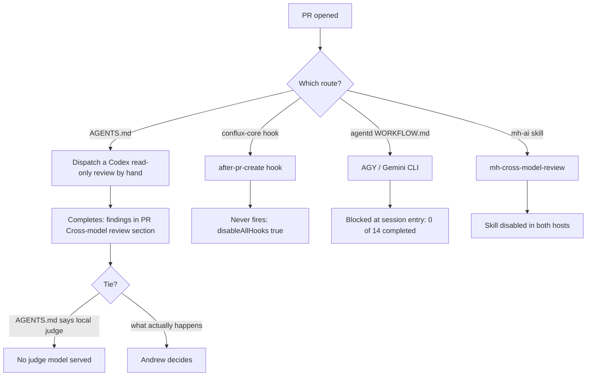

Cross-model review is the main quality control in our method: an agent from one model family
checks the work of another, because models from the same family tend to share blind spots. The
method depends on it. As of **2026-10-30** it is defined four ways, automated once, and the
automation is switched off. This lesson explains how we got here.

## The four definitions

| # | Where | Rule | Status |
|---|---|---|---|
| 1 | `AGENTS.md` [§Cross-model review, line 112](https://github.com/madharedev/madhare-support/blob/865da77acbc2b7eba46ed22d2ba722ff5a39b7a2/agents/AGENTS.md#L112) | Reviewer is always the other family: Codex writes and Claude reviews, or the reverse. "The local judge breaks ties." | **Built** as a manual dispatch; judge is **Target** |
| 2 | mh-ai skill `mh-cross-model-review` | Codex or agy as reviewer | **Disabled** in both Claude and Codex |
| 3 | conflux-core hook [`cross_model_review.py`](https://github.com/madharedev/conflux-agents/blob/f721fc0e9f2a30f9d91cc3509f5ef3e8da5f99de/hooks/cross-model-review/cross_model_review.py#L26) | After a PR is created, route to `OTHER_FAMILY = {"claude": "codex", "codex": "claude", "unknown": "codex"}` | Installed, **inert** (hooks off) |
| 4 | agentd `instructions/WORKFLOW.md` line 80 | "Cross-model review is AGY CLI with actual model/session/full-head proof… a Copilot ask does not count." | **Fails**: 0 of 14 runs completed |

Only one path reaches a verdict: a Codex review dispatched by hand when Claude authored the change
(`codex exec -s read-only`, gpt-6.1-sol). [conflux-api PR #80](https://github.com/madharedev/conflux-api/pull/80)
is the worked example: six Codex review rounds, 25 findings, fixes validated, hours recorded.

## Why the AGY runs fail

The agentd workspace mandates AGY (the Gemini CLI). Its run records are in
`/srv/work/dev/agentd/conflux/state/agy-reviews/*.json`. All 14 date from 2026-10-22, all
requested `gemini-4-argon-high`:

| Status | Count | What happened |
|---|---|---|
| `STOPPED` | 9 | Stopped before producing a verdict |
| `STOPPED_ENTRY_BLOCKED_NOT_REVIEW` | 3 | AGY could not get through session entry, so it never reviewed |
| `BLOCKED_HEADLESS_COMMAND_AUTO_DENIAL` | 2 | `actual_verdict`: "NOT RUN: mandatory bootstrap refused by native headless permission mode" |
| **Completed** | **0** | |

The mechanism is visible in the records. The workspace AGENTS.md says an agent's **first command**
must be `./scripts/session-start …`. AGY was launched headless (`transport: agy-print-process`)
with a permission mode of `request-review`. In headless mode there is nobody to approve a shell
command, so AGY auto-denied the mandatory first command, and the agent stopped before reading a
single line of the PR. The entry ritual designed to make reviews trustworthy is what prevented
them.

Meanwhile `state/claude-reviews/` shows 10 `COMPLETED` (docs-auditor 6, test-lead 4) and 17
still `LAUNCHED` with no result. Those reviewers were Claude, reviewing work built by Claude
builders: **same family**, so they do not satisfy any of the four definitions.

> [!WARNING]
> **Finding (High): cross-model review has four specs and one working path.** Across 16 sampled
> PRs, only 4 of 14 merged PRs had a finished cross-model review on the merged head (Module 5).
> On 10-30, jbc-site-plan-review-engine #537 was merged with "Cross-model review: Not yet" and a
> post-merge Codex review came back REQUEST_CHANGES. **Fix:** make AGENTS.md the only definition,
> make review a **dispatched step** in the feature's test task (not a hook), delete the AGY rule
> from WORKFLOW.md, and name the actual tie-breaker.

## The hook incident, 2026-10-22

Claude Code hooks are shell commands that run on events. A `PreToolUse` hook runs before every
tool call and can **block** it by exiting with code 2 ([hooks reference](https://code.claude.com/docs/en/hooks)).
That makes them a powerful gate, and a dangerous one.

### What was installed

Each agentd workspace had a `PreToolUse` hook, `scripts/claude-hook.py`. A backup of the madhare
workspace's copy is at
`/srv/work/dev/agentd/fleet/state/claude-hooks-disabled-20261022T061253Z/before/srv/work/dev/agentd/madhare/scripts/claude-hook.py`.
Lines 24–34 are the core of it:

- Comment: "The workspace is deliberately not released for delivery yet. Read-only built-in
  inspection and the exact bootstrap command are the only permitted operations."
- Allow `Read`, `Glob`, `Grep`.
- Allow `Bash` only if the command, split into words, is exactly
  `./scripts/session-start --role <a known role> --session <this session>`.
- Everything else: denied, unless a per-session grant file `state/docs-grants/<session>.json`
  existed.

That is a **default-deny** gate. It was written while the workspaces were being prepared, and it
was never relaxed when work began.

### What happened

Agents could read files and enter the workspace, and nothing else: no edits, no builds, no `git`,
no `gh`. On 2026-10-22 Andrew wrote, in two messages kept as evidence in
`/srv/work/dev/agentd/conflux/evidence/aud-hook-authority-20261022/authority-native.json`:
"please remove or relax the claude hooks they are blocking everythign", then "nothing should be
blocked, at all".

### The fix that was applied

Fleet (the operations session) did the following, recorded as
`FIXED_VERIFIED_CONFIG_AND_PROTOCOL` in
`/srv/work/dev/agentd/conflux/evidence/aud-hook-authority-20261022/fleet-hook-retirement-receipt.loaded.json`:

1. Set `"disableAllHooks": true` in the global `/srv/conflux/claude/settings.json` and in six
   workspaces.
2. Removed the `SessionStart` and `PreToolUse` entries in jbc, madhare, sabai and support.
3. Turned the hook scripts into no-ops.
4. Wrote the direction into every workspace AGENTS.md: keep hooks disabled, "do not restore them
   or replace them with another tool-denial gate".

It worked. Agents could work again the same morning.

### The consequence

`disableAllHooks` is global. It switches off **every** hook, including ones installed later.
Seven days afterwards, on 2026-10-29, the conflux-core plugins were installed, and each ships
hooks:

| Plugin hook | Event | Meant to do | Today |
|---|---|---|---|
| `policy` | Claude `PreToolUse` (all tools) | Enforce `policy.yaml`: deny `git push --force`, `git push origin main`, destructive, credential, external-message and spend intents | Inert |
| `update-issues` | before-dispatch, after-dispatch, after-merge | Move issues to In Progress / In Review / Done | Inert |
| `add-hours` | before-dispatch, after-dispatch | Measure and record hours on the task ("Hours are recorded on every task… No exceptions") | Inert |
| `cross-model-review` | after-pr-create | Dispatch the other-family review | Inert |
| `doc-audit` | after-pr-create | Tell the agent to dispatch the doc auditor | Inert |

The install guide says so itself ([lines 50–53](https://github.com/madharedev/conflux-agents/blob/f721fc0e9f2a30f9d91cc3509f5ef3e8da5f99de/docs/install.md#L50-L53)):
"Plugin hooks, including the policy hook, are skipped while `disableAllHooks` is `true`… their
policy is then not enforced". The settings also set `CONFLUX_HOOKS=off`, a second switch for the
same thing.

Add the permission settings and the picture is complete:

| Host | Setting | Effect |
|---|---|---|
| Claude Code | `defaultMode: bypassPermissions` | No permission prompts |
| Claude Code | `disableAllHooks: true` | No policy hook |
| Codex | `sandbox_mode = "danger-full-access"`, `approval_policy = "never"` | No sandbox, no prompts |

So the [coder policy](https://github.com/madharedev/conflux-agents/blob/f721fc0e9f2a30f9d91cc3509f5ef3e8da5f99de/agents/coder/policy.yaml)
deny rules are text in a prompt and nothing more. An agent that decides to force-push is stopped
only by its own judgment and by GitHub branch protection. At research time Codex still ran its own
GitKraken hooks (`/srv/conflux/codex/hooks.json`), so "hooks disabled fleet-wide" meant Claude only.

> [!WARNING]
> **Finding (High): the fix for an over-blocking hook removed all enforcement.** The old hook was
> default-deny and blocked real work; the remedy disabled every hook, including the policy, hours,
> issue-status and review hooks installed a week later. Hours capture and auto-review are now
> manual and inconsistent (4 of 16 sampled PRs have no hours). **Fix:** keep hooks off for
> *gating*, as Andrew directed, and move the useful work into dispatched steps and server-side
> checks: a GitHub Action that fails a PR without Hours or a Cross-model review section, branch
> protection for `main` and release branches, and an explicit `add-hours` call in the
> merge-and-close skill. That enforces the process without blocking any tool call.

### The lesson for agents

Andrew's direction is binding and specific: **do not restore hooks and do not build a replacement
tool-denial gate.** That rules out "just turn the policy hook back on". It does not rule out
checks that run *after* work, on GitHub, where they cannot block an agent mid-task.

> [!TIP]
> When you open a PR today, do by hand what the inert hooks would have done: request the
> other-family review, move the issue status, and record hours on the task and in the PR's Hours
> section. Say in the PR that you did it by hand.

## Check yourself

1. Claude authored a PR. Which review route will actually produce a verdict, and which three will
   not? Give the reason for each failure.
2. Why did AGY never review anything, even though it was authenticated and the model started?
3. Andrew said "nothing should be blocked, at all". Why does that not stop us from adding a
   GitHub Action that fails PRs without an Hours section?

Answers

1. A Codex read-only review dispatched by hand (AGENTS.md) works. The conflux-core hook never
   fires because `disableAllHooks` is true. The AGY route is blocked at session entry (0 of 14
   completed). The mh-ai `mh-cross-model-review` skill is disabled in both hosts.
2. The workspace makes `session-start` the mandatory first command. AGY ran headless with a
   `request-review` permission mode, so it auto-denied that shell command and stopped before
   reviewing. Its records say "NOT RUN: mandatory bootstrap refused by native headless permission
   mode".
3. His direction was about hooks that block agents' tool calls. A server-side check on the PR
   blocks no tool call; it reports a missing section after the work is done, which is the process
   AGENTS.md already requires.

