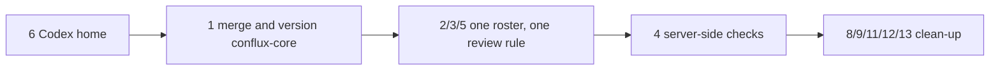

This lesson collects every finding from Module 3 in one table, as of **2026-10-30**. None of
them is anyone's fault. Each came from a sensible decision made under pressure: a gate written
while workspaces were being prepared, a quick install from a working build, a process file
written a week after the workspaces. What makes them findings is that nobody went back. Most of
the fixes are small. The order matters more than the size.

## The findings

| # | Finding | Evidence | Severity | The fix |
|---|---|---|---|---|
| 1 | **Installed agents come from an unmerged, detached worktree.** The files both hosts load are gitignored build output. | `known_marketplaces.json` and the Codex marketplace point at `…/install-f721fc0e9f2a/dist/conflux-core`; `git worktree list` shows `(detached HEAD)`; `dist/` matched by `.gitignore:12`; `main` README "intentionally contains no active agent implementations" ([README](https://github.com/madharedev/conflux-agents/blob/b15c16210e93e312b97bc4a789be570068285d49/README.md)); [PR #83](https://github.com/madharedev/conflux-agents/pull/83) open | High | Merge #83 and #85, tag `v1.0.0`, build into a versioned path, repoint both hosts, delete the install worktree |
| 2 | **The roster contradicts itself.** Claude dispatches and Codex implements (AGENTS.md); Codex leads and Claude Sonnet builds (agentd); every plugin agent is Opus. | [AGENTS.md:9–11](https://github.com/madharedev/madhare-support/blob/865da77acbc2b7eba46ed22d2ba722ff5a39b7a2/agents/AGENTS.md#L9-L11); `project.json` `lead_profile`/`worker_profile`; WORKFLOW.md:32–33; `dist/…/agents/*.md` line 4 `model: opus` | High | AGENTS.md is the one roster. Map agentd roles to conflux-core names; generate or delete the `project.json` profiles; pin the coder's model family in the agent package |
| 3 | **Cross-model review has four definitions and one working path.** | AGENTS.md:112; mh-ai skill disabled; [hook](https://github.com/madharedev/conflux-agents/blob/f721fc0e9f2a30f9d91cc3509f5ef3e8da5f99de/hooks/cross-model-review/cross_model_review.py#L26) inert; WORKFLOW.md:80 AGY; `state/agy-reviews` 0 of 14 completed; `state/claude-reviews` same-family | High | One definition (AGENTS.md). Review is a dispatched step in the feature's test task. Remove the AGY rule and the disabled skill |
| 4 | **The fix for an over-blocking hook removed all enforcement.** Policy, hours, issue-status and review hooks are installed but inert. | `settings.json` `disableAllHooks: true`, `CONFLUX_HOOKS: off`; old `claude-hook.py` lines 24–34 (default-deny); `authority-native.json`; [install.md:50–53](https://github.com/madharedev/conflux-agents/blob/f721fc0e9f2a30f9d91cc3509f5ef3e8da5f99de/docs/install.md#L50-L53) | High | Keep hooks off (Andrew's direction). Enforce after the fact: a PR check for Hours and Cross-model review sections, branch protection on `main`/`release/*`, `add-hours` called from merge-and-close |
| 5 | **The local judge and Vera do not exist.** | `ssh mh-ai docker ps`: only `vllm-embed-qwen3-8b` (embedding); twin judge is `claude-opus-5-5` ([README:75](https://github.com/andrew-hodsdon/agent-runtime/blob/e9d46c2431759dfc87fbf93f05e24093ef421710/libs/harnesses/twin/README.md#L75)); Vera only at AGENTS.md:141 | High | Serve and qualify a local chat model, or name Andrew as tie-breaker in AGENTS.md. Define Vera as an agent with a refinement command, or remove her |
| 6 | **The Codex home lost its process link and config.** | Research run (2026-10-30, earlier): `AGENTS.md` symlink, `config.toml`, `agents/*.toml`, `hooks.json` present. At 14:49Z: all absent after a rewrite at 14:47Z (`rollback/codex-migration`); only caches remain | High | Make the Codex home a versioned install step (symlink, `config.toml`, agent roles), re-run it, and check it in every board audit ([#72](https://github.com/madharedev/conflux-agents/issues/72)) |
| 7 | **Branch and merge rules drift.** The installed dispatcher uses `main ← integration ← rls/<release>` and forbids agent merges; AGENTS.md uses `release/vX.Y.Z → epic → feat → task` and "Agents can merge anything" with approval; agentd says "Andrew… alone merges". | `dist/…/conflux-dispatcher/agents/conflux-dispatcher.md` lines 15–17; AGENTS.md:101; [PR #85](https://github.com/madharedev/conflux-agents/pull/85) open | Med | Merge and install #85; generate the dispatcher's branch rules from AGENTS.md text, not a copy |
| 8 | **Status names and PR templates differ.** | AGENTS.md: Backlog → Refining → Ready → … → Done and Closes · Ran It · Cross-model · Docs · Version · Hours. WORKFLOW.md:11 `Backlog -> Draft -> …`; WORKFLOW.md:82 What / Ran it / Unverified / Dependencies. [coder config](https://github.com/madharedev/conflux-agents/blob/f721fc0e9f2a30f9d91cc3509f5ef3e8da5f99de/agents/coder/configs/coder.yaml) `In Progress` / `In Review` | Med | Use the AGENTS.md vocabulary everywhere; fix the hook bindings' capitalisation; retire the WORKFLOW.md template |
| 9 | **The definition of record is unresolved.** README says "the configured database"; nothing installed references one. Three file formats coexist. | conflux-agents README; agent-runtime [`libs/python/agents/README.md`](https://github.com/andrew-hodsdon/agent-runtime/blob/e9d46c2431759dfc87fbf93f05e24093ef421710/libs/python/agents/README.md); `agent.yaml`, `roles/*/role.yaml` (PR #82), agentd `roles/*.md` | Med | Decide: files in conflux-agents (with `conflux-gen --check`) are the record until a database exists. Write that into the README |
| 10 | **Every definition has four copies, and Codex roles were copied by hand.** | Source `skills/code/SKILL.md`, `dist/`, Claude cache, Codex cache (lab 3); install.md: "The agent role is copied by hand" | Med | One installer for both hosts (#72), with `--check` in the board audit |
| 11 | **The coder is hard-wired to NestJS/TypeScript** but dispatched for Python and test work. | `configs/coder.yaml` bindings; rendered "Coder: typescript (nestjs)" | Med | Add `coder-python` and `coder-tests` configs; the dispatcher picks the config per issue |
| 12 | **Workspace entry is stale and routes around its own gate.** Approval expired 2026-10-22T22:00Z, so every receipt says `LOCKED`; work continued under side JSON files. Bootstrap checks a local `andrew/review` that no longer exists on GitHub. Receipts are self-reports (`NOT_VERIFIED`). | `state/approved-dispatch.json`; `workspace.py:73–126`; `gh api …/branches/andrew%2Freview` 404; WORKFLOW.md amendment stack | Med | Retire agentd session entry for work under the new layout, or update its baselines to `release/*`. Keep one authority file per batch |
| 13 | **mh-ai skills have no repo history.** One commit by `pkg-hub` from a host directory; `fastapi` points at `skills/mh-dump`. | `git rev-list --count HEAD` = 1 in the marketplace clone | Low | Move the skills into a GitHub repo (for example conflux-agents `skills/`) and review changes by PR |
| 14 | **Both hosts run with no prompts and no sandbox.** | Claude `bypassPermissions`; Codex `danger-full-access`, `approval_policy = "never"` (at research time) | Low (given 4) | Acceptable on a single-operator dev box *if* finding 4's server-side checks exist. Document it as a deliberate choice |

## Fix order

The findings depend on each other. This order removes the most risk per step:

1. **Restore the Codex home** (finding 6). Without it, Codex sessions run without the process.
2. **Merge and version conflux-core** (findings 1, 7, 10). Everything else edits files that
   should come from a merged, tagged source.
3. **One roster, one review rule** (findings 2, 3, 5). Edit AGENTS.md through a madhare-support
   patch release, then regenerate the agents from it.
4. **Server-side enforcement** (findings 4, 14). A PR check plus branch protection, no hooks.
5. **Clean up** (findings 8, 9, 11, 12, 13).

## Questions only Andrew can answer

These came out of the research and are blocking several fixes. Until they are answered, follow
AGENTS.md and say in your report which assumption you made.

| Question | Blocks |
|---|---|
| Which roster is authoritative, and should agentd roles be mapped onto conflux-core names? | 2 |
| Who or what is Vera? | 5 |
| Which local model is the judge, and where will it be served? Or is the tie-breaker Andrew? | 3, 5 |
| Is review a dispatched step (not a hook) from now on? | 3, 4 |
| May PR #83 and #85 be merged, and what "database" is the definition of record? | 1, 9 |
| With hooks off, how should hours and the policy deny rules be enforced? | 4 |
| Should mh-ai skills move into a GitHub repo? | 13 |
| Are personas part of the product or private to the fleet (PR #86)? | — |

## Working safely in the meantime

- Dispatch conflux-core agents as they are, but **read the dispatcher's branch rules against
  AGENTS.md** before you follow them.
- Request a **Codex** review by hand for any Claude-authored PR and record it in the PR.
- Record **hours** yourself on the task and in the PR.
- Never deploy or install from a worktree you created. If you must rebuild agents, build into
  scratch and use `--check`; do not overwrite `dist/`.
- When two files disagree, say so in your report. That is how these findings were found.

> [!TIP]
> Re-run lab 3 and lab 4 at each board audit. If `--check` prints drift, a Codex file has gone
> missing, or a receipt shows a new `instruction_version`, something changed and the board should
> show who changed it.

## Check yourself

1. Why does finding 1 come before finding 2 in the fix order?
2. Which finding would you fix first if Codex were about to start a release, and why?
3. A colleague proposes re-enabling only the conflux-core policy hook "because it's not the old
   one". What do you tell them?

Answers

1. Fixing the roster means editing agent packages and regenerating them. Until conflux-core is
   merged and versioned, those edits would land in an unmerged detached worktree and be installed
   from gitignored output, so the fix would itself be undeployable by the process.
2. Finding 6. Without the `AGENTS.md` symlink and `config.toml` in `CODEX_HOME`, a Codex session
   loads no global process and no conflux-core marketplace config, so it would not know the
   release, branch or review rules at all.
3. Andrew's direction is to keep hooks disabled and not replace them with another tool-denial
   gate. The policy hook is a `PreToolUse` gate, so re-enabling it is exactly that. Propose
   server-side checks on the PR and branch protection instead, which block no tool call.

