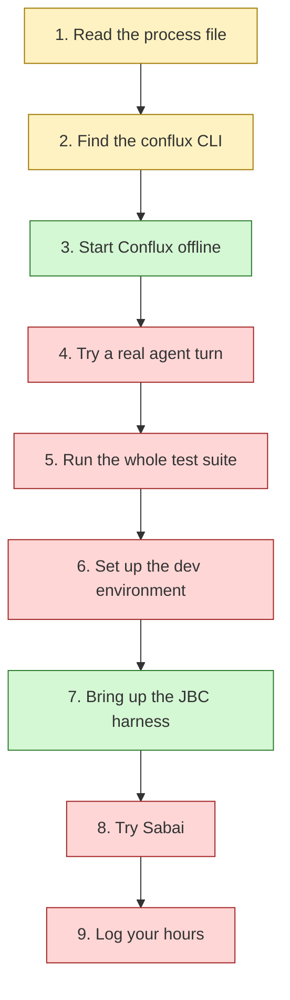

This module is about **using** what Mad Hare ships: running it, testing it, supporting it.
Andrew asked for it to show all of the bad, so here it is plainly. The products work in a few
narrow places, and those places are worth knowing well. Everywhere else, a newcomer runs into
something that is broken, stale or only in someone's head. Everything here is **as of
2026-10-30**, from an audit run on the dev machine (host `madhare`).

This first lesson walks the path a new person actually follows in their first hour. It gives
nine **breakpoints**, the places where that path stops, and what to do at each one. The rest
of the module goes into each area in depth, with labs.

## The path at a glance

Green works. Yellow works but misleads you. Red stops you. Two of the nine steps work cleanly.
That ratio is the main finding of this module.

## The nine breakpoints

### 1. Read the process file (works, but misleads)

Start with `/srv/conflux/AGENTS.md`. It is a symlink to the
[global process file](https://github.com/madharedev/madhare-support/blob/865da77acbc2b7eba46ed22d2ba722ff5a39b7a2/agents/AGENTS.md)
in madhare-support. It is **the** process, and it wins over any repo's own file.

> [!WARNING]
> **Breakpoint 1.** The file says "**Releases start here**" (line 59), meaning madhare-support.
> It also says a repo with its own templates "keeps a copy of the release template there"
> (line 53). madhare-support has
> [four templates](https://github.com/madharedev/madhare-support/tree/865da77acbc2b7eba46ed22d2ba722ff5a39b7a2/.github/ISSUE_TEMPLATE)
> (config, defect, incident, support) and **no release template**. Because a repo's own
> templates replace the org defaults, the org `release.md` doesn't show up either.

**What to do:** to start a release, use the org `release.md` structure by hand (lesson 7), and
flag the missing form. Also know about the **layering** nobody mentions. Working in the
Conflux workspace adds its own `AGENTS.md` and `instructions/*`, which bring extra rules: a
manual `session-start`, registered temp leases, and AGY CLI for reviews. Read them as well.

### 2. Find the `conflux` CLI (works, but which one?)

`command -v conflux` gives `/usr/bin/conflux`, from the Debian package `conflux-runtime`
0.1.0~dev.0. The service actually **running** on the machine (port 13080 and the tailnet) is
a different program, also called `conflux`, at `~/.local/opt/conflux-engine/bin/conflux`,
version 1.0.6. The repo's
[`main`](https://github.com/madharedev/conflux-engine/blob/13801f53295b082a26d8f9cd7cc425788d27535e/package.json)
says 1.1.1.

> [!WARNING]
> **Breakpoint 2.** Three versions and two CLIs share one name. They use different ports
> (8792 and 3080 by default), different environment contracts and different health JSON.
> Lesson 2 untangles them.

**What to do:** always run `conflux version` and `command -v conflux` before you trust any
output. Name the full path in anything you write down.

### 3. Start Conflux offline (works)

The packaged runtime starts offline with a **stub** model in about ten seconds. It answers
health checks, runs a stub turn and writes trace files. Lab 3 walks through it.

> [!TIP]
> Only the package README
> ([install-debian.md line 37](https://github.com/madharedev/conflux-engine/blob/d4ee1ab9b37eab30f0d374c686fe23e27ba2a66a/docs/releases/install-debian.md))
> tells you to set `ENGINE_STUB=1`. `conflux --help` lists the four required variables but
> not that one. Read the README at `/usr/share/doc/conflux-runtime/README.md`.

### 4. Try a real agent turn (fails)

> [!WARNING]
> **Breakpoint 4.** The runtime's `/ready` reports `"agents":[]`. The package ships no agents,
> and the README's example agent `rook` gets `AGT-001` (unknown agent). The runtime README is
> explicit: "No real provider call has been made from this service yet"
> ([agent-runtime README line 5](https://github.com/madharedev/conflux-engine/blob/d4ee1ab9b37eab30f0d374c686fe23e27ba2a66a/apps/agent-runtime/README.md)).
> The dispatch path (`cflx run` → gateway → engine `/internal/v1/runs`) isn't built yet
> ([conflux-engine#87](https://github.com/madharedev/conflux-engine/issues/87), open).

**What to do:** stop at the stub. Provider keys come only through `pass-cli` (see
`~/AGENTS.md`), and a paid call needs Andrew's approval. There's nothing to run them against
yet anyway.

### 5. Run the whole test suite (fails)

The obvious move is to clone madhare-testing and run `make test-all`, which its
[README](https://github.com/madharedev/madhare-testing/blob/ecf3cc1bf3ff13863dd7fbb3aba5437b85f99a30/README.md)
recommends (line 91).

> [!WARNING]
> **Breakpoint 5.** `test-all` runs five suites in order
> ([Makefile line 126](https://github.com/madharedev/madhare-testing/blob/ecf3cc1bf3ff13863dd7fbb3aba5437b85f99a30/Makefile)).
> The verifier fails 2 of 20 on hard-coded paths. Then surface crashes trying to clone a
> branch of the **archived** `madhare-agents` repo, and rls crashes the same way.

**What to do:** run individual suites (`make test-substrate`) or a project runner
(`projects/
/run-suite`). Lab 6 does this.

### 6. Set up the dev environment (fails)

`make dev-env` and `make dev-doctor` are the next thing the README suggests.

> [!WARNING]
> **Breakpoint 6.** The doctor reports **8 FAIL**: `MHA_*` variables unset, ADC login missing,
> and `pg-agents-dev` on 127.0.0.1:5435 unreachable (that container isn't running). It also
> counts `api.lab.madhare` answering **HTTP 502** as a PASS. The README's "Host step (Andrew,
> once)" to replace the `mha` wrapper (line 46) hasn't been done, so `mha` still runs code from
> an archived repo.

**What to do:** skip `dev-env`. Nothing in this module needs it.

### 7. Bring up the JBC harness (works)

The per-project harness for the JBC engine comes up in about 14 seconds with a doctor result of
"0 FAIL, 1 WARN". Its suite runs in about 3 minutes. This is the best-maintained test setup we
have.

> [!TIP]
> **Tribal knowledge, now written down.** Always pass your own `PROJECT`, `HARNESS_DB_PORT` and
> `HARNESS_VOLUMES_ROOT`. If you don't, you share the operator's `jbc` stack, port and volume,
> and you clobber them. `make down` keeps the host volume, so delete yours yourself.

### 8. Try Sabai (fails)

> [!WARNING]
> **Breakpoint 8.** `sabai-engine` `main` is a single README commit. The code sits on an
> unmerged release branch ([PR #130](https://github.com/madharedev/sabai-engine/pull/130)). The
> harness profile points at `/srv/work/dev/repos/sabai-agent-platform`
> ([sabai.env](https://github.com/madharedev/madhare-testing/blob/ecf3cc1bf3ff13863dd7fbb3aba5437b85f99a30/harness/projects/sabai.env)),
> which is missing and archived. `make up PROJECT=sabai` is **REFUSED**, exit 2.

**What to do:** you can still run the `sabai` CLI's synthetic mode from the release worktree's
venv (lesson 4). There's no test environment for it.

### 9. Log your hours (fails)

The process says hours go on the task "via the add-hours hook", and that "A live time report
must be available at all times" (lines 155–156).

> [!WARNING]
> **Breakpoint 9.** Claude hooks are switched off fleet-wide (`"disableAllHooks": true` in
> `/srv/conflux/claude/settings.json`, line 20), so the add-hours hook never fires. The hub's
> state refresh prints `time=UNKNOWN` for every project, and its user unit
> `mh-state-refresh.service` is `failed`. There is no live time report.

**What to do:** don't run `measure-issue-work.py --sync-board` casually. It writes to a GitHub
project board, and it's the coordination agent's job at check-ins. Record your hours in the
PR's **Hours** section and tell your dispatcher, so they can be entered.

## Summary table

| # | Step | Status (2026-10-30) | What to do |
|---|---|---|---|
| 1 | Read the process | Built, with a template gap | Use the org release structure by hand; read the workspace layer too |
| 2 | Find `conflux` | Built ×2, confusing | `command -v` + `conflux version` every time |
| 3 | Start offline | **Built** (stub only) | Lab 3 |
| 4 | Real agent turn | **Target** | Stop at the stub; dispatch is #87 |
| 5 | `make test-all` | **Partial** | Run individual suites |
| 6 | `dev-env` / doctor | **Partial**, 8 FAIL | Skip |
| 7 | JBC harness | **Built** | Own PROJECT, port, volumes; clean up |
| 8 | Sabai | **Target** (empty main, broken profile) | CLI synthetic mode only |
| 9 | Hours | **Partial** (hook off, report failed) | PR Hours section; tell your dispatcher |

## Rules that keep you safe all hour

- Work only in `/srv/conflux/projects/<project>/repos/<repo>` or its worktrees, never in
  `~/dev`, which is Andrew's.
- Run heavy commands through `mhjob`. It wraps
  [`systemd-run --user --scope`](https://www.freedesktop.org/software/systemd/man/latest/systemd-run.html)
  in `madharejobs.slice`, so a build can't starve the desktop.
- **Never `git fetch` in a shared canonical clone.** It moves the remote-tracking refs other
  agents rely on. Make a scratch clone with `git clone <canonical-path> <scratch>`. Even the
  audit for this course fetched once by accident, and it's recorded as a side effect.
- Labs never write to a shared database, to GitHub or to the cloud.

## Check yourself

1. You run `conflux health` and get `{"error":"Health endpoint unreachable…"}`, yet a Conflux
   dashboard is open in your browser. What's the most likely explanation?
2. Why does `make test-all` fail on a fresh clone, and what do you run instead?
3. The process says hours are recorded by a hook. Why does that record nothing here, and what
   should you do instead?

Answers

1. There are two `conflux` programs. `/usr/bin/conflux` (the deb) checks 127.0.0.1:8792 by
   default, and nothing is started there. The dashboard is the separate user-local 1.0.6
   engine on port 13080. Run `command -v conflux` and `conflux version`, and point `--url` at
   the service you mean.
2. `test-all` runs verifier, surface and rls along with the others. The verifier scans
   `/srv/work/dev/repos/...` paths that don't exist, and surface and rls clone a branch of the
   archived `madhare-agents` repo, which crashes. Run individual suites such as
   `make test-substrate`, or a project's `run-suite`.
3. `disableAllHooks: true` switches every Claude hook off, the add-hours hook included, and the
   state refresh that would produce the report is failed. Put your hours in the PR's Hours
   section and tell your dispatcher. Don't run the board-sync script yourself.

