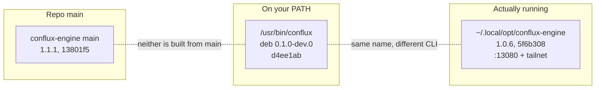
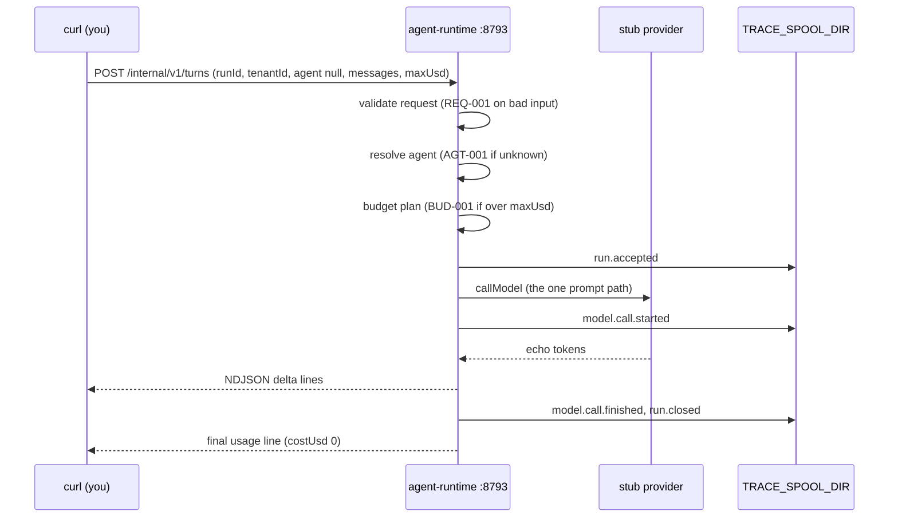

Conflux is the Mad Hare agent runtime product. Module 1 covered how it's designed. This lesson
is about what you can **run** on the dev machine today (2026-10-30), and the first thing to
know is that "Conflux" there means three things at once.

## Three versions of one product

| What | Where | Version / source | Ports | Status |
|---|---|---|---|---|
| **Debian package** `conflux-runtime` | `/usr/bin/conflux`, `/usr/lib/conflux`, docs in `/usr/share/doc/conflux-runtime/` | 0.1.0~dev.0, built from `d4ee1ab` on branch `chore/deployment-package-20261027` | API 8792, runtime 8793 | **Built** for startup and stub turns |
| **User-local engine** | `~/.local/opt/conflux-engine/bin/conflux`, user unit `conflux-engine-local.service` | `@conflux/engine` 1.0.6, source `5f6b308` (branch `feat/engine-consolidated`, pre-reset lineage) | 13080 (default 3080) | **Running**, with a dashboard and Swagger, started as a transient unit |
| **Repo main** | `conflux-engine` canonical clone | [package.json](https://github.com/madharedev/conflux-engine/blob/13801f53295b082a26d8f9cd7cc425788d27535e/package.json) **1.1.1**, HEAD `13801f5` | — | Built, but not what's installed |

There's also a fourth implementation nobody uses any more: a Python HTTP runtime
(`conflux-runtime-local.service`, running `python -m conflux_engine.http_runtime.server`),
stopped since 2026-10-22. Its status is **Abandoned**.



> [!WARNING]
> **Finding (high): one name, three versions.** Two CLIs are both called `conflux`. They have
> different default ports (8792 vs 3080), different environment contracts (`ENGINE_*` vs
> `CONFLUX_PERSISTENCE_MODE` / `CONFLUX_ADMIN_*`) and different health JSON (`service` vs
> `revision`). Neither is built from `main`, and `main` is `1.1.1` rather than the `X.Y.Z-dev`
> the process requires. **Fix:** Andrew names the product line; the other installs are removed
> or renamed; main moves to `-dev`.

### Telling them apart in ten seconds

```bash
command -v conflux                                   # /usr/bin/conflux
conflux version                                      # "productVersion":"0.1.0-dev.0"
~/.local/opt/conflux-engine/bin/conflux --help | head -3
systemctl --user status conflux-engine-local --no-pager | head -5
```

The `systemctl` header shows "transient unit". The user-local engine was started with
[`systemd-run`](https://www.freedesktop.org/software/systemd/man/latest/systemd-run.html), so
as configured it won't come back after a reboot.

## The packaged runtime: what's in the box

The package ships two NestJS services plus a small foreground CLI:

- **Engine API** (`dist/apps/api/main.js`, port 8792). Read adapters for GCS, Postgres,
  AlloyDB metadata, Gmail, Pub/Sub, Grafana, GCE and docs. Anonymous callers get `/health`
  only. `/version` returns **401** "Authentication required". Status **Partial**.
- **Agent runtime** (`dist/apps/agent-runtime/main.js`, port 8793). One work route,
  `POST /internal/v1/turns`, plus `/health`, `/version` and `/ready`. Status **Built** for the
  stub provider only.
- **`conflux` CLI** ([`scripts/conflux.mjs`](https://github.com/madharedev/conflux-engine/blob/d4ee1ab9b37eab30f0d374c686fe23e27ba2a66a/scripts/conflux.mjs)).
  Exactly three commands: `version`, `health [--url]`, `start [--service all|api|runtime]`.

The [install doc](https://github.com/madharedev/conflux-engine/blob/d4ee1ab9b37eab30f0d374c686fe23e27ba2a66a/docs/releases/install-debian.md)
is precise about what it doesn't do. "No service starts during installation. No systemd unit,
user, credential or host policy is created." `/etc/conflux/conflux.env.example` "is
documentation and is never automatically evaluated as shell code". You set the variables
yourself.

### Exit codes you will see

| Situation | Output | Exit |
|---|---|---|
| Unknown command (`conflux bogus`) | `{"error":"Unknown command"}` | 64 |
| Bad or duplicate option, colliding ports | error JSON | 64 |
| `conflux health` with nothing listening | `{"error":"Health endpoint unreachable or returned an invalid response"}` | 1 |
| Healthy | `{"httpStatus":200,"healthy":true,"service":"conflux-api"}` | 0 |

> [!NOTE]
> The install doc says both endpoints "must return HTTP200 with `status:ok`". What the CLI
> actually prints is `"healthy":true`. That's a small doc drift. Trust the observed output.

## Starting it offline

The runtime refuses to start without four variables: `ENGINE_DEFAULT_MODEL`, `ENGINE_PORT`,
`ENGINE_MAX_USD_PER_TURN` and `TRACE_SPOOL_DIR`. `conflux --help` lists those four.
The offline recipe also needs `ENGINE_STUB=1` and a stub model:

```bash
export ENGINE_DEFAULT_MODEL=stub/echo ENGINE_STUB=1
export ENGINE_MAX_USD_PER_TURN=0.10 TRACE_SPOOL_DIR="$PWD/conflux-traces"
export PORT=8792 ENGINE_PORT=8793
conflux start
```

`conflux start` runs both services in the foreground. Ctrl-C stops "the CLI and only its own
children". If one child fails, its siblings stop too, and any child still running after five
seconds is killed. It doesn't search for processes by name.

What comes back when it's up:

```text
$ conflux health --url http://127.0.0.1:8793
{"httpStatus":200,"healthy":true,"service":"conflux-engine-agent-runtime"}
$ curl -s http://127.0.0.1:8793/ready
{"status":"ready","defaultModel":"stub/echo","agents":[],
 "providers":{"anthropic":false,"gemini":false,"openai":false,"stub":true},"traceIngest":false}
```

Read `/ready` closely, because it tells you what can't run. `agents` is empty. No provider has
a key. `traceIngest` is false, so traces go only to the local spool.

## A turn, end to end



The request contract
([agent-runtime README](https://github.com/madharedev/conflux-engine/blob/d4ee1ab9b37eab30f0d374c686fe23e27ba2a66a/apps/agent-runtime/README.md),
lines 9–30) is a JSON body with `runId`, `tenantId`, `agent` (nullable), `messages` and
`maxUsd` (nullable). The response is `200 application/x-ndjson`, which is
[newline-delimited JSON](https://github.com/ndjson/ndjson-spec): one object per line, flushed
as it's produced. The last line is either `usage` or `error`.

### The codes, and why errors come back as HTTP 200

| Code | Meaning | Model called? | HTTP |
|---|---|---|---|
| `REQ-001` | Bad request: unknown field, bad id, empty `messages`, negative `maxUsd` | No | **400** |
| `AGT-001` | Unknown agent | No | 200, last NDJSON line |
| `MDL-001` / `MDL-004` | No provider family / no API key | No | 200 |
| `BUD-001` / `BUD-002` | Over budget / unpriced model | No | 200 |
| `TRC-001` | Trace spool not writable | No | 200 |
| `MDL-007/008/009` | Provider error / timeout / refusal | Yes | 200 |

Once the runtime has accepted a valid request, it has already sent the 200 status line and
starts streaming. Any later refusal arrives as `{"type":"error","code":"…"}` on the last line.
**A client that checks only the HTTP status will treat `AGT-001` as success.** It's
deliberate, but it catches people out, so clients must parse the last line.

### Traces

Each turn writes `run-event.v1` records (`run.accepted`, `model.call.started`,
`model.call.finished`, `run.closed`, or `run.error`) wrapped as `mh.trace.envelope/v1` lines in
`<TRACE_SPOOL_DIR>/<date>-<runId>.jsonl`. "Message content is never traced." You see the
model, cap and token estimate, never the prompt.

## What cannot run yet, and why

| You want to… | Status | Evidence |
|---|---|---|
| Run a turn as a named agent | **Target** | `/ready` shows `"agents":[]`; `rook` → `AGT-001` |
| Call a real model | **Target** | README line 5, "No real provider call has been made from this service yet"; keys only via `pass-cli`, spend needs approval |
| Dispatch a task (`cflx run` → gateway → engine `/internal/v1/runs`) | **Target** | No engine implements `/internal/v1/runs`; the madhare-testing conflux-api suite has 10 PENDING scenarios citing [conflux-engine#87](https://github.com/madharedev/conflux-engine/issues/87) |
| Use the gateway CLI `cflx` from `main` | **Partial** | [conflux-api main](https://github.com/madharedev/conflux-api/blob/44a3f09cecf20b4b8eb18415028d28c7b4a24d8e/README.md) has `scripts/dev.sh`; `scripts/cflx` is on the pinned epic branch `6518568` |
| Read the engine API's `/version` anonymously | By design, refused | 401 "Authentication required" |
| Run `conflux board audit --project=56` (quoted in the process) | **Target**, no code | `{"error":"Unknown command"}`, exit 64 |

> [!WARNING]
> **Finding (high): no path runs a real task.** Dispatch isn't built, no agents are packaged,
> and the runtime has never made a provider call. Everything you can do with Conflux today is
> startup, health and stub turns. **Fix:** land #87 (E2.2/E2.3), package at least one agent,
> and record one paid, approved provider turn as "Ran It" evidence.

The logs also print a `DEP0040 punycode` deprecation warning at startup. It's harmless, but
it's noise you'll see in every run.

## Check yourself

1. You POST a turn with `"agent":"rook"` and get HTTP 200. Did it work? How do you know?
2. Which variables must be set before `conflux start` succeeds offline, and which one is
   documented only in the package README?
3. Why is "start the engine and dispatch a coding task to it" not possible today? Give two
   pieces of evidence.

<details>
<summary>Answers</summary>

1. No. The runtime streams NDJSON and reports refusals on the last line. Here that line is
   `{"type":"error","code":"AGT-001"}` (unknown agent), because the package ships no agents
   (`/ready` shows `"agents":[]`). Always parse the last line, not just the status code.
2. `ENGINE_DEFAULT_MODEL`, `ENGINE_PORT`, `ENGINE_MAX_USD_PER_TURN` and `TRACE_SPOOL_DIR` are
   required, and `--help` lists them. `ENGINE_STUB=1`, with `stub/echo` as the model, appears
   only in the install README. `PORT=8792` sets the API port.
3. No engine implements `/internal/v1/runs`: the conflux-api suite marks the 10 dispatch
   scenarios PENDING against conflux-engine#87, which is open. On top of that, the runtime has
   no agents, and its README says no real provider call has been made.

</details>
