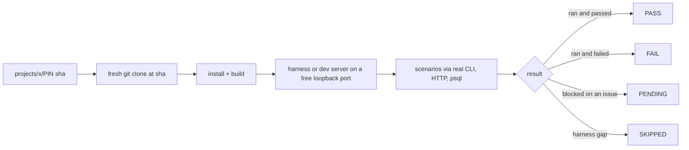

The process is short on testing, and strict. "**No tests in product repos.
`madhare-testing` holds all tests.**" Every product needs a suite and harness that builds
with a dummy database, a runner for manual and regression runs, and the ability to ship with
the code. "Test functionality, never bare text-string matches"
([global process, Testing section](https://github.com/madharedev/madhare-support/blob/865da77acbc2b7eba46ed22d2ba722ff5a39b7a2/agents/AGENTS.md)).

This lesson shows how the test repo meets that rule where it's maintained, where it has rotted,
and why the rest of the system ignores it. Everything here was run on 2026-10-30 against
madhare-testing `main` at `ecf3cc1`, in a scratch clone.

## The shape of the repo

| Part | What it is | Run with |
|---|---|---|
| `substrate/` | Hermetic PostgreSQL 18 + a Qdrant mock in compose, with 20 scenarios including negative controls | `make test-substrate` |
| `verifier/` | JSON-schema verifier and its 20-scenario suite | `make verify-schemas`, `make test-verifier` |
| `packages/surface/` | Surface (CLI/API contract) suite | `make test-surface` |
| `certification/` | "Vera Prosecutor": enforces Andrew's Testing Law and issues a verdict | `make audit`, `make test-certification`, `make certify` |
| `rls/` | Functional suite against a fresh clone of a release branch | `make test-rls` |
| `harness/` | One shell container + FAKE-seeded PostgreSQL 18 + pgvector per client project | `make up/suite/down PROJECT=…` |
| `projects/<name>/` | Per-product `PIN` (the SHA under test) and `run-suite` | `projects/<name>/run-suite` |
| `readmodel/`, `evalstore/`, `support_acceptance/` … | Smaller suites and stores | various |

`make help` lists about 30 targets. The projects present are `conflux-api`, `conflux-engine`
(a Postman collection check only), `infra-local` and `jbc`. `projects/sabai/` holds only a
`.gitkeep`.

### Two rules that make it trustworthy

1. **Pin, then clone fresh.** A project runner tests a fresh clone at the SHA in its `PIN`,
   "never a working tree"
   ([conflux-api run-suite header](https://github.com/madharedev/madhare-testing/blob/ecf3cc1bf3ff13863dd7fbb3aba5437b85f99a30/projects/conflux-api/run-suite)).
   A result therefore names exactly what was tested. It also means a fix upstream doesn't show
   until someone moves the pin. JBC's
   [PIN](https://github.com/madharedev/madhare-testing/blob/ecf3cc1bf3ff13863dd7fbb3aba5437b85f99a30/projects/jbc/PIN)
   is `b6984dc`, from about 2026-10-13.
2. **PENDING is not PASS.** Scenarios that can't run yet are "written, listed in the summary,
   never run and never counted as passed". The runner's exit code is 0 if everything that ran
   passed, 1 if a scenario failed, and 2 if the run couldn't start.



## What passes and what fails today

| Command | Result (2026-10-30) | Status | Why |
|---|---|---|---|
| `make test-substrate` | **20/20 PASS**, "VERDICT: CERTIFIED", containers torn down, 7.6 s | **Built** | Self-contained; the best first run |
| `make verify-schemas` | Valid 1, errors 0 | **Built** | Fixtures only |
| `make check-conflux-postman` | "PASS artifact checks: 14 variables, 18 GET requests" | **Built** | File check |
| `projects/conflux-api/run-suite` | **26 passed, 10 pending**, exit 0, ~3 min | **Partial** | All 10 pending: "no engine implements /internal/v1/runs; conflux-engine#87" |
| JBC harness `make up` + `make suite` | Doctor 0 FAIL, 1 WARN; suite **20 PASS, 4 FAIL, 4 PENDING, 1 SKIPPED** (29 scenarios, 427 checks) | **Partial** | See lab 6 |
| `make test-verifier` | **18/20**; [09] and [10] FAIL | Rotted | Hard-coded `/srv/work/dev/repos/...` paths |
| `make test-surface`, `make test-rls` | **Crash**: `Remote branch rls/madhare-agents-v0.1.0 not found` | Rotted | Clones an archived repo |
| `make audit` | **8 violations in the repo itself** | Rotted | The test repo breaks its own law |
| `make test-certification` | **25/26**, "[09/26] Full Workspace Law Audit … FAIL", **REJECTED** | Rotted | Follows from `audit` |
| `make dev-doctor` | **8 FAIL**; a 502 counted as PASS | Rotted | Needs services that aren't running |
| `make up PROJECT=sabai` | **REFUSED**, exit 2 | **Target** | Profile points at a missing path |

### Where it rotted, with the line

> [!WARNING]
> **Hard-coded old workspace paths.** The verifier's scenarios 9 and 10 scan
> `/srv/work/dev/repos/madhare-platform/...` and `/srv/work/dev/repos/madhare-agents/...`
> ([verifier/test.sh lines 116 and 123](https://github.com/madharedev/madhare-testing/blob/ecf3cc1bf3ff13863dd7fbb3aba5437b85f99a30/verifier/test.sh);
> also [Makefile lines 76 and 79](https://github.com/madharedev/madhare-testing/blob/ecf3cc1bf3ff13863dd7fbb3aba5437b85f99a30/Makefile)).
> The workspace rules moved clones to `/srv/conflux/projects/<project>/repos/`. Those paths no
> longer exist, and `madhare-agents` is archived.

> [!WARNING]
> **An archived repo as a test dependency.** `rls/harness/rls.py` lines 12–13 set
> `DEFAULT_SOURCE = "https://github.com/madharedev/madhare-agents.git"` and
> `DEFAULT_REF = "rls/madhare-agents-v0.1.0"`
> ([rls.py](https://github.com/madharedev/madhare-testing/blob/ecf3cc1bf3ff13863dd7fbb3aba5437b85f99a30/rls/harness/rls.py)).
> The branch is gone, `git clone` exits 128, and `test-all` stops there, because `test-all`
> runs substrate, verifier, surface, certification and rls in that order (Makefile line 126).

> [!WARNING]
> **The judge fails its own law.** `make audit` reports, for example,
> `ERR_PROSECUTOR_STRING_MATCHING_ASSERTION at readmodel/tests/test_product_offline.py:117` and
> `ERR_PROSECUTOR_MOCK_BYPASS at support_acceptance/tests/test_acceptance.py:19`. Because
> certification includes a full workspace audit
> ([certification README](https://github.com/madharedev/madhare-testing/blob/ecf3cc1bf3ff13863dd7fbb3aba5437b85f99a30/certification/README.md)),
> `make certify` can never say CERTIFIED for this repo until those 8 are fixed.

The pattern: suites that someone runs every week (substrate, conflux-api, jbc) stay green or
honestly PENDING. Suites nobody runs (verifier, surface, rls, dev-env) quietly broke when repos
were renamed, moved or archived. Nothing caught it, because nothing runs them automatically.

## CI: who calls what

The process asks for "**minimal CI**" on every repo's `main`: build/lint and "the product's
test-suite entry point from `madhare-testing`". The audit asked GitHub for each active repo's
`.github/workflows`:

| Repo | Workflow | What it runs | Calls madhare-testing? |
|---|---|---|---|
| conflux-engine | [`ci.yml`](https://github.com/madharedev/conflux-engine/blob/13801f53295b082a26d8f9cd7cc425788d27535e/.github/workflows/ci.yml) | `npm run typecheck`, `lint`, `test` (in-repo vitest), gitleaks, on self-hosted runners | No |
| madhare-support | [`forms.yml`](https://github.com/madharedev/madhare-support/blob/865da77acbc2b7eba46ed22d2ba722ff5a39b7a2/.github/workflows/forms.yml) | `npm ci`, build, `npm test -w @madhare/ops`, `forms:check` | No |
| madhare-platform | yes | (not inspected in this module) | No |
| madhare-web | yes | (not inspected in this module) | No |
| madhare-testing itself | **none** (404) | — | — |
| the other 15 active repos | **none** | — | — |

> [!WARNING]
> **Finding (high): no product CI calls the test suite.** `grep -l madhare-testing` across all
> workflow files finds nothing. madhare-testing has no CI of its own either, so its rot goes
> unnoticed. **Fix:** a reusable workflow in madhare-testing that takes a repo and SHA and runs
> `projects/<name>/run-suite --sha`, called from each product's minimal CI. Run madhare-testing's
> own green suites on its `main`.

> [!WARNING]
> **Finding (medium): "No tests in product repos" is broken by the flagship.** conflux-engine
> has 29 `*.spec.ts`/`*.test.ts` files (for example `apps/agent-runtime/src/*.spec.ts`) and runs
> them in CI. madhare-support runs `node --test` on `packages/ops/src/*.test.ts`. They're useful
> tests, but they're in the wrong place under the rule. **Fix:** Andrew decides whether unit
> tests may stay in product repos (and the process says so), or the specs move to
> madhare-testing with an owner.

Why CI doesn't call it, as far as the evidence shows: the CI rule was written after the suites.
The runners need Docker, a GitHub token for private clones, and a few minutes. The self-hosted
runner exists for conflux-engine only, and nobody has been assigned to wire it up. It's a
process gap, not a technical blocker.

## Reading a result honestly

The JBC suite ends with a line worth memorising:

```text
store: not stored (no --store CONFIG); a result only in a file is not a result
```

That's the suite telling you that a result sitting in `latest.json` on one machine isn't
evidence anyone else can check. For a PR's **Ran It** section, quote the summary line (`20 PASS,
4 FAIL, 4 PENDING, 1 SKIPPED … engine sha b6984dc…`), the PIN SHA and the command, and classify
every FAIL. "Tests pass" with no SHA isn't a result.

## Check yourself

1. The conflux-api suite exits 0 but reports 10 pending. Can you write "conflux-api dispatch
   tested" in a PR? Why or why not?
2. A JBC scenario's known bug was fixed and the issue closed upstream last week, but the
   scenario still fails in your run. What's the most likely reason?
3. Name two reasons `make test-all` can't pass on a fresh clone today, with the file for each.

<details>
<summary>Answers</summary>

1. No. PENDING scenarios are written but never run and never counted as passed. Exit 0 means
   everything that **ran** passed. Dispatch is blocked on conflux-engine#87, so dispatch is
   untested.
2. The suite tests the engine at the SHA in `projects/jbc/PIN` (`b6984dc`), not the latest
   `main`. Until someone moves the pin, the run reflects the old code. That's the case for
   S-09, whose issue (#212) is closed.
3. Any two of these. `verifier/test.sh` lines 116/123 scan missing `/srv/work/dev/repos/...`
   paths (18/20). `rls/harness/rls.py` lines 12–13 clone a branch of the archived
   `madhare-agents` repo, which crashes surface and rls. `make audit` finds 8 violations, so
   certification is REJECTED.

</details>
