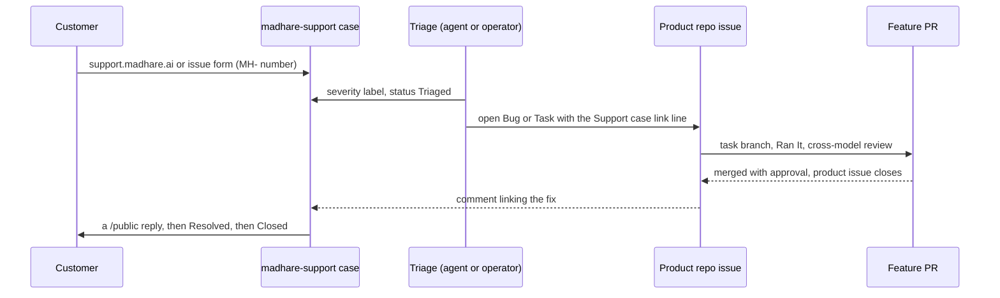

This lesson covers three things that sit around the products and decide whether anyone can
trust them: **support** (how a problem becomes a fix), **hours** (how time is captured), and
**test environments** (where a feature is proven). For each, it gives the design first and then
the reality as of 2026-10-30.

## Support: the designed flow

`madhare-support` is "the production support repo". It tracks incidents and production bugs.
New work is **triaged** there and then created as issues in the affected repos, and releases
start there too
([global process, Triage and release start](https://github.com/madharedev/madhare-support/blob/865da77acbc2b7eba46ed22d2ba722ff5a39b7a2/agents/AGENTS.md)).
The repo's [README](https://github.com/madharedev/madhare-support/blob/865da77acbc2b7eba46ed22d2ba722ff5a39b7a2/README.md)
fills in the mechanics:

| Element | Rule | README line |
|---|---|---|
| Intake | The support portal at support.madhare.ai, or a new issue in this repo | 6 |
| Board | Org project 82, columns **New → Triaged → In progress → Waiting on customer → Resolved → Closed** | 5 |
| Severity | sev-1 (production down / data at risk for a paying customer) to sev-5 (request or feedback) | 13–17 |
| Identity | Every case keeps its `MH-` number for life | 23 |
| Handoff | Product work goes to the product repo as a Bug, Task or Incident that says `Support case: madharedev/madhare-support#<n> (MH-<id>)`, and the case links back | 24 |
| Closure | The case stays open until the customer outcome is delivered, even after the product issue closes | 24 |
| Customer replies | Comments are internal by default; start one with `/public` to reply to the customer | 25 |
| Forms | Generated from `packages/ops/forms/case-forms.json`. "Edit the contract, not the YAML." | 27 |

### Forms are code

The three case forms (**Support request**, **Defect**, **Incident**) are defined once in
[`case-forms.json`](https://github.com/madharedev/madhare-support/blob/865da77acbc2b7eba46ed22d2ba722ff5a39b7a2/packages/ops/forms/case-forms.json)
(contract 1.0.0). The `@madhare/ops` package generates the YAML in `.github/ISSUE_TEMPLATE/`,
and every generated file starts "Generated from forms/case-forms.json (contract 1.0.0). Do not
edit by hand." CI (`forms.yml`) runs `forms:check`, which fails if someone edits the YAML
directly. One source plus a drift check is the documentation standard applied to forms, and it
works. Lab 8 runs it.

### Runbooks

- [`runbooks/deploy-0-1-0.md`](https://github.com/madharedev/madhare-support/blob/865da77acbc2b7eba46ed22d2ba722ff5a39b7a2/runbooks/deploy-0-1-0.md).
  "Every script is **dry-run by default**; `--execute` is the only thing that writes", and
  `make deploy` writes only with exactly `EXECUTE=1`. That's a good pattern to copy. The
  runbook cites `madhare-infra#129`, and madhare-infra is **archived**.
- `runbooks/estate-operations.ipynb`, plus `docs/mh-lab/runbooks/*` for the home lab (camera
  offline, UPS power loss, restore-pg-platform and so on).

### Support: the reality

> [!WARNING]
> **Finding (medium): no release form where releases start.** The process says releases start
> in madhare-support, and that a repo with its own templates "keeps a copy of the release
> template there" (line 53). madhare-support's
> [templates](https://github.com/madharedev/madhare-support/tree/865da77acbc2b7eba46ed22d2ba722ff5a39b7a2/.github/ISSUE_TEMPLATE)
> are `config, defect, incident, support`. The
> [org defaults](https://github.com/madharedev/.github/tree/c99d68197aa58f86411e4af4ebc229a2ff3837b8/.github/ISSUE_TEMPLATE)
> include `release.md`, `epic.md`, `feature.md`, `task.md` and `remainder.md`, but a repo's own
> folder hides them. **Fix:** add a `Release` form to `case-forms.json`, so it's generated and
> drift-checked like the others.

> [!WARNING]
> **Finding (low): two status vocabularies.** The support board uses New → Triaged → … →
> Closed. The process says "One status field everywhere: Backlog → Refining → Ready → In
> progress → In review → Accepted → Done". **Fix:** either the process names the support board
> as a deliberate exception (customer cases aren't features), or the board adopts the global
> list.

> [!WARNING]
> **Finding (medium): the support repo is mostly a to-do list.** Only 2 issues carry the
> `incident` label (54 carry `support`, which is applied broadly). #95 is a real incident
> ([Codex desktop tool bridge rejects result_buffered_for_ns](https://github.com/madharedev/madhare-support/issues/95)),
> yet it has **no labels at all**: no severity, no status. #81–#94 are operator tasks
> ("Rotate two exposed tokens…", "Lock the next release…"). A search of the org on 2026-10-30
> found only 3 product-repo issues that mention "Support case" at all, so the link-back rule
> is rarely used.
> That's cross-cutting work, which the process says lives in the hub. **Fix:** move non-case
> work to the hub, and keep this repo for cases, incidents and release starts.

## Hours and the live time report

**The design.** "Hours are recorded on every task, in every project, Sabai included. No
exceptions." They go on the task when it closes, in the "Actual hours" field "via the add-hours
hook", and in the PR's **Hours** section. "A live time report must be available at all times. If
it's off, that's an issue to fix right away." The board audit flags tasks closed without hours.

**The reality, step by step:**

1. **The hook is switched off.** The add-hours hook (`conflux-dispatcher/1.0.0/hooks/scripts/add_hours.py`)
   is a Claude Code PreToolUse/PostToolUse hook. `/srv/conflux/claude/settings.json` line 20
   sets `"disableAllHooks": true`, which switches every hook off
   ([hooks reference](https://docs.anthropic.com/en/docs/claude-code/hooks)). Andrew directed
   that fleet-wide, and it isn't to be reversed. So the hook-based capture in the process
   doesn't run.
2. **It counted the wrong way anyway.** The hook *adds* overlapping dispatches ("added, not
   unioned"). The Conflux workspace's `WORKFLOW.md` (line 53) defines Actual hours as "the
   **union** of measured work-block intervals". A different script computes that:
   `measure-issue-work.py --sync-board`, run by the coordination role at check-ins, writing
   to board 72.
3. **There's no live report.** The hub's state refresh prints `time=UNKNOWN` for every project.
   The user units `mh-state-refresh.service` and `madhare-docs-hub-refresh.service` are both
   `failed` (checked with `systemctl --user is-failed` on 2026-10-30).
4. **Sabai keeps a separate ledger.** A private timekeeper in 15-minute increments sits in an
   `_attic-dev-reset-…` directory and stops at 2026-10-17. Only one Sabai task carries Actual
   hours, and release [PR #130](https://github.com/madharedev/sabai-engine/pull/130) claims
   "Hours 2.0" that aren't on any task.

> [!WARNING]
> **Finding (high): hours capture is off and there's no live time report.** This is the one
> thing the process says to fix "right away". **Fix:** remove the hook reference from the
> process. Name `measure-issue-work.py` (union semantics) as the single mechanism, run it on a
> timer as a proper (non-transient) unit, and publish its output as the live report. Bring
> Sabai's ledger into the same pipeline.

**What you do meanwhile:** write your hours in the PR's Hours section, and tell your dispatcher
the start and end times of your work blocks. Don't run the board sync yourself.

## Test environments: process versus reality

**The design.** "A test environment is temporary and portable, not something that lives on a
filesystem." A run starts containers from existing images and volumes, runs, and is torn down.
"Every epic has a test environment where Andrew can sign in and run each of those commands
with no further setup." Until a feature is released, its CLIs run only inside temporary test
environments.

**What exists** is the madhare-testing per-project harness
([docs/harness.md](https://github.com/madharedev/madhare-testing/blob/ecf3cc1bf3ff13863dd7fbb3aba5437b85f99a30/docs/harness.md)):

| Process requirement | Harness today | Status |
|---|---|---|
| Temporary: started, run, torn down | `make up` / `make down`; containers and DB removed | **Built** |
| Nothing left on the filesystem | `make down` **keeps the host volume** by design; 273 leftover directories (1.5 GB) under `/srv/hot/runtime/dev/volumes`, dated Oct 17 to Oct 30 | **Partial** |
| Portable | Profiles are files in the repo; isolated copies via `PROJECT`/`PROFILE`/port | **Built** |
| Per **epic** | Per **project** only (conflux-api, infra-local, jbc). No epic config anywhere | **Target** |
| Andrew signs in and runs each feature's command | `make shell` gives a shell as `tester` in the container; nobody has done the "sign in and run" step for an epic | **Target** |
| Every product | JBC works. Sabai profile is broken. No Code A Zone or Review Portal scenarios | **Partial** |

> [!WARNING]
> **Finding (high): no per-epic test environment exists.** The process makes it a requirement
> of every epic. **Fix:** define an epic environment as a harness profile plus a pinned SHA plus
> a list of feature commands (`projects/
/epics/<n>.env`), with a `make up EPIC=<n>` that
> prints the commands to run. Make `make down` remove the host volume unless `KEEP=1` is passed,
> and prune the 273 leftovers once, with Andrew's approval.

> [!NOTE]
> The README and `docs/harness.md` disagree about the volume root:
> `/srv/work/dev/testing/volumes/<project>/` (which doesn't exist) versus
> `/srv/hot/runtime/<env>/volumes/<project>/`. Trust `docs/harness.md` and the code.

## Check yourself

1. A customer's case needs a code fix in conflux-api. Which two links must exist, and when
   does the support case close?
2. Why does editing `.github/ISSUE_TEMPLATE/support.yml` by hand fail CI, and where should the
   change go?
3. Give two concrete differences between the process's "test environment" and the harness as
   it works today.

Answers

1. The conflux-api issue carries `Support case: madharedev/madhare-support#<n> (MH-<id>)`, and
   the support case gets a comment linking back to it. The case stays open until the customer
   outcome is delivered, even after the product issue closes, and then goes Resolved → Closed.
2. The YAML is generated from `packages/ops/forms/case-forms.json`, and the `forms.yml`
   workflow runs `forms:check`, which fails when the generated files don't match the contract.
   Edit `case-forms.json`, then run `npm run forms` to regenerate.
3. Any two of these. It's per project, not per epic. `make down` keeps the host volume (273
   leftovers), so it isn't purely temporary. There's no "sign in and run each feature's
   command" setup for Andrew. Sabai and Code A Zone have no working profile or scenarios.

