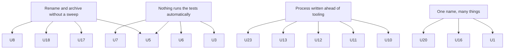

This is the module's findings register, as of **2026-10-30**. Each row says what's broken,
where the evidence is, how much it matters, and the change that would remove it. None of it is
about blame. Most rows are what happens when a fast-moving team renames, archives and rebuilds
faster than anything checks the result.

**Severity:** **high** means it blocks using or trusting a product. **Medium** means it wastes
time or misleads. **Low** means it's a surprise or doc drift.

## The findings

| # | Finding | Evidence | Sev | The fix |
|---|---|---|---|---|
| U1 | **Three Conflux versions at once, and two CLIs named `conflux`** with different ports, env contracts and health JSON | `/usr/bin/conflux` 0.1.0-dev.0 (`d4ee1ab`); `~/.local/opt/conflux-engine` 1.0.6 (`5f6b308`); [main package.json](https://github.com/madharedev/conflux-engine/blob/13801f53295b082a26d8f9cd7cc425788d27535e/package.json) 1.1.1 | high | Andrew names the product line; remove or rename the other install; one CLI name per product |
| U2 | **No path runs a real task**: dispatch unbuilt, no agents packaged, no provider call ever made | `/ready` `"agents":[]`; [agent-runtime README](https://github.com/madharedev/conflux-engine/blob/d4ee1ab9b37eab30f0d374c686fe23e27ba2a66a/apps/agent-runtime/README.md) line 5; 10 PENDING on [#87](https://github.com/madharedev/conflux-engine/issues/87) | high | Land #87 E2.2/E2.3; package one agent; record one approved provider turn as Ran It |
| U3 | **No product CI calls madhare-testing**; 16 of 20 active repos have no CI | `gh api …/contents/.github/workflows` → 404 for 16; no workflow mentions madhare-testing | high | A reusable `run-suite` workflow in madhare-testing, called from each product's minimal CI |
| U4 | **"No tests in product repos" broken by the flagship** | conflux-engine: 29 spec/test files, run by [ci.yml](https://github.com/madharedev/conflux-engine/blob/13801f53295b082a26d8f9cd7cc425788d27535e/.github/workflows/ci.yml); madhare-support `node --test` | medium | Andrew decides: allow unit tests in product repos (edit the process), or migrate them with an owner |
| U5 | **madhare-testing rots against renamed and archived repos** | [verifier/test.sh](https://github.com/madharedev/madhare-testing/blob/ecf3cc1bf3ff13863dd7fbb3aba5437b85f99a30/verifier/test.sh) 116/123; [rls.py](https://github.com/madharedev/madhare-testing/blob/ecf3cc1bf3ff13863dd7fbb3aba5437b85f99a30/rls/harness/rls.py) 12–13 → archived `madhare-agents`; [sabai.env](https://github.com/madharedev/madhare-testing/blob/ecf3cc1bf3ff13863dd7fbb3aba5437b85f99a30/harness/projects/sabai.env) → missing path | high | Repoint every dependency at a pinned fresh clone, or retire the suite; run the repo's own suites in CI so rot shows the day it happens |
| U6 | **The test repo fails its own Testing Law**, so certification can never pass | `make audit` 8 violations; `make test-certification` 25/26 REJECTED ([certification README](https://github.com/madharedev/madhare-testing/blob/ecf3cc1bf3ff13863dd7fbb3aba5437b85f99a30/certification/README.md)) | medium | Fix the 8 (string-match assertions, a mock bypass), then gate main on `make audit` |
| U7 | **Doctor counts HTTP 502 as PASS** | `make dev-doctor`: "PASS api … answered HTTP 502" | low | Treat 5xx as FAIL |
| U8 | **Harness volume root documented two ways** | README line 9 vs [docs/harness.md](https://github.com/madharedev/madhare-testing/blob/ecf3cc1bf3ff13863dd7fbb3aba5437b85f99a30/docs/harness.md) line 9 | low | One authority: the README links to harness.md |
| U9 | **Test environments aren't temporary**: 273 leftover volumes, 1.5 GB | `ls /srv/hot/runtime/dev/volumes \| wc -l` = 273; `make down` keeps the host volume by design | medium | `make down` removes the volume unless `KEEP=1`; prune the leftovers once, with Andrew's approval |
| U10 | **No per-epic test environment** where Andrew can sign in and run each feature's command | Harness is per project; no epic config; Sabai profile broken; no Code A Zone scenarios | high | Epic profile = harness profile + pinned SHA + feature command list; `make up EPIC=<n>` prints the commands |
| U11 | **Hours capture is off**: the add-hours hook is disabled, and it added overlaps where the workspace requires a union | `disableAllHooks: true` (`/srv/conflux/claude/settings.json` line 20, [hooks docs](https://docs.anthropic.com/en/docs/claude-code/hooks)); `WORKFLOW.md` line 53 | high | Remove the hook from the process; make `measure-issue-work.py` (union) the only mechanism, on a timer |
| U12 | **No live time report** | `mh-state-refresh` prints `time=UNKNOWN`; `mh-state-refresh` and `madhare-docs-hub-refresh` units `failed` | high | Repair the unit, publish the measured hours as the live report, alert on failure |
| U13 | **Releases start in madhare-support, which has no release form** | [templates](https://github.com/madharedev/madhare-support/tree/865da77acbc2b7eba46ed22d2ba722ff5a39b7a2/.github/ISSUE_TEMPLATE): config, defect, incident, support; process line 53 requires a copy | medium | Add a `Release` form to `case-forms.json` so it's generated and drift-checked |
| U14 | **Two status vocabularies** | Support board New→…→Closed ([README](https://github.com/madharedev/madhare-support/blob/865da77acbc2b7eba46ed22d2ba722ff5a39b7a2/README.md) line 5) vs the process's Backlog→…→Done | low | Name the support board as an exception in the process, or adopt the global list |
| U15 | **Support repo used as a to-do list; triage rules rarely applied** | Incident #95 has no labels; #81–#94 are operator tasks; 3 product issues mention "Support case" | medium | Move non-case work to the hub; a weekly triage check that every open case has severity and status |
| U16 | **`main` versions break the process** (`X.Y.Z-dev` required) | conflux-engine main `1.1.1`; conflux-api `1.0.0`; madhare-web `1.0.0` | medium | Bump each main to the next `-dev` in a patch release |
| U17 | **Canonical clones stale or off-branch** | JBC engine 626 behind and dirty; code-a-zone on `andrew/review` with stale local main (no `build` script); two madhare-support clones; archived repos still cloned | medium | A read-only clone audit at each checkpoint; remove archived clones; one clone per repo |
| U18 | **Stale tools on PATH with no owner** | `~/bin/mha` → archived `madhare-agents` on `epic/remediation-396`; `mh*` from `~/tools`, in no repo | medium | Remove `mha` (or do the README's one-time host step); move or retire `mh*` |
| U19 | **Long-running services started as transient units** | `conflux-engine-local`, `madhare-docs-site`, `madhare-web-8820`: "transient unit" ([systemd-run](https://www.freedesktop.org/software/systemd/man/latest/systemd-run.html)) | medium | Proper user unit files in a repo, with an issue, as the process requires for infra changes |
| U20 | **Cross-model review tool drift** | Global: "Codex writes and Claude reviews"; Conflux `TESTING.md`: "Cross-model review uses AGY CLI" | low | One statement in the global process; the workspace file links to it |
| U21 | **`mhjob` can't describe itself** | `mhjob --help` → "Failed to find executable --help", exit 1 | low | Handle `-h`/`--help` before `exec` |
| U22 | **Runtime refusals arrive as HTTP 200** | `AGT-001` as the last NDJSON line, status 200 | low (by design) | Document it in the gateway client; keep it, since streaming forces it |
| U23 | **The process's model feature command doesn't exist** | `conflux board audit` → `{"error":"Unknown command"}`, exit 64 | low | Mark the example as Target in the process, or build it as the first board-audit feature |
| U24 | **`measure-issue-work.py` writes without `--sync-board`** | writes `evidence/…/issue-metrics-current.json` (line 216) | low | A read-only default; writes only with an explicit flag |

## Four root causes

Most rows come from four causes. Fixing a cause removes several rows at once.

1. **Rename and archive without a sweep.** When `madhare-agents` was archived and clones moved
   to `/srv/conflux/projects`, nothing searched for references. A one-line checklist item on
   every archive or move ("grep all repos, `~/bin` and harness profiles for the old name") would
   have prevented U5, U17 and U18.
2. **Nothing runs the tests automatically.** madhare-testing has no CI, and no product calls
   it. Suites someone runs every week stay healthy; the rest rot silently. U3 is the
   highest-leverage fix in this module.
3. **The process was written ahead of the tooling.** The process describes a hook, a live
   report, per-epic environments, a release form and a `conflux board audit` command. Each one
   is a sensible target, but they're stated as if they were Built. The fix is to mark them
   **Target** with an issue in the process itself, the same Built/Target rule the docs follow.
4. **One name, many things.** Three Conflux versions, two `conflux` CLIs, `main` versions that
   aren't `-dev`, two review tools. Pick one, and write it down once.

## What needs Andrew first

These fixes change scope or process, so they wait for his decision. Raise them; don't make
them yourself:

- Which `conflux` is the product line, and whether the transient `conflux-engine-local` keeps
  running (U1, U19).
- Whether unit tests may live in product repos (U4).
- Whether to drop or repoint the verifier, surface and rls suites (U5).
- The single hours mechanism and where the live report lives (U11, U12).
- What a per-epic environment is concretely, and approval to prune 273 volumes (U9, U10).
- A generated release form and the support board's status list (U13, U14).

Everything else is a patch release with an issue. The process already says so: "Process and
architecture changes are edits to this file, made through a PR as a patch release."

## Check yourself

1. Which single fix in this table would most likely have stopped U5 and U6 from happening
   unnoticed, and why?
2. Pick one row that's really "the process is ahead of the tooling". What's the honest way to
   fix the process text today, before the tooling exists?
3. Why is U22 (refusals as HTTP 200) rated low, while U2 is rated high?

Answers

1. U3: run madhare-testing's suites in CI, its own and each product's. The verifier's missing
   paths, the rls crash and the audit violations would each have failed a check on the day they
   appeared, instead of being found by an audit weeks later.
2. For example U11/U12 or U13: mark the hook, the live report or the release form as
   **Target** in the process, with a link to the issue that will build it, and state the
   interim practice (hours in the PR's Hours section; use the org `release.md` by hand). That
   applies the Built/Target rule to the process itself.
3. U22 is deliberate and documented: once a stream starts, the status line has been sent, and
   the last NDJSON line carries the outcome. A careful client handles it. U2 means no real
   agent task can run at all, so the product's core purpose can't be exercised.

