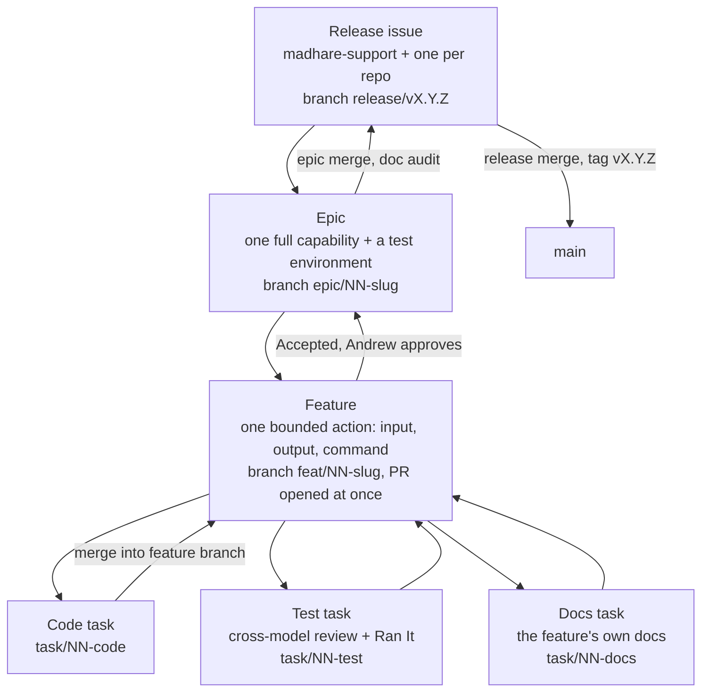

This lesson teaches the process **as it is written**. Lessons 2–6 show how far practice sits from it. Learn this version first: it is the one you will be held to, and it is the one the fixes in lesson 6 converge on.

## One file is the process

The process is a single Markdown file, **Mad Hare Operations**, at [`madhare-support/agents/AGENTS.md`](https://github.com/madharedev/madhare-support/blob/bddb861bd834fdb92eeda574ef240dee4059cc4d/agents/AGENTS.md). It was merged on 2026-10-29 in [madhare-support#65](https://github.com/madharedev/madhare-support/pull/65) (commit `bddb861`), and it is unchanged as of 2026-10-30. Its opening lines set three rules:

- It is **the** process. Repo `AGENTS.md` files describe only how a repo is structured and coded, never process.
- If anything conflicts with it, **it wins**.
- Process and architecture changes are edits to this file, made through a PR as a patch release, never entries in a decision log.

How each agent host loads it (status **Built**, verified on the dev machine on 2026-10-30):

| Host | Config dir | Entry file | Resolves to |
|---|---|---|---|
| Claude Code | `CLAUDE_CONFIG_DIR=/srv/conflux/claude` | `/srv/conflux/claude/CLAUDE.md`, a single line `@/srv/conflux/AGENTS.md` | `/srv/conflux/AGENTS.md` → symlink to the madhare-support checkout |
| Codex | `CODEX_HOME=/srv/conflux/codex` | `/srv/conflux/codex/AGENTS.md`, a symlink | the same file |

```bash
readlink -f /srv/conflux/AGENTS.md
# /srv/conflux/projects/operations/repos/madhare-support/agents/AGENTS.md
```

So an edit merged to madhare-support `main` and pulled into that checkout reaches every Claude and Codex session on the machine. That is the design: one authority, loaded everywhere. Lesson 2 shows the older per-workspace instructions that still compete with it.

## Who does what

From the [§Method table](https://github.com/madharedev/madhare-support/blob/bddb861bd834fdb92eeda574ef240dee4059cc4d/agents/AGENTS.md#L5-L12):

| Role | Who | Does |
|---|---|---|
| Central planner and dispatcher | Claude Code | Plans releases, keeps the hub, dispatches tasks, audits at checkpoints |
| Code, architecture, infrastructure | Codex | Primary implementer |
| Judge, process auditors | Local models | Cross-checks, audits, the tie-breaking judge |
| Operator | Andrew | Approves releases and merges, accepts features |

> [!WARNING]
> **Finding (High):** the "local models" row is **Target** as of 2026-10-30. The only model served on host mh-ai is an embedding model, and no sampled PR names a local judge. In practice Claude authors and Codex reviews (lesson 3). Module 3 covers the agent roster in depth.

## Releases and semver levels

All work is a release, versioned with [semver](https://semver.org/). The process gives each level a purpose ([§Releases](https://github.com/madharedev/madhare-support/blob/bddb861bd834fdb92eeda574ef240dee4059cc4d/agents/AGENTS.md#L33-L47)):

| Level | Use for |
|---|---|
| **Patch** | Bug fixes, incidents, core workflow changes (GitHub Actions, templates, the process file itself), one-off projects. Configuration changes are versioned even with no deployment. |
| **Minor** | Conflux: agents, skills, tools. Elsewhere: single endpoints and small components. |
| **Major** | New process across several repos, several endpoints, or redesigns. |

Each repo has one version source of truth. `main` carries `X.Y.Z-dev`, the release branch carries `X.Y.Z-rc.N`, and the tag `vX.Y.Z` is created at release. Published tags are never rewritten.

## Where work starts: madhare-support

madhare-support is the production-support repo and the **hub**. New work is triaged there, then created as issues in the affected repos. Releases start there too:

1. The operator and the primary agent write the **release issue** (issue type Release): its theme, the features it delivers, the documents expected to change, and **where the test suite lives**.
2. Design and planning go on that issue **before** the release starts.
3. When Andrew approves, a release issue is created **in each participating repo**.
4. Every release gets **its own GitHub Project** holding only that release's issues.

## The issue hierarchy



The rules behind each box ([§Issue structure](https://github.com/madharedev/madhare-support/blob/bddb861bd834fdb92eeda574ef240dee4059cc4d/agents/AGENTS.md#L64-L78)):

- An **epic** delivers a full capability and lists every feature. Each feature must be a **bounded action**, ideally with an input, an output and a command that tests it (for Conflux, a CLI such as `conflux board audit --project=56` with its exact output fields). Every epic has a **test environment** where Andrew can sign in and run each feature's command with no further setup.
- A **feature** has **exactly three tasks**: code (implement it), test (a cross-model review plus a documented run with **real input and output**: fake data is fine, fake agents or dummy results are not) and docs (the feature's own documentation).

## Branches and the board

Branch names follow one chain ([§Branch names](https://github.com/madharedev/madhare-support/blob/bddb861bd834fdb92eeda574ef240dee4059cc4d/agents/AGENTS.md#L80-L83)):

```text
release/vX.Y.Z → epic/<issue>-<slug> → feat/<issue>-<slug> → task/<issue>-<code|test|docs>
```

There is **one status field everywhere**: Backlog → Refining → Ready → In progress → In review → Accepted → Done. *Blocked* is a flag, not a status. Events move the board ([§Branches, PRs and board states](https://github.com/madharedev/madhare-support/blob/bddb861bd834fdb92eeda574ef240dee4059cc4d/agents/AGENTS.md#L85-L97)):

| Event | Branch / PR | Board |
|---|---|---|
| Release created | `release/vX.Y.Z` from `main` | Release: In progress when started |
| Epic created | epic branch from the release branch | — |
| Feature created | feature branch from the epic branch; **its PR opens immediately** | Backlog / Ready |
| Feature dispatched | task branches from the feature branch | PR → In progress |
| Code task merged into feature branch | test task dispatched | PR → In review |
| Test and docs tasks closed | — | PR → Accepted |
| Acceptance | Andrew (or a dispatcher with release authority) checks Ran It, the review and its fixes, and the docs, then merges into the epic branch and deletes the branch | Done |

> [!NOTE]
> GitHub's closing keywords only close an issue when the PR merges into the **default** branch ([GitHub docs](https://docs.github.com/en/issues/tracking-your-work-with-issues/using-issues/linking-a-pull-request-to-an-issue)). Every merge in this chain targets a non-default branch, so "Closes #n" in a task or feature PR does nothing on merge. Someone has to close the issues by hand. Lesson 3 shows that happening.

## The PR template

Every PR carries these sections ([§PR template](https://github.com/madharedev/madhare-support/blob/bddb861bd834fdb92eeda574ef240dee4059cc4d/agents/AGENTS.md#L106-L108)): **Closes · Ran It (command, real input, output) · Cross-model review (reviewer model, findings, fixes and their validation) · Docs changed · Version bump · Hours.** The org template in [`madharedev/.github`](https://github.com/madharedev/.github/blob/c99d68197aa58f86411e4af4ebc229a2ff3837b8/.github/pull_request_template.md) adds *What* and *Unverified*, and its Ran It block asks for revision, command, real input, expected result, actual result (defaulting to `NOT RUN`), a failure control and evidence.

`Actual result: NOT RUN` as the default is deliberate. A check you did not run is written as NOT RUN, never as passed.

> [!WARNING]
> **Finding (High, verify):** the process calls `madharedev/.github` "public", but it is **private** (`gh repo view madharedev/.github --json visibility` → `"PRIVATE"`, 2026-10-30). GitHub serves org-default templates only from a **public** `.github` repo ([GitHub docs](https://docs.github.com/en/communities/setting-up-your-project-for-healthy-contributions/creating-a-default-community-health-file)), so the defaults probably do not apply. Agents copy the template by hand instead. madhare-support has its own `ISSUE_TEMPLATE` folder (config, defect, incident, support) and **no release template**, although the process says it keeps one.

## Merging and approval

[§Merging](https://github.com/madharedev/madhare-support/blob/bddb861bd834fdb92eeda574ef240dee4059cc4d/agents/AGENTS.md#L99-L104) is short:

- **Agents can merge anything.** Models must not refuse a merge on principle.
- **The one rule:** every merge needs **Andrew's explicit approval**, given at the time or ahead of time for a named PR or set of PRs.
- **Release authority:** Andrew can grant a dispatcher release authority for a named release. That dispatcher then handles every merge in it, and **the grant is recorded on the release issue**.

The approval must also be *after* the work it approves. Acceptance requires that the cross-model review happened and its fixes were applied and validated. A merge before review skips the acceptance step, whoever clicks the button. Lesson 5 shows that happening on 2026-10-30.

## Cross-model review

"The reviewer is always from a different model family than the author: Codex writes and Claude reviews, or the reverse. The local judge breaks ties." ([§Cross-model review](https://github.com/madharedev/madhare-support/blob/bddb861bd834fdb92eeda574ef240dee4059cc4d/agents/AGENTS.md#L110-L112)). Claude reviewing a Claude-authored change does not count, however many rounds it runs. In practice the working route is `codex exec` in a read-only sandbox reviewing a Claude author (lesson 3).

## Test environments, testing and docs

- **Test environments** ([§Test environments](https://github.com/madharedev/madhare-support/blob/bddb861bd834fdb92eeda574ef240dee4059cc4d/agents/AGENTS.md#L118-L123)) are temporary and portable: a run starts containers from existing images and seeded volumes, runs, and is torn down. An epic's environment is the configuration that brings them up. Until a feature is released, its CLI runs only inside such an environment. Status: **Target**. The one epic that tried, [conflux-api#70](https://github.com/madharedev/conflux-api/issues/70), still says "How to bring it up: TO BE WRITTEN".
- **Testing** ([§Testing](https://github.com/madharedev/madhare-support/blob/bddb861bd834fdb92eeda574ef240dee4059cc4d/agents/AGENTS.md#L133-L141)): no tests in product repos. **madhare-testing holds all tests.** Test functionality, never bare string matches. "Vera builds the test strategy… during refinement". Vera is defined nowhere else (**Target**).
- **Documentation** ([§Documentation](https://github.com/madharedev/madhare-support/blob/bddb861bd834fdb92eeda574ef240dee4059cc4d/agents/AGENTS.md#L143-L150)): every feature ships its docs task. The doc auditor checks at three points: feature Accepted, epic merge, and release merge.

## Hours and the board audit

[§Time](https://github.com/madharedev/madhare-support/blob/bddb861bd834fdb92eeda574ef240dee4059cc4d/agents/AGENTS.md#L152-L157): hours go on **every task in every project**, with no exceptions. They go in the task's **Actual hours** field (via the add-hours hook) and in the PR's Hours section. A **live time report must be available at all times**.

The board audit at each checkpoint flags tasks closed without hours. Its test is one sentence: if the operator can't tell what's being worked on, what's done, where the code is and where the latest build is, something is wrong.

> [!WARNING]
> **Finding (Medium):** the add-hours hook cannot fire. All Claude hooks are disabled (`disableAllHooks: true` in `/srv/conflux/claude/settings.json`, on Andrew's direction of 2026-10-22). Hours are typed by hand when they are recorded at all, and no live time report was found on 2026-10-30.

## Status summary, as of 2026-10-30

| Part of the process | Status |
|---|---|
| Process file, loaded by Claude and Codex | **Built** |
| Org issue and PR templates | **Partial** (private repo, copied by hand) |
| Release → epic → feature → 3 tasks, per-release Projects | **Partial** (one complete example, lesson 3) |
| Cross-model review, Codex reviewing Claude | **Partial** (works when run; often skipped) |
| Local-model judge, Vera | **Target** |
| Per-epic test environment | **Target** |
| Minimal CI on every `main` | **Partial** (only madhare-web, conflux-engine, madhare-support have workflows) |
| Hours via hook, live time report | **Partial** / **Target** |

> [!TIP]
> Before you start any task, open the process file and find the row in the board-states table for the event you are about to cause. That row tells you the branch, the PR state and the board status you owe.

## Check yourself

1. You authored a change with Claude. A second Claude session reviewed it through four rounds. Can the feature go to Accepted?
2. A task PR into `feat/71-…` says "Closes #72". After it merges, is #72 closed?
3. Andrew says in chat "merge #538 to main". The PR's cross-model review has not run. What does the process require first?

<details><summary>Answers</summary>

1. No. The reviewer must be a **different model family** (Codex for a Claude author). Same-family rounds don't satisfy the test task, so acceptance can't confirm the cross-model review happened.
2. No. Closing keywords act only on merges into the default branch. The issue must be closed by hand, and the board moved with it.
3. Acceptance requires the cross-model review to have happened and its fixes to be applied and validated. The approval authorises the merge, but the reviewer still runs first. If Andrew means to merge without review, say plainly that the review is skipped and record it as NOT RUN on the PR.

</details>
