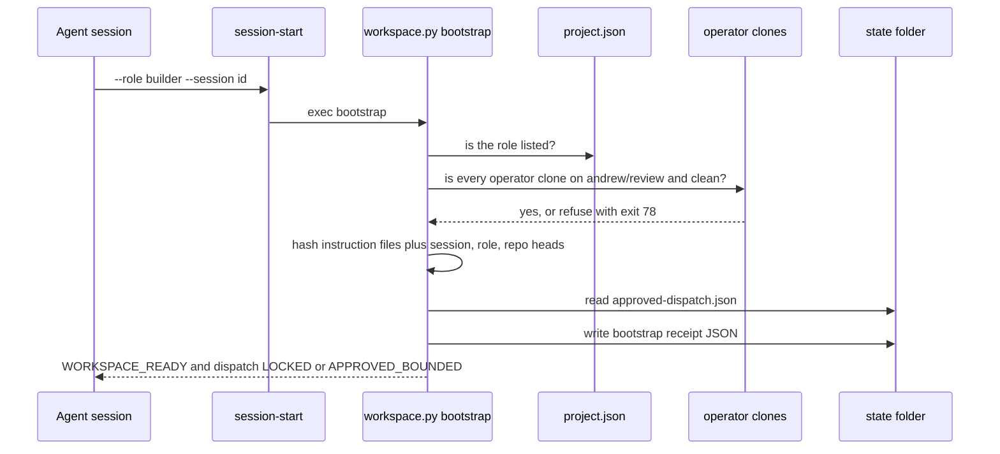

A **session** is one running conversation with an agent host: Claude Code (the CLI or the desktop app) or Codex. Everything an agent does happens inside a session. How a session is born decides which instructions it loads, which folder it works in, and what it believes it may do.

Mad Hare has **two generations** of session practice running at once as of 2026-10-30. Neither has been retired. This lesson describes both, then shows where they collide.

## Generation 1: agentd workspaces (2026-10-20 to 10-25)

Workspaces live at `/srv/work/dev/agentd/<project>`. Six exist: conflux, jbc, madhare, production-support, sabai, support. Each has `AGENTS.md`, `project.json`, `instructions/WORKFLOW.md`, `instructions/roles/*.md`, `scripts/` and `state/`.

The workspace's `AGENTS.md` opens with "Mandatory manual session entry". Your first command is:

```bash
./scripts/session-start --role YOUR_ROLE --session ACTUAL_SESSION_ID
```

`scripts/session-start` is four lines. It runs `exec python3 scripts/workspace.py bootstrap "$@"`. The bootstrap:



**Roles** come from `project.json`: coordination, dispatcher, builder, docs-auditor, test-lead, custodian. Each has a short brief in `instructions/roles/`. Several say "Prepared only; no worker/session is launched by this brief." One session can hold several roles. Session `01a16663…` has builder, coordination, custodian, dispatcher and test-lead receipts.

**Receipts** are `state/bootstrap-<sha256(session)[:20]>-<role>.json`. The conflux workspace has 151. A real one, trimmed:

```json
{"role":"builder","session":"01a16663-…","status":"WORKSPACE_READY","dispatch":"LOCKED",
 "instruction_version":"conflux-ls1-approved-cli-20261021.1","adapter_enforcement":"NOT_VERIFIED"}
```

Read it carefully:

- `WORKSPACE_READY` means the clones were clean and the instructions were hashed. It does **not** mean permission. WORKFLOW.md line 5: "A valid setup receipt is not permission to dispatch."
- `dispatch` is `APPROVED_BOUNDED` only when `state/approved-dispatch.json` was approved by Andrew, matches the batch id and has not expired. That file's `expires_at` is `2026-10-22T22:00:00Z`, so **every receipt since then says LOCKED**.
- `adapter_enforcement: NOT_VERIFIED` is always present. Nothing checks that the host actually obeys the receipt.

**Worktrees and leases.** Builders get one owned worktree at `worktrees/<repo>/<issue>-<role>`, for example `worktrees/conflux-agents/54-hook-retirement-builder`. Temporary paths need a registered lease: `workspace.py guard-temp /tmp/foo` refuses with `{"status": "BLOCKED", "reason": "temporary path requires a registered unexpired lease"}` and exit 78. There are 116 leases, and the last one expired on 2026-10-28.

**Dispatch** is one bounded prompt to a fresh `claude -p` process on Sonnet/high, with turn caps: plan 75 author turns, cap 100 (WORKFLOW.md "turn sizing" amendment of 2026-10-21). Workers leave receipts in `state/claude-workers/*.json` with model, auth method, usage preflight and handoff file. **Review** is AGY/Gemini CLI, posted on the owning issue.

The hook story matters here. The original preparation hook allowed only Read, Glob, Grep and the exact session-start command, and denied everything else. On 2026-10-22 Andrew said it was "blocking everything" and that "nothing should be blocked, at all". All Claude hooks were disabled fleet-wide, and session entry became a manual step ([conflux-agents#55](https://github.com/madharedev/conflux-agents/pull/55)). Session-start is now a convention you follow, not a gate.

Status as of 2026-10-30: **Built, now stale**. The last product receipt in conflux is from 2026-10-25.

## Generation 2: /srv/conflux projects (from 2026-10-29)

The global process ([§Workspace](https://github.com/madharedev/madhare-support/blob/bddb861bd834fdb92eeda574ef240dee4059cc4d/agents/AGENTS.md#L23-L31)) moved the work:

- Agents work only in `/srv/conflux/projects/<project>/repos/<repo>` (one canonical clone each) and `/srv/conflux/projects/<project>/worktrees/<repo>/<branch>`.
- **One worktree per task branch**, removed after the branch merges. Branches are deleted after merge, and nothing is left unpushed at the end of a session.
- `~/dev` is Andrew's. Agents never work there.
- Heavy commands run through `/home/gurplelite/.local/bin/mhjob`, a `systemd-run --user --scope` wrapper. It has no `--help`: `mhjob --help` tries to run `--help` as a program.
- Per-project state is `state.json` plus `state.journal.jsonl`. This is **Partial**: the PR that would put it in the process, [madhare-support#66](https://github.com/madharedev/madhare-support/pull/66), is still open.

There is **no session-start** in this layout. Sessions are created like this in practice:

1. **A hub session** runs in `/srv/conflux` and holds the cross-project view. On 2026-10-28 at 23:55Z one deep status session was **forked into seven persona sessions**.
2. **Personas** are named sessions, each owning a product line: Reeve (fleet and hub), Calder (Conflux agents and engine), Rook (Code A Zone), Bert (web and docs), LaShonda (Mad Hare's own Conflux), Kif (Sabai), Sabrina (company operations). They are output styles in `/srv/conflux/claude/output-styles/`. Packaging them is [conflux-agents#86](https://github.com/madharedev/conflux-agents/pull/86), still open, so they're **Partial**.
3. **Personas message each other** through the desktop app's cross-session messages (`<cross-session-message from="local_…" name="Bert - Mad Hare Portal">`, hub session `3cf1e80b`, 2026-10-29).
4. **Each persona dispatches subagents** from the installed conflux-core plugins (`coder:coder`, `tester:tester`, `test-writer:test-writer`, `doc-writer:doc-writer`, `doc-auditor:doc-auditor`, `conflux-dispatcher:conflux-dispatcher`). There were 299 subagent transcripts under `-srv-conflux` this week. Reeve's session `3cf1e80b` has 105, and Calder's `fd99f351` has 59.
5. **Codex** is called as the cross-model reviewer with `codex exec` in a read-only sandbox (codex-cli 0.165/0.166, `gpt-6.1-sol`), for example on [conflux-api#80](https://github.com/madharedev/conflux-api/pull/80).

### Side sessions and hand-offs in the desktop app

The Claude desktop app adds two session shapes:

- **Side sessions** are forks that run beside the main conversation. They keep hand-over notes under `/home/gurplelite/.config/Claude/side-session-notes/local_<id>/`, for example a `cert-academy-handover.md` from 2026-10-30. A note is how the next session learns what the last one decided.
- **Hand-offs** move a task you are in the middle of into its own session: a fork of the conversation plus your remaining plan. The original session is then free to answer something new. Use one when a new request arrives mid-task, not for small corrections.

Both are useful, and both multiply sessions. The process does not say when to fork, what a hand-over note must contain, or how a forked session finds its board item. That gap is part of why, on 2026-10-29 at 17:25, Andrew said he doesn't want new session agents "spending the first 20 minutes on the board".

## Who does what, by source

| Source | Plans and dispatches | Implements | Reviews |
|---|---|---|---|
| Global process (10-29) | Claude Code | Codex | other family, local judge breaks ties |
| agentd `project.json` (10-21) | lead `gpt-6.1-sol` (Codex) | Claude `sonnet` workers | AGY/Gemini |
| Installed conflux-core plugins | `conflux-dispatcher` (opus) | `coder` (opus) | `tester`, cross-model hook (inert) |
| What happened this week | Claude personas | mostly Claude subagents | Codex when run |

The global process and `project.json` have the roles **flipped**: one says Claude dispatches and Codex codes, the other says Codex leads and Claude builds. Practice follows neither cleanly. Claude did most of the dispatching **and** most of the coding, with Codex as the reviewer.

## Where the two generations disagree

| Topic | agentd `WORKFLOW.md` | Global process |
|---|---|---|
| Statuses | Backlog → **Draft** → In progress → In review → Accepted → Done | Backlog → **Refining → Ready** → In progress → In review → Accepted → Done |
| Hierarchy | Release epic → Feature → **Story** → checklist tasks | Release → Epic → Feature → **three tasks** |
| PR template | What / Ran it / Unverified / Dependencies | Closes · Ran It · Cross-model · Docs · Version · Hours |
| Merges | "Andrew reviews Accepted PRs and **alone merges**" | "**Agents can merge anything**" with Andrew's approval |
| Reviewer | AGY CLI; "a Copilot ask does not count" | Codex ⇄ Claude |
| Branches, clones | operator clones on `andrew/review`, `worktrees/REPO/ISSUE-ROLE` | `release/…` chain, `/srv/conflux/projects/…` |

The global file says it wins. But the old workspace's `AGENTS.md` is still the **project instruction file** for any session whose working directory is `/srv/work/dev/agentd/<project>`. It still opens with "Your first command is `./scripts/session-start`". A session opened there today loads both sets of instructions, and they contradict each other.

> [!WARNING]
> **Finding (High):** two live process generations. A session's behaviour depends on which folder it was opened in. The installed dispatcher agent also still encodes a third branch scheme (`main ← integration ← rls/<release>`). The fix for that, [conflux-agents#85](https://github.com/madharedev/conflux-agents/pull/85), is open and not installed.

> [!WARNING]
> **Finding (High):** the old control plane points at things that no longer exist. `project.json` names **board 72**, which is closed. Its `remote_baseline` is `origin/andrew/review`, and that branch returns "Branch not found" on conflux-engine and conflux-agents. The dispatch approval expired on 2026-10-22. Any agent that follows the workspace instructions faithfully is working against a dead board and a missing branch.

> [!WARNING]
> **Finding (Medium):** agents worked in `~/dev`. Transcript folders `-home-gurplelite-dev-conflux-agents` (sessions dated 10-27 and 10-29) and `-home-gurplelite-dev-conflux-engine-agy` (five sessions on 10-23) exist, although the process says agents never work there.

## A good session start today

Until lesson 6's fixes land, this is the defensible start for a new session:

1. Open it in `/srv/conflux/projects/<project>/…`, not in `/srv/work/dev/agentd/…` and never in `~/dev`.
2. Confirm the process loaded: `readlink -f /srv/conflux/AGENTS.md`.
3. Find your task on the **release's own board**, and its branch in the `release/ → epic/ → feat/ → task/` chain.
4. Make one worktree for that task branch under `/srv/conflux/projects/<project>/worktrees/<repo>/<branch>`.
5. If you fork or hand off, write the hand-over note: the issue, the branch, the head SHA, what is NOT RUN and the next step.

> [!TIP]
> When you inherit a session, read the newest hand-over note and the PR's **Unverified** section before anything else. Those two places hold what the previous session did not finish.

## Check yourself

1. A receipt says `"status":"WORKSPACE_READY","dispatch":"LOCKED"`. May the session dispatch builders?
2. You open a session in `/srv/work/dev/agentd/conflux`. Which two instruction sources load, and which one wins on merge rights?
3. Name two things a hand-over note must carry so the next session doesn't spend its first 20 minutes on the board.

<details><summary>Answers</summary>

1. No. `WORKSPACE_READY` only says the clones were clean and the instructions were hashed. A receipt is never permission. `LOCKED` means there is no unexpired, Andrew-approved dispatch batch (it expired on 2026-10-22).
2. The global process (via `CLAUDE.md` → `@/srv/conflux/AGENTS.md`) and the workspace's own `AGENTS.md`, which points to `WORKFLOW.md`. The global file wins, so agents may merge with Andrew's explicit approval. WORKFLOW.md's "Andrew alone merges" is superseded but still loaded.
3. Any two of: the issue and board item, the branch and head SHA, what is NOT RUN or unverified, and the next step. Also the approval state, if a merge is pending.

</details>
