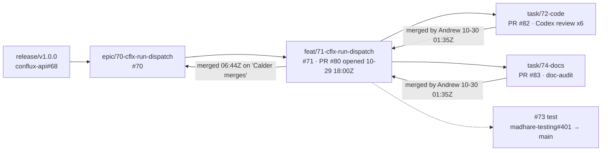

Of 16 PRs sampled across Mad Hare repos between 2026-10-22 and 10-30, exactly **one feature** ran the whole written process: **`cflx run dispatch`** in conflux-api. It's worth studying closely. It proves the method works when it's held tight, and it shows what "tight" costs in time and care. It also shows what still slipped through.

## The cast

| Level | Item | Branch | State, 2026-10-30 |
|---|---|---|---|
| Release | conflux-api#68, coordinated by madhare-support#68 | `release/v1.0.0` @ `44a3f09` | open |
| Epic | [conflux-api#70](https://github.com/madharedev/conflux-api/issues/70) "Operators dispatch coding agents from GitHub issues with cflx" | `epic/70-cflx-run-dispatch` | **open** |
| Feature | [#71](https://github.com/madharedev/conflux-api/issues/71) "cflx run dispatch starts one coding agent per issue" | `feat/71-cflx-run-dispatch` | closed 06:44:58Z by hand |
| Code task | #72 | `task/72-code` → [PR #82](https://github.com/madharedev/conflux-api/pull/82) | closed by hand |
| Test task | [#73](https://github.com/madharedev/conflux-api/issues/73) | test work in [madhare-testing#401](https://github.com/madharedev/madhare-testing/pull/401); review comments on #82 | closed by hand |
| Docs task | #74 | `task/74-docs` → [PR #83](https://github.com/madharedev/conflux-api/pull/83) | closed by hand |
| Feature PR | [PR #80](https://github.com/madharedev/conflux-api/pull/80) | `feat/71-…` → `epic/70-…` | merged 06:44:23Z |



## Step 1: the epic is written from the template (2026-10-29)

The epic body opens with `<!-- Body from madharedev/.github .github/ISSUE_TEMPLATE/epic.md … written by the dispatcher on 2026-10-29 -->`. It has every section the process asks for:

- **Outcome**, in one sentence an operator can check: "runs `cflx run dispatch` with one or more GitHub issues and sees one coding agent started per issue…"
- **Release context** with **pinned SHAs** for every input: the release branch at `44a3f09…`, conflux-agents PR #83 at `f721fc0…`, conflux-engine PR #86 at `5f6b308…`.
- **Features table**: one row, the bounded action. It gives the command (`cflx run dispatch --issue FAKE-ORG/fake-repo#12 --platform claude-code --json`), the input, and the exact output schema (`{run_id, intent, platform, agents: [{issue, agent, worktree, branch, pr_target, status}]}`).
- **Test environment**: "How to bring it up: TO BE WRITTEN by #73". The section also names the planned compose file, the images, the sign-in and the teardown.
- **Dependencies**, including a hard blocker: conflux-engine#83.
- **Acceptance** checkboxes and **stop conditions**: "when #71 is accepted, show Andrew and wait", and no paid model call or deploy without Andrew's OK.

This is what a bounded feature looks like. A stranger could run the command and check the output fields.

## Step 2: the feature PR opens immediately

PR #80 was opened at **2026-10-29T18:00:50Z**, before any code, exactly as the board-states table requires. Task PRs followed: #82 (code) at 19:17Z and #83 (docs) at 19:58Z, both from task branches cut from `feat/71-…`. The test task's harness work went to madhare-testing#401 at 20:36Z. That follows the testing rule that "madhare-testing holds all tests".

## Step 3: Ran It, with failure controls

PR #82's Ran It section (recorded 2026-10-29T20:47:05Z at revision `6518568`) is the model to copy. It runs the real `cflx` against a real gateway started twice, once with no engine and once with an engine URL where nothing listens. It uses FAKE references (`FAKE-ORG/fake-repo#12`). Each heading is a check with its exit code:

```text
### cflx run dispatch --help (exit 0)
### usage error: no issue or epic (exit 2)
### no sign-in: 401 CFX-AUTH-001 (exit 1)
### bad reference: 400 CFX-REQ-001 (exit 1)
### engine not configured: 503 CFX-UP-001, nothing started (exit 1)
### prompts-only, two issues: the exact engine hand-off, no engine call (exit 0)
### engine unreachable: 503 CFX-UP-002, no hang (exit 1)
### no run was created for the refused request (GET /v1/runs/run_none is 404)
### regression: a chat turn on the same route still streams (stub route)
### Positive path with a live engine
```

The last heading is the honest part. PR #80 states "**Positive path with a live engine: NOT RUN.** conflux-engine serves no `/internal/v1/runs`… No fake engine and no dummy agents were used anywhere." That is the process working. A missing dependency is reported as NOT RUN and is never faked into a pass.

## Step 4: the cross-model review, six rounds

From PR #80's review section:

- Author: Claude (session Calder). Reviewer: **Codex** (codex-cli 0.165.0, **read-only sandbox**), task #73.
- **Six rounds on #82, 25 findings**, every one fixed or answered. Each round is a comment on #82 headed "Cross-model review round N". A read-only count confirms six:

```bash
gh pr view 82 -R madharedev/conflux-api --json comments \
  --jq '[.comments[]|select(.body|test("Cross-model review round"))]|length'
# 6
```

- Round 1 (`21e44de`): 5 major, 5 minor, 5 contract remarks. Round 2: 8 findings in the recovery paths. Round 3: 2 regressions. **Round 4: APPROVE.**
- Then the madhare-testing suite exposed needless recovery after a start that never reached the engine. That was fixed, and **review was reopened**. Round 5 found a redirect edge case, fixed in `6518568` (`redirect: 'error'`). **Round 6: APPROVE.**
- Validation: `make check` after every fix, Ran It re-recorded on `6518568`, and the suite re-pinned to `6518568` (26 passed, 10 pending).

Note what happened after round 4. An approval did not end the review. When a test found a new problem, the fix went back to the reviewer. That loop is what "fixes and their validation" means in the PR template.

## Step 5: docs as their own task

PR #83 shipped `docs/cli.md` (flags, `--json` shape, exit codes 0/1/2/78, every error code) and marked `docs/architecture.md` **Built** or **Target** element by element. It also corrected OpenAPI descriptions with no path change (28 paths, and the e2e path check passed). It has its own Ran It: `mhjob make check`, all three Mermaid diagrams parsed (one had been broken by a `;`), every relative link resolved, and gitleaks found no leaks. A `doc-auditor:doc-audit` pass ran on every merge of the code branch.

## Step 6: hours, merge and receipt

Andrew merged #82 and #83 into the feature branch at 01:35Z on 2026-10-30. The feature PR merged into the epic branch at 06:44:23Z. The merger was the agent account `mh-devops-admin`, on Andrew's approval "Calder merges" (06:27Z), relayed by the hub and checked against its transcript. The process explicitly allows that: agents may merge with Andrew's explicit approval. The merge comment is a **receipt**:

> "Hours, as recorded in this PR: #72 code 2.6 h · #73 test 0.85 h · #74 docs 0.8 h · total 4.25 h. The task issues and #71 are closed by hand below, since a merge into a non-default branch does not close them."

It also lists what stays open: the engine run contract decision, engine E2.2/E2.3, and the live-engine path.

## What still slipped, even here

| Gap | Evidence | Why it happened |
|---|---|---|
| No test environment | Epic #70: "TO BE WRITTEN by #73". #73 closed at 06:44:54Z without it | The engine had no run endpoint, so there was nothing to bring up end to end |
| Live positive path NOT RUN | PR #80 Ran It | A real dependency gap (conflux-engine#83, E2.2/E2.3), honestly reported |
| Issues closed by hand | PR #80 merge comment, `closingIssuesReferences: []` | Closing keywords act only on the default branch ([GitHub docs](https://docs.github.com/en/issues/tracking-your-work-with-issues/using-issues/linking-a-pull-request-to-an-issue)) |
| Board stale | [Board 89](https://github.com/orgs/madharedev/projects/89): #71–#74 and PR #80 still **In review** after closing | No step or hook moves the board on a hand close. Hooks are off |
| Hours split across places | Board has #72 2.6, #73 0.85, #74 0.8. #73's body still says "Actual hours: `TBD`" | Hours typed by hand in two places, with no add-hours hook |
| Test task off its branch | No `task/73-test` PR. Test work merged to madhare-testing `main` (#401) | The process puts tests in madhare-testing but names a conflux-api task branch: the two rules don't fit together |
| Docs PR had no cross-model review of its own | PR #83: delegated to #73 | The review covered the code head. Docs were covered by doc-audit only |
| Epic not closed out | #70 open, acceptance boxes unticked | Correct: the stop condition says wait for Andrew at the feature checkpoint |
| Small record mismatch | Merge comment says 06:56 UTC. GitHub `mergedAt` is 06:44:23Z | Hand-written receipt |

> [!WARNING]
> **Finding (Medium):** even the best example needed hand work at four points (closing issues, moving the board, copying hours, writing the receipt). Each hand step is where the less careful PRs in lesson 5 fail. Automating those four steps is in lesson 6.

## The bar, as a checklist

Use this on your own PR before you ask for approval:

- [ ] Branch is `task/<n>-code|test|docs` from the right `feat/` branch, and the feature PR already exists.
- [ ] **Ran It** names the revision, the exact command, the real (FAKE is fine) input and the actual output. It covers the positive path, failure controls and a regression check.
- [ ] Anything not run says **NOT RUN** and why.
- [ ] A **different model family** reviewed the same head you are merging. Findings, fixes and their validation are recorded.
- [ ] Docs changed (or "none, because…"), and doc-audit run.
- [ ] Hours on the task and in the PR.
- [ ] After merge: issues closed, board moved, receipt written.

> [!TIP]
> Open PR #82's Ran It in the browser and compare it with your last PR. Count the failure controls. #82 has more than a dozen. If yours has none, that is the first thing to add.

## Check yourself

1. Round 4 of the Codex review on #82 said APPROVE. Why were there two more rounds, and was that right?
2. The live-engine positive path was never run. Why is the feature PR still a good example?
3. After #80 merged, board 89 still showed #71–#74 In review. Which process rule does that break, and what caused it?

<details><summary>Answers</summary>

1. The madhare-testing suite found a new defect after approval. The fix changed the code, so the approval no longer covered the head being merged. Re-reviewing (rounds 5 and 6) was right: the review must cover the head you merge.
2. Because it says so plainly. It records NOT RUN with the reason (no engine endpoint), uses no fake engine or dummy agents, and lists the gap as still open. The process forbids faking results, not reporting a gap.
3. The board audit: the operator must be able to tell what is done. Issues were closed by hand (closing keywords don't fire off the default branch), and nothing moved the board items. Hooks are disabled and no manual step covers it.

</details>
