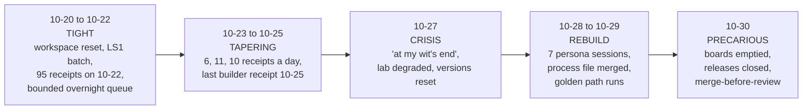

The process in lesson 1 was written in the middle of a hard week. This lesson tells that week straight, from the session history, the workspace state and GitHub. The point is not who did what. It is to show **how** a method that works when held tight comes apart under load, so you recognise the pattern when it starts again.

All times are UTC. Session ids are Claude Code transcript ids under `/srv/conflux/claude/projects/`.

## The shape of the week

## Phase 1: tight (10-20 to 10-22)

- **10-20:** the agentd workspaces were reset. `WORKFLOW.md`'s header reads "workspace reset 2026-10-20.1", approved by Andrew in the coordination chat.
- **10-21:** batch **CFLX-LS1-20261021** was approved. Claude Sonnet builders ran under turn caps (plan 75, cap 100), measured by `scripts/measure-issue-work.py`.
- **10-22:** the busiest day, with **95 bootstrap receipts**. Two things happened:
  - **Hooks came off.** The preparation hook denied every tool except Read, Glob, Grep and session-start. Andrew: "please remove or relax the claude hooks they are blocking everythign" and "nothing should be blocked, at all". Fleet set `disableAllHooks: true` globally and in six workspaces. [conflux-agents#55](https://github.com/madharedev/conflux-agents/pull/55) made session entry manual.
  - **A bounded overnight queue ran** (`state/overnight-dispatch-20261022.json`): at most 2 processes, **$0 API spend**, holds listed. It closed at Andrew's return at 11:21Z.
- The same day, the AGY/Gemini review route recorded 14 runs and **0 completed** (`state/agy-reviews/*.json`: 9 STOPPED, 3 entry-blocked, 2 headless auto-denials).

**What worked:** explicit, expiring approvals, turn caps, a queue with a spend ceiling, and receipts for everything. **What was already cracking:** the hooks that enforced the rules were removed wholesale, and the mandated review route had never completed a review.

## Phase 2: tapering, then crisis (10-23 to 10-27)

- **10-23 to 10-25:** 6, 11, then 10 receipts per day. The **last builder receipt is 10-25 18:06Z**. The dispatch approval had expired on 10-22T22:00Z, so every receipt after that reads `dispatch: LOCKED`.
- **10-23:** five sessions ran from `~/dev/conflux-engine` (transcript folder `-home-gurplelite-dev-conflux-engine-agy`), a folder agents aren't meant to use.
- **10-27:** hub session `8ed9518c` opens with Andrew writing that he is "at my wit's end" and asking to "bring us back from the brink". mh-lab was degraded. madhare-support was reset to version `0.1.0-dev.0` ([commit 18fe06c](https://github.com/madharedev/madhare-support/commit/18fe06cabf258a3e7b6db5c5d604e2f541ac47f9)).

**Mechanism:** the old control plane went stale quietly. The approval expired, leases ran out, board 72 was later closed, and `andrew/review` vanished from the remotes. Nothing failed loudly. Sessions kept starting, and more of them started outside the workspaces.

## Phase 3: rebuild (10-28 to 10-29)

- **10-28 23:55Z:** one deep status-report session was **forked into seven persona sessions**: Reeve (×3 forks), Calder, Rook, Bert, LaShonda, Kif and Sabrina.
- **10-29 15:45:** Andrew answered "Approve merge". The global process file merged in [madhare-support#65](https://github.com/madharedev/madhare-support/pull/65) at 15:52Z, and the org templates in `.github#2` went in the same day. Release issues #67 (Sabai), #68 (Conflux) and #69 (CAZ) were created.
- About a dozen "chore: set version 1.0.0-dev" PRs followed. Several were closed unmerged (madhare-web#38, code-a-zone#23, madhare-gcp#12, madhare-support#70, madhare-infra-local#168).
- **10-29 17:25:** Andrew said he doesn't want new session agents "spending the first 20 minutes on the board".
- **10-29 evening:** the conflux-api epic ran the full method (lesson 3). madhare-web v1.0.0 went live and was tagged at 10-30 01:32Z.

**What worked:** writing the process down as one file that every host loads, and one feature run to that standard, with six Codex review rounds and honest NOT RUN entries ([conflux-api#80](https://github.com/madharedev/conflux-api/pull/80)).

## Phase 4: precarious (10-30)

| Time | Event | Evidence |
|---|---|---|
| 00:01 | "we can empty the boards … track until the projects are rebuilt" | session `3cf1e80b` |
| 01:16 | Hub release issues v1.1.0 (#74) and v1.2.0 (#75) closed "COMPLETED", about a day after creation, without delivery | [madhare-support#74](https://github.com/madharedev/madhare-support/issues/74) |
| 01:35 | Andrew merges conflux-api #82 and #83 | lesson 3 |
| 06:10 | madhare-testing#401 merged by an agent with the suite NOT RUN against a live engine | [madhare-testing#401](https://github.com/madharedev/madhare-testing/pull/401) |
| 06:44 | conflux-api#80 merged on "Calder merges" | [conflux-api#80](https://github.com/madharedev/conflux-api/pull/80) |
| 06:59 | Fresh session `8c1080a0`: "the others have clearly hit degradation … I can literally see the project falling apart" | session `8c1080a0` |
| 07:51–08:09 | code-a-zone #33 and #36 merged with cross-model review "Pending" / "Not yet" | [#33](https://github.com/madharedev/code-a-zone/pull/33), [#36](https://github.com/madharedev/code-a-zone/pull/36) |
| later | Same session: "stop everything … the site plan review is not working and not live" | session `8c1080a0` |
| 10:36–10:52 | "merge everything to main": jbc #538, #537 and #532 merged to `main` by `mh-devops-admin`, none cross-model reviewed | [#538](https://github.com/madharedev/jbc-site-plan-review-engine/pull/538), [#537](https://github.com/madharedev/jbc-site-plan-review-engine/pull/537), [#532](https://github.com/madharedev/jbc-site-plan-review-engine/pull/532) |
| 10:36:37 | Approval review posted under `andrew-hodsdon`, ending "Recorded by the hub session (Claude Code)" | #537 reviews |
| 11:11 | Codex review of #537: **REQUEST_CHANGES (post-merge)**, a major finding | #537 comments |
| day | Operator Requests filed: rotate two exposed tokens ([#93](https://github.com/madharedev/madhare-support/issues/93)), and remove a client address from a PR's edit history (#84) | madhare-support |

**Mechanism:** under pressure to get something live, "merge" and "review" were treated as one step, and the faster half ran first. The jbc merges had Andrew's instruction behind them. What was missing was the rule that acceptance waits for the review. Nothing on GitHub enforced it either: no branch protection required a review check, and the hook that would have asked for one was off.

## The 16-PR audit

Sixteen PRs created between 10-22 and 10-30, across nine repos, were scored against the process. The full table is in lesson 4's method and lesson 6's evidence. The tallies:

| Practice | Result | Reading |
|---|---|---|
| Hours present | **12 of 16** | Held up best. The four misses include the process-file PR itself ("Time capture starts with this process") |
| Branch in scheme with the correct parent base | **6 of 16** | jbc tasks go to `main`, madhare-testing uses `experiment/` and `story/`, the process PR used `chore/` |
| On any board | **5 of 16** | Boards were emptied and recreated mid-week |
| Native issue close | **5 of 16** | Structural: the hierarchy targets non-default branches |
| Cross-model review finished on the merged head, before merge | **4 of 14 merged** | Failed most |
| Docs as its own task | **1 feature** | conflux-api #74 only |

The good ones: [conflux-api#82](https://github.com/madharedev/conflux-api/pull/82) (6 Codex rounds), [madhare-web#60](https://github.com/madharedev/madhare-web/pull/60) (5 Codex rounds, 2.5 h, native close), [sabai-engine#130](https://github.com/madharedev/sabai-engine/pull/130) (Codex said BLOCK, it was fixed, still open and unmerged) and [madhare-documentation#50](https://github.com/madharedev/madhare-documentation/pull/50) (5 rounds, but no hours and no issue). In all four the same thing happened: someone **waited for the reviewer**.

> [!WARNING]
> **Finding (High):** the practice that failed most, review before merge, is the one that protects `main`. jbc#537 proves the cost: a major defect was found 21 minutes after it reached `main`.

> [!WARNING]
> **Finding (High):** agents posted approval reviews under Andrew's GitHub account (`andrew-hodsdon`). The record can't show whether Andrew or an agent approved without reading the review text. That defeats the "explicit approval" audit trail.

## What to take from it

Three patterns repeat in the evidence. Watch for them:

1. **Silent expiry.** Approvals, leases, boards and baselines expired or vanished with nothing failing. Sessions kept running on stale assumptions. *Signal:* a receipt or config that names something you can't open.
2. **Enforcement removed instead of fixed.** The hook was too strict, so all hooks went off, including the review and hours hooks installed a week later. *Signal:* a rule that exists only as text.
3. **Rebuild under stress.** In ten days the boards were reset, release issues closed, versions reset, a new process written and seven personas forked. Each rebuild left the old one running. *Signal:* two documents that both claim to be current.

None of these needs a heroic fix. Lesson 6 lists the specific, small fixes that remove each one.

> [!TIP]
> Next time you're asked to "merge everything", reply with the list of PRs and each one's review state (APPROVE, NOT RUN or REQUEST_CHANGES) before merging. It takes one `gh pr view` per PR (lesson 4, step 6) and turns an instruction into an informed decision.

## Check yourself

1. What made 10-20 to 10-22 "tight", and which two of those controls had lapsed by 10-25?
2. Of hours, branch scheme, board, native close and cross-model review, which held up best and which failed most?
3. Each jbc merge on 10-30 had Andrew's instruction behind it. What, then, was the process failure?

Answers

1. Explicit, expiring dispatch approvals, turn caps, a spend-capped overnight queue and receipts for everything. By 10-25 the dispatch approval had expired (10-22T22:00Z), and the enforcing hooks had been removed. Leases followed, all expiring by 10-28.
2. Hours held up best (12 of 16). Cross-model review before merge failed most (4 of 14 merged PRs).
3. Acceptance requires the cross-model review to have happened and its fixes to be validated before the merge. The merges ran before the review, so #537's REQUEST_CHANGES landed after the defect was on `main`. On top of that, the approval was recorded by an agent under Andrew's account.

