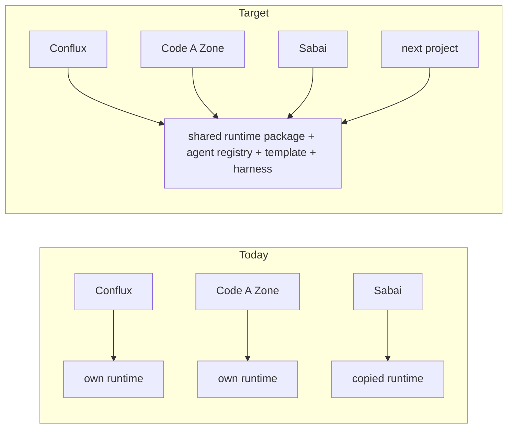

Every module of this course found the same pattern: when the method is tight it works, and
when it is loose each project makes its own copy of something that should be shared. The copies
then drift from each other. That drift is the cost Andrew described: *"as of now I have nothing
unless I rebuild it for each small project."*

This lesson is the wand. It lists what has to exist **once**, where it should live, and the
first concrete step toward it. Nothing here is new invention. Each row is something we already
built, at least once, somewhere.

## The shared pieces

| # | Piece | Today (2026-10-30) | Once, shared | First step |
|---|---|---|---|---|
| 1 | **One engine line** | Two engine codebases (`main` 1.1.1 and the unmerged #86 line, 1.0.6) conflict in about 160 paths. The running engine is the unmerged one | One `conflux-engine` `main`, one version, one `conflux` CLI | Decide #86 vs `main` and land conflux-engine#87 |
| 2 | **One runtime library that products consume** | Code A Zone's JBC engine has its own runtime, agents, telemetry, config and migrations. Sabai copied five CLI files from a Conflux version that no longer exists | A versioned package (CLI skeleton, config loader, run/audit store, telemetry, migrations, refusals) that Code A Zone and Sabai depend on, not copy | Extract the parts all three already share in spirit; publish them as a package |
| 3 | **One agent registry** | Three agent systems (conflux-core plugins, mh-ai skills, agentd roles) with different role names; installed from a detached worktree of an open PR | conflux-agents `main`, versioned, installed from a release, with one roster | Merge conflux-agents#83, decide the roster, retire the other two |
| 4 | **One process file** | The global `AGENTS.md` (10-29) and six per-workspace `WORKFLOW.md` files (10-20 to 10-22) disagree on statuses, branches, merge rights and review | The global file only. Workspaces generated from it, or retired | Retire `/srv/work/dev/agentd/*` instructions, or regenerate them from the global file |
| 5 | **One project template** | Each project hand-assembles `AGENTS.md`, `state.json`, board, status set, PR template and CI | A `new project` command: repo from template, minimal CI that calls madhare-testing, board with the global statuses, release issue | Write the template from the conflux-api layout, the one that followed the method |
| 6 | **One test harness, wired into CI** | madhare-testing works where maintained, but suites point at archived repos and missing paths, and 16 of 20 active repos have no CI | Every repo's `main` runs its madhare-testing entry point in CI; a harness profile per product, kept current | Repair the broken suites; add the minimal CI workflow to each repo |
| 7 | **One per-epic test environment** | None exists. The harness is per project and only the JBC profile really works | A container profile per epic that Andrew can sign in to and run each feature's command | Build it for one epic, then template it |
| 8 | **Enforcement that doesn't depend on hooks** | All Claude hooks are disabled, so hours, policy and review hooks never run | Checks in CI and in the dispatcher: PR template sections, review present on the merged head, hours present, branch name | A PR-check workflow in the org `.github` repo |
| 9 | **One cross-model review path** | Four definitions, 0 of 14 Gemini review runs completed, and the completed reviews were Claude on Claude | Review as a dispatched step by a different model family, with its result posted on the PR | Pick one route and make the dispatcher run it |
| 10 | **One live time report** | Hours are switched off with the hooks, the state refresh reports `time=UNKNOWN`, and Sabai keeps a private ledger | One hours field on every task, filled at close, and a report generated from the boards | Make hours a required PR section that CI checks |

> [!IMPORTANT]
> The order matters. Rows 1, 3 and 4 are decisions more than code. Until there is one engine,
> one roster and one process, every other fix gets built against a moving target, and the
> drift starts again.

## Why a shared piece beats a copy

A copy is faster the week you make it. It costs more every week after:

- **It drifts.** Sabai's copied CLI matches a Conflux that no longer exists. The Code A Zone
  portal was ported by copy with hand-written shims for the Next.js parts it couldn't bring.
- **Fixes don't travel.** A bug fixed in one copy stays in the others. A security fix has to be
  found and repeated per project.
- **Nobody can tell what is canonical.** Four version numbers are live for one engine; three
  APIs overlap in scope; two programs are both called `conflux`.
- **Every new project starts from zero.** That is the "nothing unless I rebuild it" problem.

## Using this list on a new project

Before building anything for a new project, go down the table:

1. Is there a shared version of this piece? Use it, even if it is missing a feature. Add the
   feature to the shared piece.
2. If there isn't, build it **in the shared place** (the package, conflux-agents, the template,
   madhare-testing), not inside the project.
3. If you must copy for a deadline, open an issue to fold the copy back, link it on the release
   issue, and say so in the PR.

## Check yourself

1. Why do rows 1, 3 and 4 come first?
2. A new client project needs a CLI with run auditing. What should it reuse, and what should it
   do if the shared piece lacks a feature?
3. Hooks are disabled. Where should the hours and review checks run instead?

Answers

1. They are decisions (one engine, one roster, one process). Every other fix depends on them,
   and building before deciding creates new drift.
2. The shared runtime package (CLI skeleton, run/audit store, telemetry). Add the missing
   feature to the shared package, not to a project copy.
3. In CI (a PR-check workflow in the org `.github` repo) and in the dispatcher, not in
   per-session hooks.

